> 2026-10-19 归档：原路径 `docs/FUNCTIONAL_GUIDE.md`。这是未提交的历史草稿，保留供追溯；功能状态、账号时序、版本、链接和部署信息可能过时或互相冲突，不作为当前需求、接口合同或操作手册。当前以 `docs/development/IMPLEMENTATION_STATUS.md`、已确认产品设计及实际接口为准。

# CourseManagement 查课管理系统 功能说明与业务操作指南

版本：V2.0 规范基线 · 更新日期：2026-10-17
适用系统：CourseManagement 查课管理系统（后端 FastAPI、管理端 Vue 3、移动端微信小程序）
配套参考：产品与架构总体设计（原相对路径：`development/CAMPUS_PRODUCT_ARCHITECTURE_WEB_REDESIGN_20261015.md`） · 权限策略（原相对路径：`PERMISSIONS.md`） · 排班规则（原相对路径：`SCHEDULING_RULES.md`） · API 契约（原相对路径：`API_CONTRACT.md`）

---

## 目录

- [一、系统概述与核心设计理念](#一系统概述与核心设计理念)
  - [1.1 业务背景与系统定位](#11-业务背景与系统定位)
  - [1.2 四维数据归属体系](#12-四维数据归属体系)
  - [1.3 数据生命周期与跨学期保留](#13-数据生命周期与跨学期保留)
- [二、用户角色体系与权限架构](#二用户角色体系与权限架构)
  - [2.1 五大核心角色与职责边界](#21-五大核心角色与职责边界)
  - [2.2 权限判定与数据范围模型](#22-权限判定与数据范围模型)
  - [2.3 专属授权与负责人工作交接](#23-专属授权与负责人工作交接)
- [三、Web 学院工作台：七大核心业务入口与操作流](#三web-学院工作台七大核心业务入口与操作流)
  - [3.1 工作台 (Workbench)](#31-工作台-workbench)
  - [3.2 教务资料管理 (Academic)](#32-教务资料管理-academic)
  - [3.3 学生与班级管理 (Students)](#33-学生与班级管理-students)
  - [3.4 志愿者组织与资格 (Organizations)](#34-志愿者组织与资格-organizations)
  - [3.5 查课安排与智能排班 (Inspections)](#35-查课安排与智能排班-inspections)
  - [3.6 考勤认定与异议处理 (Attendance)](#36-考勤认定与异议处理-attendance)
  - [3.7 统计报表与版本周报 (Reports)](#37-统计报表与版本周报-reports)
- [四、辅助管理入口与校级统筹治理](#四辅助管理入口与校级统筹治理)
  - [4.1 学校与学院管理 (School)](#41-学校与学院管理-school)
  - [4.2 账号与权限管理 (Users)](#42-账号与权限管理-users)
  - [4.3 学期全流程与归档锁定](#43-学期全流程与归档锁定)
- [五、微信小程序移动端协同与个人课表](#五微信小程序移动端协同与个人课表)
  - [5.1 微信身份认证与学生绑定](#51-微信身份认证与学生绑定)
  - [5.2 志愿者移动查课工作流](#52-志愿者移动查课工作流)
  - [5.3 学生考勤查询与申诉举证](#53-学生考勤查询与申诉举证)
  - [5.4 独立云端个人课表体系](#54-独立云端个人课表体系)
- [六、核心业务底线与关键规则保障](#六核心业务底线与关键规则保障)
  - [6.1 乐观并发控制与防穿透保护](#61-乐观并发控制与防穿透保护)
  - [6.2 审计日志同事务一致性](#62-审计日志同事务一致性)
  - [6.3 两阶段解耦与历史事实不可变](#63-两阶段解耦与历史事实不可变)

---

## 一、系统概述与核心设计理念

### 1.1 业务背景与系统定位

高校日常教学秩序检查（查课）具有多学院并行、参与主体多元（学工教师、学生干部、青年志愿者、普通学生）、课次时间高度离散、现场证据要求严格等特点。传统查课模式往往依赖纸质表格或离线 Excel 统计，存在排班冲突频繁、名单版本混乱、现场代查漏查、考勤异议周期冗长以及跨院数据归属不清等深层次痛点。

**CourseManagement 查课管理系统** 面向高校提供全流程闭环的教学秩序督导数字化解决方案：
- **学院独立运营**：支持各二级学院独立导入教务资料、配置个性化作息与课程分类、自建志愿者组织与开展日常查课；
- **学校协同治理**：支持超级管理员全校统筹，统一分发默认标准作息与校历，处理跨院支援与学期归档；
- **移动双端协同**：志愿者通过微信小程序即时查收任务、比对名单快照、拍照举证；学生移动端查收考勤、发起异议并使用完全独立的云端个人课表；
- **全链路严密审计**：关键写操作乐观锁防重，全流程业务流转同事务留痕，确保数据真实可追溯。

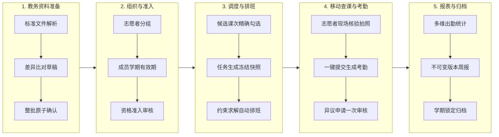

---

### 1.2 四维数据归属体系

系统严格区分四种维度的业务归属，坚决杜绝“以当前登录人学院臆测数据所有权”或“以外院选课推导管理权”：

| 归属维度 | 定义与职责范围 | 权限与数据边界 |
| :--- | :--- | :--- |
| **开课学院 (Course College)** | 教务系统中开设该门课程的行政教学单位。 | 仅代表课程的学术与教学归属，**不直接赋予其全班学生的日常学工管理权**。 |
| **学籍学院 (Enrollment College)** | 学生在查课当日所属的行政学院与行政班级。 | 决定学生的日常学工归属与学籍档案维护权；学籍异动走专门审批流，历史考勤记录不随转院而迁移。 |
| **导入维护学院 (Import College)** | 提交并确认该批次教务资料、名单或选课关系的学院。 | 负责本院资料来源的真实性与合规性；导入草稿仅本院可见，正式确认后生成对应视图。 |
| **任务负责学院 (Responsible College)** | **在获授权工作区内发起并组织该次查课任务的责任学院。** | **决定查课任务、受派记录、现场照片、正式考勤、学生异议及任务周报的核心管理归属。** |

#### 跨学院重复检查的正式口径
当学院 A 与学院 B 在同一教学周的同一实际课次分别检查了同一名学生张三时：
- **独立存证**：学院 A 与学院 B 的任务分别记录、分别拍照、分别生成考勤认定；
- **互不覆盖**：若学院 A 认定为“正常”，学院 B 认定为“迟到”，系统各自真实保留，**不自动覆盖、不强行合并为单一全校结论**；
- **异议隔离**：学生张三对学院 B 的结果提出异议，仅由学院 B 的授权教师处理，与学院 A 无关；
- **科学统计**：校级出勤统计中，该事件计为“2 次检查人次、1 名学生、1 个学生课次”，绝不武断宣传为“张三旷课两次”。

---

### 1.3 数据生命周期与跨学期保留

系统确立了“长期实体持续存在、关系按有效期演进、业务事实学期快照”的三层生命周期体系，**彻底杜绝新学期清空历史档案或复制实体数据的落后做法**：

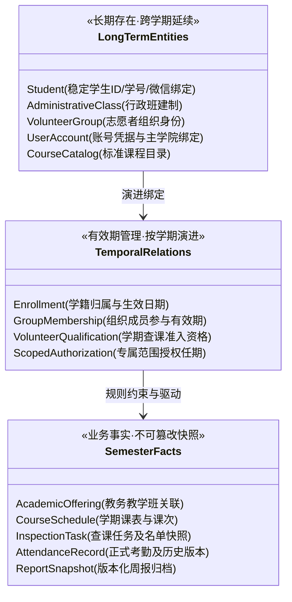

1. **学生与行政班跨学期延续**：
   - 学生转专业、休学、复学或毕业通过学籍异动流转，学生实体与微信绑定关系长期保持；
   - 换学期不会注销学生账号，也不会重新录入行政班建制。
2. **组织与配置按需复用**：
   - 志愿者大队与分组架构长期保持，新学期通过“学期准备向导”带入上学期成员草稿并重验资格；
   - 组织不复制、账号不克隆、支援授权不暗中续期。
3. **业务快照不可篡改**：
   - 查课任务一旦生成，其绑定的学生名单、上课教室、教师信息以及执行规则即刻固化；
   - 历史考勤查询默认展示任务当时快照，即使该学生次月转专业至其他学院，历史事实所属的责任学院与名单行政班均保持原始状态。

---

## 二、用户角色体系与权限架构

### 2.1 五大核心角色与职责边界

系统严格定义了五大核心业务角色，并在各领域划分清晰的责任边界：

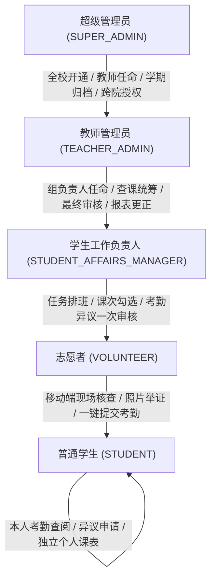

| 角色标识 | 定位与核心工作范围 | 严密安全红线与边界约束 |
| :--- | :--- | :--- |
| **SUPER_ADMIN (超级管理员)** | 学校层级总治理者：开通与停用学院、任命教师管理员、配置全校默认校历与作息模板、学期最终不可逆归档、跨院调配。 | 平台管理需显式授予 `administrator_account.manage` 权限；**最后有效超管受保护禁止停用**；学校汇总统计不作为任意批量覆写的后门。 |
| **TEACHER_ADMIN (教师管理员)** | 学院日常工作区全权管理者：绑定唯一主学院，管理本院教务导入、课表发布、学生档案、志愿者组织、查课排班、异议审核与学院报表。 | 权限严格受限于所属学院范围，**不可跨院读取或修改他院档案**；不能互相授予或撤销教师角色。 |
| **STUDENT_AFFAIRS_MANAGER (学生工作负责人)** | 学院日常查课具体业务骨干：必须具备在读有效学籍、微信绑定与正式任命；负责候选课次勾选、排班规划器执行、手动改派、考勤异议一次审核。 | 学院归属实时取自本人当日学籍；**解绑微信或学生学籍离校立即撤销该角色及全部专属授权**；默认无教师账号管理与学籍修改权限。 |
| **VOLUNTEER (查课志愿者)** | 移动端任务一线执行者：具备学生绑定 ＋ 当学期有效查课资格；负责在小程序接收任务、核对现场名单快照、标记缺勤学生、拍照举证并提交。 | 仅可查看本人当前受派的任务及最小化名单；**严禁越权访问全院名册或其他未受派任务的现场照片**。 |
| **STUDENT (普通学生)** | 受检者与终端服务对象：凭学号与一次性绑定码建立身份绑定；在移动端查询本人出勤记录、发起异议复议并使用独立云端课表。 | 仅可访问与本人相关的考勤与异议事实；**个人课表完全独立于正式教务，不得作为出勤或排班依据**。 |

---

### 2.2 权限判定与数据范围模型

系统执行服务端多因子联合鉴权，前端页面隐藏或按钮置灰仅作为用户体验引导：

$$\text{Effective Permission} = \text{Role Matrix} + \text{Scoped Grant} + \text{Identity Validity} + \text{Resource Scope} + \text{State Guard}$$

1. **角色矩阵 (Role Matrix)**：`SUPER_ADMIN`、`TEACHER_ADMIN`、`STUDENT_AFFAIRS_MANAGER`、`VOLUNTEER`、`STUDENT` 对应的内置默认权限集合；
2. **专属授权 (Scoped Grant)**：针对特定志愿者分组、特定课程类型或特定教学班授予的细粒度操作权限；
3. **身份有效性 (Identity Validity)**：学生账号必须处于 `ACTIVE` 状态，微信绑定关系有效；志愿者必须具备当前学期的有效资格；
4. **资源范围守卫 (Resource Scope)**：底层 Repository 必须显式接收不可变的 `ResourceScope(college_id, ...)`，强制隔离跨院或未知归属的数据查询；
5. **状态守卫 (State Guard)**：例如已归档学期禁止常规写操作、已截止任务禁止常规删除、存在未结案异议的考勤禁止直接覆盖。

---

### 2.3 专属授权与负责人工作交接

为解决学生干部轮换、兼职助理协作带来的管理混乱，系统引入透明的专属授权与安全交接体系：

- **权限来源透明诊断**：
  在管理端「账号与权限」视图中，用户可直观查验任意人员的权限来源树（明确标注某项能力是来自主学院身份、角色矩阵、还是某一条具体的专属授权记录），杜绝“幽灵权限”；
- **一键安全交接流程**：
  当原负责人卸任换届时，教师管理员在管理端发起「负责人交接」：
  1. 系统自动列出该人员名下待处理的排班与异议待办事项；
  2. 预览将要撤销的旧组专属授权，与将要授予新负责人的专属授权；
  3. 确认后在**单一数据库事务**内完成旧权撤销、新权下发并记录专项审计日志；
  4. 原负责人的历史审批记录与操作日志真实留存，不发生身份篡改。

---

## 三、Web 学院工作台：七大核心业务入口与操作流

Web 管理端采用清晰的七大一级入口架构，配合统一的顶栏工作区上下文条（`WorkspaceContextBar`），确保多学院、跨学期业务逻辑清晰严密。

```mermaid
graph TD
    AppShell["学院工作台外壳 (AppShell)"]
    AppShell --> TopBar["统一上下文条 (学院选择 / 学期选择 / 当前档案标识)"]

    AppShell --> P1["1. 工作台 (/dashboard/home)"]
    AppShell --> P2["2. 教务资料 (/dashboard/academic)"]
    AppShell --> P3["3. 学生与班级 (/dashboard/students)"]
    AppShell --> P4["4. 志愿者组织 (/dashboard/organizations)"]
    AppShell --> P5["5. 查课安排 (/dashboard/inspections)"]
    AppShell --> P6["6. 考勤与异议 (/dashboard/attendance)"]
    AppShell --> P7["7. 统计报表 (/dashboard/reports)"]

    P2 --> T21["正式课表"] & T22["教学班与分类"] & T23["资料准备(导入向导)"] & T24["课程类型"] & T25["作息与校历"] & T26["发布给学生"]
    P3 --> T31["学生与班级名册"] & T32["按日期查看学籍(as_of)"] & T33["学籍变更与交接"]
    P4 --> T41["组织与规则"] & T42["成员、支援与请假"] & T43["学期准备向导"] & T44["本学期资格"]
    P5 --> T51["任务与排班"] & T52["选择具体课次"] & T53["组范围抽查"] & T54["未来变更处置"] & T55["提交截止设置"]
    P6 --> T61["考勤与现场照片"] & T62["学生异议处理"]
    P7 --> T71["出勤统计概览"] & T72["多维度分析"] & T73["版本周报导出"]
```

### 3.1 工作台 (Workbench)

**核心定位**：学院运营的“驾驶舱”，聚合全流程状态指引与待办流转。

1. **学期准备状态卡片**：
   系统根据底层真实数据库状态，自动聚合展示 7 项关键准备度的就绪情况：
   - 作息与校历（是否采用学校模板或存在本院独立方案）
   - 正式课表（本学期是否已导入有效课表）
   - 课程分类（本学期课程是否已全部完成类型标定）
   - 课表发布（是否已将正式版本发布至小程序端）
   - 学生与班级（本学期有效档案与绑定人数统计）
   - 组织与规则（志愿者分组与避让规则是否配置）
   - 本学期资格（本学期志愿者执行池是否就绪）
   每张卡片直观显示“未开始 / 需处理 / 已就绪”，点击可一键穿透直达对应配置页。
2. **权限内待办聚合**：
   实时汇总当前登录人有权处理的待办事项：
   - **待排班任务**：已生成但尚未成功指派执行人的查课任务；
   - **名单待核对课次**：选课发生变动或存在异常冲突的教学班；
   - **待审核异议**：学生新提出的考勤申诉记录。
3. **顶栏上下文模式规范**：
   - `semester` 模式：消费全局学期（如查课安排、考勤异议、周报），切换学期后页面数据同步切换；
   - `current` 模式：消费长期实体（如学生档案、行政班、学校管理），顶栏明确标注“当前有效档案”，不被学期选择器隐式过滤；
   - `mixed` 模式：如志愿者组织，概览展示长期架构，成员与资格按所选学期动态加载。

---

### 3.2 教务资料管理 (Academic)

**核心定位**：学院教务基座管理，包括标准文件解析、教学班分类、作息维护与面向小程序的正式发布。

#### 1. 资料准备（全新“草稿—差异核对—整批确认”导入向导）
系统彻底告别传统的直接覆盖模式，提供全链路安全的导入向导：

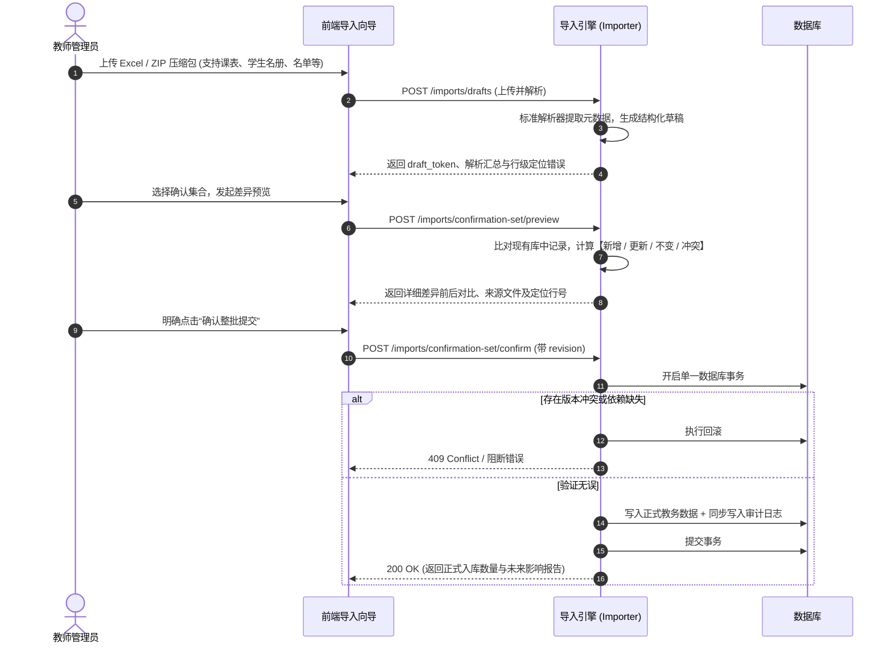

- **安全边界保障**：一次最多支持 20 个文件，单个文件上限 10 MiB；草稿预览阶段绝不写入任何正式教务事实；集合中任意文件出现阻断性错误，整批确认立即原子回滚。

#### 2. 共享教学班 (`AcademicOffering`) 与学院管理视图
- 教务系统通常缺少全校唯一的教学班数字编号。系统采用“学期 ＋ 课程名 ＋ 完整周次 ＋ 实际节次 ＋ 教室 ＋ 教师”特征进行智能推荐匹配；
- 必须由教师在 Web 端**人工确认关联**后，方才建立正式绑定；未关联资料作为学院独立视图安全运行，绝不强行自动合并外院名单。

#### 3. 动态课程类型管理
- 告别固定枚举限制，课程类型（普通课、早自习、晚自习、专业实训、考前辅导等）由学院自主定义；
- 支持为不同类型独立配置查课要求与冲突优先级，教学班持有唯一类型，未分类课程不能直接排入组内抽查。

#### 4. 作息与校历管理
- **学校模板采用**：学院可直接预览并一键采用学校发布的标准节次模板；
- **学院独立作息**：支持特殊教学单位（如艺术、实训中心）自定义各节次起止时间；
- **校历调休与停课**：可视化配置单日调休、国家节假日停课与补课计划，排班算法自动识别并准确避开停课日。

#### 5. 发布给学生
- 教学班与课表经核对无误后，教师管理员执行“发布给学生”；
- 发布操作生成带版本号的正式教务快照，小程序端将即时感知并提示学生一键同步至个人课表。

---

### 3.3 学生与班级管理 (Students)

**核心定位**：学生全生命周期学籍管理与微信身份安全分发。

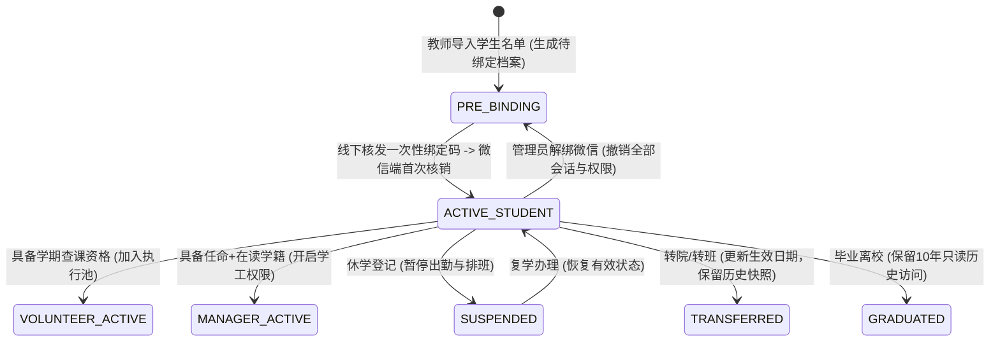

1. **行政班管理**：维护行政班级建制、所属年级、班级当前在读人数及微信绑定进度百分比；
2. **学生名册与多日期学籍快照 (`as_of`)**：
   - 默认展示“当前有效档案”；
   - 提供精准的“按指定日期查询学籍”功能（`GET /students?as_of=YYYY-MM-DD`）：指定日期将调取当日有效的学籍快照，真实还原学生在历史任务发生时的所属班级与学院，杜绝用当前档案硬套历史业务；
3. **学籍变更与交接办理**：
   - 提供转院、转班、休学、复学的线上交接登记；
   - 明确历史划分：学生转院前产生的查课记录与违纪认定永久归属原任务学院，新学院仅对生效日后的新任务负责；
4. **一次性微信绑定码体系**：
   - 线下核验后批量生成或重置绑定码，支持按行政班导出分发 Excel；
   - 绑定码具备单次有效性与过期时限，微信端核销过程对数据库行记录加 `FOR UPDATE` 排他锁，杜绝并发冒领。

---

### 3.4 志愿者组织与资格 (Organizations)

**核心定位**：志愿大队、查课执行分组与人员调配中心。

1. **组织架构与规则配置**：
   - 学院可自建多个并行的志愿者小组（如大一查课组、实训查课组、自习督导组）；
   - **组内查课偏好**：可按课程类型限定本组查课范围（如“本组仅负责晚自习”）；
   - **本班回避规则**：系统强制要求志愿者不得查自己所在的行政班，合班教学时同样严格执行回避。
2. **成员有效期与状态管理**：
   - 组织成员具备明确的 `semester_id` 与有效起止日期；
   - 成员可在线申报**不可用时间与请假申请**，审批通过后，排班求解器在不可用时段内绝对禁止向该志愿者派发任务。
3. **学期准备向导 (Preparation Wizard)**：
   - 换学期时，提供一键准备向导：从指定历史学期带入组织框架与成员候选名单；
   - 自动重新验证候选人本学期学籍在读状态与查课资格，剔除毕业或休学人员，生成新学期参与草稿；
   - 确认后原子入库，无需手工重复建组。
4. **跨组与跨院支援机制**：
   - 支持设置组间支援额度与跨院支援授权，支援人员在授权期内纳入目标组排班池，逾期自动失效。

---

### 3.5 查课安排与智能排班 (Inspections)

**核心定位**：精准课次抽查、两阶段智能排班规划器与异常影响处置。

#### 1. 候选课次精准勾选与计算
- 管理员选择周次与日期区间，系统调用领域服务展开该区间内全部教学班发生的实际上课课次；
- 自动剔除国家法定节假日停课、调休无课日及体育课（体育课不作为查课对象，但保留在本人课表中参与冲突检测）；
- 响应携带 `selection_scope` 与 `selection_revision`，保证前端勾选提交时的版本一致性。

#### 2. 两阶段解耦架构
- **阶段一（任务生成）**：将选定的候选课次固化为 `InspectionTask`，生成唯一的业务任务标识，锁定当时的教学班学生名单版本快照；
- **阶段二（自动排班）**：仅针对第一阶段成功生成且未取消的 `assignable_task_ids` 调用规划求解器。两阶段彻底解耦，排班求解遇到容量瓶颈绝不导致已生成的任务丢失。

#### 3. 规划算法与硬软约束求解体系
排班引擎采用纯 Python 实现的「动态稀缺优先 → 公平域内择优 → 有界单任务换位」启发式规划算法：

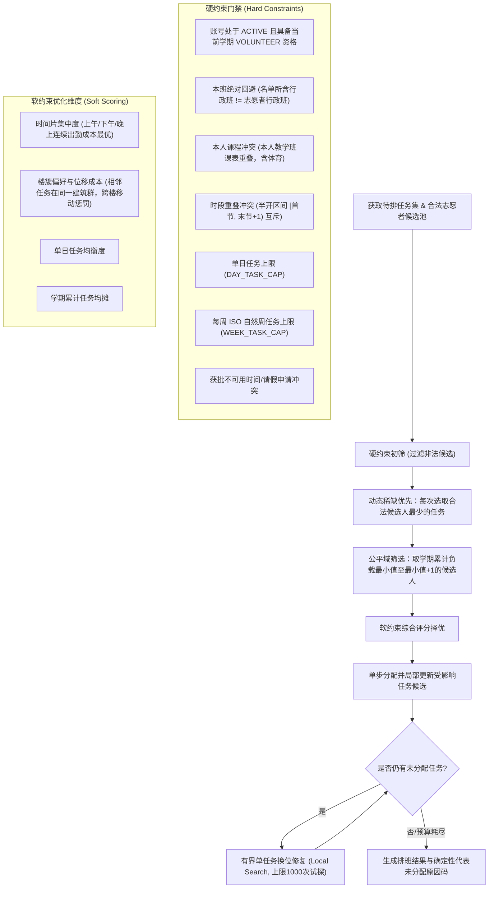

- **确定性未分配原因码**：若任务无法成功排入，API 严格返回代表性原因码（如 `DAY_TASK_CAP`、`WEEK_TASK_CAP`、`ROSTER_AVOIDANCE`、`COURSE_CONFLICT`、`TIME_OVERLAP` 等），清晰指导管理员手动调配。

#### 4. 人工改派、调班与未来变更处置
- **手动改派**：管理员可随时手动调换执行人，系统实时重新核验全部硬约束，防止人工误排造成冲突；
- **任务取消与安全恢复**：
  - 未执行的任务可直接取消，释放志愿者占用配额；
  - 已取消的任务只要尚未产生现场考勤事实，可通过显式 `restore` 恢复为待排状态；
- **未来变更影响处置 (Impacts)**：
  - 当某门课程发生调课、换教室或停课时，系统在「未来变更处置」选项卡中实时预警受影响的查课任务，指导管理员提前改派或取消。

---

### 3.6 考勤认定与异议处理 (Attendance)

**核心定位**：正式考勤事实生成、现场照片安全审阅与考勤异议一次审核闭环。

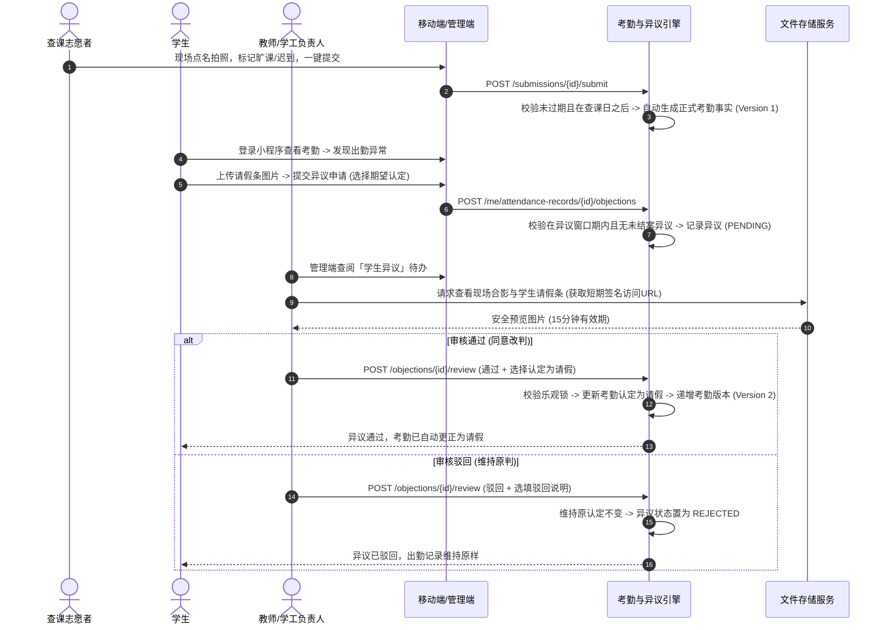

1. **自动考勤生成机制**：
   - 志愿者在移动端提交任务后，服务端**全自动转化为正式考勤事实**，无需管理员重复进行繁琐的二次录入；
   - 严禁在查课日期前提前提交；支持逾期补交，但截止时间（`submission_deadline`）前形成的考核事实快照永久留存。
2. **现场照片短时签名预览**：
   - 现场查课合影与学生异议举证图片受保护存储；
   - 查阅时动态签发带有 HMAC 签名的短时有效 URL（默认 15 分钟失效），外部无法窃取永久链接，杜绝隐私数据泄露。
3. **考勤异议一次审核闭环**：
   - 彻底废除陈旧的多级初审、终审流转；
   - 具备审核权限的教师管理员或学生工作负责人直接进行**一次审核**：
     - **审核通过**：选择新的认定结论（如将“旷课”改判为“请假”），系统同事务更新考勤并递增版本号，历史版本永久可查；
     - **审核驳回**：原认定结论保持不变，系统记录驳回时间、操作账号与审核说明，异议结案。

---

### 3.7 统计报表与版本周报 (Reports)

**核心定位**：多维度出勤分析、不可变周报版本归档与 Excel 导出。

1. **多维度出勤聚合**：
   - **学院维度**：全院整体出勤率、缺勤人次、请假率及各周趋势图；
   - **班级维度**：按行政班级统计各班缺勤人次与违纪名单，辅助辅导员开展学风督导；
   - **课程维度**：识别出勤率偏低的重点监控课程，辅助教务教学改进；
   - **组织履职维度**：志愿者出勤履职统计，支撑评优评先。
2. **不可变版本周报机制**：
   - 周报生成时，将当前全部出勤明细固化为带版本编号的快照存档；
   - 若后续因考勤异议改判导致出勤数据变化，系统在周报列表明确提示“源数据已落后”，需由授权教师显式生成新版本；
   - 旧版本周报永久保持历史原始数据不变，支持直接导出排版优良的标准化 Excel 工作簿。
3. **校级汇总统计的科学口径**：
   - 严格区分“检查任务总数”、“检查总人次”、“去重学生数”与“去重学生课次”；
   - 未能可靠推导行政班总分母时，比率安全返回 `null`，绝不虚构百分比。

---

## 四、辅助管理入口与校级统筹治理

### 4.1 学校与学院管理 (School)

本模块仅面向 `SUPER_ADMIN`（超级管理员）开放：
1. **学院生命周期管理**：全校二级学院的开通、信息维护与状态启停（停用后该学院工作区禁止新增任何业务）；
2. **教师任命**：为二级学院绑定主管教师管理员，建立合法的管理根节点；
3. **学校默认资料包发布**：维护全校统一的作息时间标准与学期校历模板，供各学院直接继承使用；
4. **测试学院保留规范**：系统内置的“软件学院”作为核心功能验收与集成测试学院永久保留，禁止清理其关联的测试班级与历史事实。

---

### 4.2 账号与权限管理 (Users)

1. **教师账号维护**：超管统一创建教师账号并分发初始密码；系统支持强制密码复杂度校验与自助改密；
2. **安全防锁死机制**：系统内置自检保护，**禁止停用最后一个具有超管权限的平台管理员**；
3. **权限全景审计追踪**：查看全校任意用户的角色构成、专属授权起止期以及历次授权变更的操作人与时间戳。

---

### 4.3 学期全流程与归档锁定

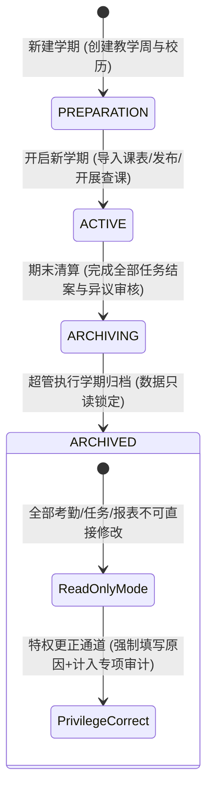

- **学期归档清零检查**：执行归档前，系统自动校验是否存在未完成任务、未结案异议或未核对名单；
- **全量只读锁定**：正式归档后，该学期的查课安排、考勤结果与报表进入不可逆只读状态；
- **受控特权更正**：若因特殊教学事故确需更正归档考勤，必须通过专门的特权纠错入口提交，强制录入更正事由，并在审计日志中高危告警留痕。

---

## 五、微信小程序移动端协同与个人课表

微信小程序 (`apps/wechat-miniapp`) 采用原生高性能框架与 TDesign 组件库构建，实现与移动终端的无缝协同。

### 5.1 微信身份认证与学生绑定

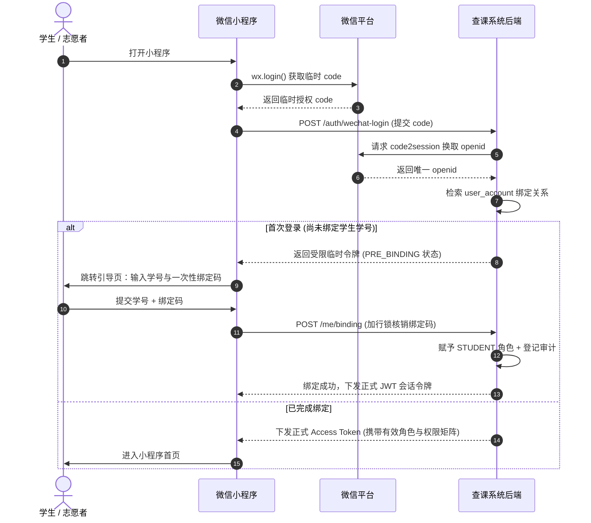

- **双令牌安全轮换**：小程序端通过 JSON 传输 Refresh Token，支持无感 401 拦截并串行静默刷新，失败至多重试一次。

---

### 5.2 志愿者移动查课工作流

1. **受派任务日程查收**：首页日历直观展示今日受派的查课课次与上课教室；
2. **现场名单快照核验**：进入任务详情页，调取系统冻结的名单快照，包含学生姓名、学号与行政班；
3. **异常学生标记**：支持单选或批量标记缺勤学生，细分类型为：旷课、迟到、早退、请假；
4. **现场证明照片上传**：调用系统相机实时拍摄现场全景或考勤表照片，上传后取得文件资源 ID；
5. **一键提交转正式考勤**：核对无误后点击提交，后端原子生成正式考勤记录，任务状态置为已完成。

---

### 5.3 学生考勤查询与申诉举证

1. **个人出勤明细**：学生可按学期实时查阅每一笔涉及本人的出勤记录，显示查课时间、课程名称与当前认定结果；
2. **安全查看现场照片**：经认证的学生可直接通过安全签名链接查看本人缺勤课次的现场证明合影；
3. **考勤异议申请**：
   - 若对认定有异议（如已提前请假），在系统配置的异议申请窗口期内点击“提出异议”；
   - 填写申诉理由，拍照上传假条或辅导员审批截图；
   - 提交后可在小程序实时跟进异议的审核进度与最终裁定结果。

---

### 5.4 独立云端个人课表体系

系统为学生提供了一套**完全解耦、无副作用的个人现代化课表**：

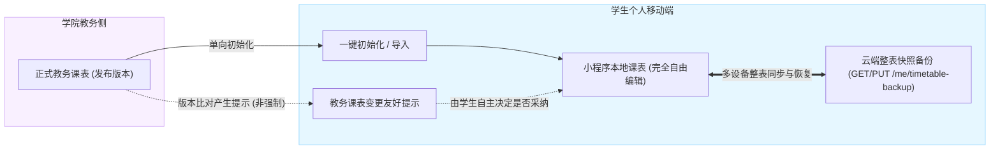

- **数据所有权归属个人**：个人课表完全为学生个人所有，学生可自由增删自定义课程、修改上课时间、调整显示颜色或添加个性化备忘；
- **整表快照云端同步**：支持小程序端本地编辑并一键向后端上传整表快照备份（`PUT /api/v1/me/timetable-backup`），更换手机或重装微信后一键无缝恢复；
- **教务发布单向提示**：当学院教务发布新课表或发生教学变更时，小程序端仅弹窗友好提示“教务课表有更新”，**由学生自主决定是否合并，系统绝不隐式覆盖学生的个性化设置**；
- **绝对零副作用**：**个人课表绝不反向作为查课排班、现场点名、免到或报表出勤率的输入**。

---

## 六、核心业务底线与关键规则保障

### 6.1 乐观并发控制与防穿透保护

1. **乐观锁机制 (`lock_version`)**：
   - 针对核心业务对象（查课任务、考勤记录、账号状态、组织配置等）维护自增的 `lock_version`；
   - 客户端写操作必须在请求中携带所持有的版本号。当服务端检测到提交版本低于或不等于当前数据库版本时，统一阻断并返回 `409 Conflict`，杜绝后提交者静默覆盖先提交者；
2. **大整数安全传输**：
   - 所有对外暴露的 ID 字段（如用户 ID、任务 ID、教学班 ID）在 API 契约中强制序列化为字符串形式，彻底防止前端 JavaScript 在解析 64 位大整数时发生末位精度丢失。

---

### 6.2 审计日志同事务一致性

系统建立了极高标准的审计留痕机制：
- 任何引起系统状态实质性变更的接口（角色分配、学籍变动、考勤更正、异议审核、学期归档等），必须在同一数据库连接上、与业务数据操作**完全处于同一个事务**内向 `audit_log` 写入审计行；
- 审计记录包含：操作人账号 ID、操作时间戳、受影响资源标识、操作动作类型、变更前数据快照、变更后数据快照与客户端 IP；
- **一致性保证**：若审计日志写入失败，整笔业务数据库事务立即回滚；若业务失败，绝不产生虚假孤立的审计行。

---

### 6.3 两阶段解耦与历史事实不可变

1. **两阶段排班解耦**：
   任务生成与排班规划作为独立业务单元存在。即使排班规划因人员全部请假而未能成功指派，已生成的查课任务依然稳妥保存在数据库中，供管理员后续手动改派或二次调度；
2. **历史考核事实不可变性**：
   - 任务设定的截止时间到达后，系统根据当时的提交状态结算考核结果（如“逾期未执行”）；
   - 即使志愿者事后补交报告，系统虽然会生成合法的出勤记录供统计使用，但截止时固化的“逾期事实”快照永久留存，确保督导考核的严谨性与权威性。

---

*CourseManagement 查课管理系统 · 架构与业务设计委员会*
