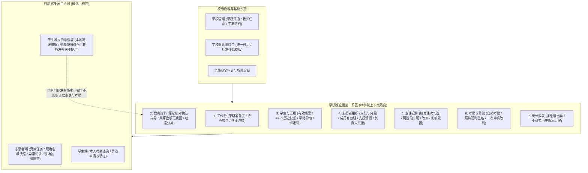

> 2026-10-19 归档：原路径 `README.md`。这是未提交的历史草稿，保留供追溯；功能状态、账号时序、版本、链接和部署信息可能过时或互相冲突，不作为当前需求、接口合同或操作手册。当前以 `docs/development/IMPLEMENTATION_STATUS.md`、已确认产品设计及实际接口为准。

# CourseManagement 查课管理系统

[](https://www.python.org/)
[](https://fastapi.tiangolo.com/)
[](https://vuejs.org/)
[](https://www.typescriptlang.org/)
[](https://www.mysql.com/)
[]()

> 面向高校多学院独立运营与学校协同治理的现代化查课管理与学工考勤平台。涵盖标准教务资料原子导入、全生命周期学生学籍档案、动态课程分类与多版本作息、志愿者组织与智能排班、移动端查课与考勤异议闭环，以及完全解耦的学生独立云端个人课表。

- **主仓库**：[Ouroboros-ga/CourseManagement](https://github.com/Ouroboros-ga/CourseManagement)（主协作分支 `dev-main`）
- **小程序上游**：[Mo-Qiong/wxsign](https://github.com/Mo-Qiong/wxsign)；本地 `apps/wechat-miniapp/` 为适配副本，来源和同步规范详见 上游来源记录（原相对路径：`apps/wechat-miniapp/UPSTREAM_PROVENANCE.md`）。

---

## 目录

- [核心架构与设计原则](#核心架构与设计原则)
- [系统功能全景](#系统功能全景)
- [技术栈与模块分布](#技术栈与模块分布)
- [快速上手与本地开发](#快速上手与本地开发)
  - [1. 后端服务 (FastAPI)](#1-后端服务-fastapi)
  - [2. 管理端 (Vue 3 Web)](#2-管理端-vue-3-web)
  - [3. 微信小程序 (Native Miniapp)](#3-微信小程序-native-miniapp)
- [工程约束与关键机制](#工程约束与关键机制)
- [文档与设计导航](#文档与设计导航)
- [实施状态与发布边界](#实施状态与发布边界)

---

## 核心架构与设计原则



1. **四维数据归属与跨院独立检查**
   - **开课学院**：负责课程教学开设，不自动获得外院选课学生管理权；
   - **学生学籍学院**：按查课当日学生有效学籍确定，学籍异动走专门审批流；
   - **导入维护学院**：负责本院教务文件的导入解析、选课关联与管理配置；
   - **任务负责学院**：发起查课检查的责任学院。跨学院对同一学生重叠检查时，**各学院记录独立留存、异议各归其主、统计分别核算**，不互相覆盖，不强制合成全校统一结论。
2. **教务身份解耦与柔性关联**
   - 共享教务身份（`AcademicOffering`）与学院管理视图（`TeachingClass`）解耦。教务系统无稳定全校编号时，系统采用“特征推荐匹配 ＋ 教师人工确认关联”，绝不盲目按教室/名称自动合并外院名单。
3. **两阶段解耦排班与规划算法**
   - **第一阶段（任务生成）**：基于校历、节次与开课计划，通过 `selection_scope` 精确勾选候选课次，冻结任务及学生名单快照；
   - **第二阶段（智能指派）**：采用纯 Python「动态稀缺优先 → 公平域内择优 → 有界单任务换位」规划算法，在满足本班回避、课程冲突、日周上限、请假不可用等硬约束下求解，并给出确定性代表未分配原因码。生成与指派解耦，第二阶段失败不影响第一阶段任务生成。
4. **考勤状态机与一次审核闭环**
   - 志愿者移动端提交后**自动生成正式考勤**；考勤异议采用**一次审核**（教师管理员或学生工作负责人直接处理，通过改判更正考勤并保留历史版本，驳回维持原认定并记录说明）。
   - 截止时间考核事实快照永久留存，补交不擦除逾期事实。
5. **学生个人课表严格解耦与零副作用**
   - 小程序个人课表完全为学生个人所有，支持本地离线编辑与云端完整快照备份；
   - 可一键从已发布的教务课表初始化，后续教务变更仅提供软性更新提示；**个人课表绝不反向影响排班、考勤、免到或报表**。

---

## 系统功能全景

### 1. Web 学院管理工作台（七大核心一级入口）

| 一级入口 | 核心功能与业务职责 | 页面上下文模式 |
| :--- | :--- | :--- |
| **工作台 (Workbench)** | 实时学期准备度卡片（作息/课表/分类/学生/组织/资格）、权限内待办聚合（待排班任务、名单待核对、异议待审核）、快捷操作流。 | `semester`（消费全局学期） |
| **教务资料 (Academic)** | 导入中心（草稿-差异核对-整批原子确认向导）、正式课表周视图/列表、教学班与课程分类维护、学校作息模板与学院校历例外、教务版本发布。 | 课表/导入为 `semester`；类型目录为 `current` |
| **学生与班级 (Students)** | 行政班花名册、学生全生命周期档案、基于 `as_of` 的历史学籍快照查询、学籍异动登记与交接、一次性微信绑定码生成与分发。 | `current`（当前档案模式，不被全局学期筛空） |
| **志愿者组织 (Organizations)** | 志愿大队与分组设置、学期成员有效期管理、学期准入资格审查、学期复用准备、组内支援机制、负责人交接与专属授权、请假/不可用时间申报。 | 混合模式：组织基础信息长期，成员与资格按学期 |
| **查课安排 (Inspections)** | 候选课次精确勾选生成、两阶段自动排班规划器、组范围抽查、人工改派与调班申请、任务取消与恢复、未来课次变更影响处置。 | `semester`（学期 ＋ 日期 ＋ 可选执行组） |
| **考勤与异议 (Attendance)** | 考勤明细（当前认定与全版本历史）、现场照片安全访问（HMAC 短时签名 URL）、学生考勤异议一次审核（改判/驳回）。 | `semester`（默认当前学院负责的所有任务考勤） |
| **统计报表 (Reports)** | 学院/班级/课程/组织多维度出勤汇总、不可变历史版本周报归档与 Excel 导出、校级统计口径（区分检查人次与去重学生课次）。 | `semester`（学院及所选学期） |

### 2. 辅助管理入口（受权开放）

- **学校与学院管理 (School)**：超管专属；学院开通、状态启停、教师任命、学校标准作息包管理、学期创建与最终不可逆归档。
- **账号与权限 (Users)**：教师账号维护、权限来源诊断（区分主学院默认能力、角色矩阵与专属授权）、管理员安全交接。
- **学期与平台设置 (Settings)**：平台基础运行参数配置、校历默认周次设置。
- **帮助与操作说明 (Help)**：内置全流程业务操作指引、学期准备指南与常见规则说明。

### 3. 微信小程序移动端（双端协同）

- **志愿者端**：微信静默登录、受派查课任务日历与列表、现场名单快照核验、异常学生标记（旷课/迟到/早退/请假）、现场证明拍照上传、一键提交自动转正式考勤。
- **学生端**：学号与一次性绑定码绑定、本人考勤记录与认定版本查阅、考勤异议申请与佐证材料上传。
- **独立云端个人课表**：个人课程本地自定义管理、多端完整快照同步与恢复、官方教务课表一键初始化导入与变更提示。

---

## 技术栈与模块分布

### 技术栈构成

- **后端核心**：Python 3.12 · FastAPI 0.115+ · SQLAlchemy 2.0 (同步模式) · PyMySQL · MySQL 8.4 LTS · Alembic · uv · openpyxl
- **管理前端**：Vue 3.5+ · TypeScript 5.6+ · Vite 5 · Pinia · Element Plus · Tailwind CSS
- **微信小程序**：微信原生框架 (WXML / WXSS / JavaScript) · TDesign 小程序组件库

### 仓库代码目录架构

```text
CourseManagement/
├── backend/                       # 后端工程 (FastAPI 模块化单体)
│   ├── app/
│   │   ├── main.py                # 应用组装、生命周期与全局路由注册
│   │   ├── models.py              # 全局 ORM 模型聚合入口 (供 Alembic 收集元数据)
│   │   ├── api/health.py          # 存活探针 (/health/live) 与数据库就绪探针 (/health/ready)
│   │   ├── core/                  # 配置加载、数据库引擎、中间件、安全与异常体系
│   │   ├── common/                # 分页、统一响应封包、解析工具
│   │   └── modules/               # 领域业务模块 (严格 Router -> Schema -> Service -> Repo -> Model)
│   │       ├── identity/          # 账号、微信鉴权、绑定码、角色矩阵、权限守卫
│   │       ├── academic/          # 学院、学期、作息、班级、学生档案、教学班、正式课表
│   │       ├── importer/          # 导入中心：Excel/ZIP 解析、差异比对、确认集合事务
│   │       ├── volunteer/         # 志愿者组织、成员有效期、资格准入、支援与请假
│   │       ├── inspection/        # 候选课次展开、任务生成、两阶段排班规划器
│   │       ├── attendance/        # 考勤状态机、版本归档、截止快照、人工考勤更正
│   │       ├── objection/         # 学生异议申请、证明材料关联、一次审核引擎
│   │       ├── report/            # 统计聚合、多维度出勤分析、不可变周报版本
│   │       ├── timetable/         # 学生独立云端个人课表与快照备份
│   │       ├── file/              # 凭据驱动的受限文件上传与 HMAC 签名短时下载
│   │       └── audit/             # 全流程写操作同事务审计日志
│   ├── migrations/                # Alembic 数据库版本演进脚本
│   └── tests/                     # unit (离线单测) / integration (真实 MySQL 集成测试)
├── apps/
│   ├── admin-web/                 # 管理端工程 (Vue 3 + Vite SPA)
│   │   ├── src/
│   │   │   ├── api/               # Axios 封装与各领域后端 API 强类型客户端
│   │   │   ├── components/        # 业务组件库 (按 academic/students/workspace 等组织)
│   │   │   ├── navigation/        # 七大工作区入口契约、上下文模式与权限守卫
│   │   │   ├── stores/            # Pinia 状态管理 (session 学院上下文、全局配置)
│   │   │   ├── views/             # 页面视图 (七大一级入口 + 辅助管理视图)
│   │   │   └── router/            # 前端路由与动态权限拦截
│   └── wechat-miniapp/            # 微信小程序适配工程
│       ├── miniprogram/           # 小程序源码 (pages / components / utils)
│       └── UPSTREAM_PROVENANCE.md # 上游来源与同步规范记录
├── deploy/                        # Docker Compose 本地数据库编排与生产部署脚本
└── docs/                          # 完整产品需求、架构设计、业务规则与技术手册
```

---

## 快速上手与本地开发

### 1. 后端服务 (FastAPI)

后端使用 [uv](https://docs.astral.sh/uv/) 进行高效的 Python 依赖与虚拟环境管理。

```powershell
# 1. 进入后端目录并锁定同步依赖
cd backend
uv sync --locked

# 2. 准备环境变量文件
Copy-Item .env.example .env
# 编辑 .env 文件，配置 DATABASE_URL（本地开发端口建议 13306，避免与本机默认 MySQL 冲突）

# 3. 启动本地开发数据库 (包含独立测试库 course_management_test)
docker compose -f ../deploy/docker-compose.yml up -d

# 4. 执行 Alembic 数据库迁移到最新版本
uv run alembic upgrade head

# 5. 初始化角色权限与超级管理员账号
$env:SEED_ADMIN_PASSWORD="YourSecurePassword123"
uv run python -m app.modules.identity.seed --admin-username admin --admin-display-name "超级管理员"

# 6. 启动本地开发服务 (支持热重载)
uv run uvicorn app.main:app --host 127.0.0.1 --port 8000 --reload
```

- 服务存活检查：`http://127.0.0.1:8000/health/live`
- 数据库就绪探针：`http://127.0.0.1:8000/health/ready`
- OpenAPI 交互文档：`http://127.0.0.1:8000/docs`（非生产环境开放）

### 2. 管理端 (Vue 3 Web)

Windows/PowerShell 环境下推荐使用 `npm.cmd`。

```powershell
# 1. 进入管理端目录并安装依赖
cd apps/admin-web
npm.cmd ci

# 2. 启动前端 Vite 开发服务器
npm.cmd run dev
```

- 浏览器访问：`http://127.0.0.1:3000`
- 代理说明：Vite 固定监听 `3000` 端口，默认将 `/api` 与 `/health` 反向代理至本地 `http://127.0.0.1:8000`；可通过设置系统环境变量 `BACKEND_URL` 覆盖后端代理目标。

### 3. 微信小程序 (Native Miniapp)

```powershell
# 1. 进入小程序源码目录并安装依赖
cd apps/wechat-miniapp/miniprogram
npm ci
npm test

# 2. 复制本地私有配置文件 (关闭开发工具域名检查，该文件被 Git 忽略)
cd ..
Copy-Item project.private.config.example.json project.private.config.json
```

- 使用 **微信开发者工具** 导入目录 `apps/wechat-miniapp`。
- 在开发者工具菜单中执行：“**工具 → 构建 npm**”。
- 模拟器联调说明：小程序默认请求环境配置于 `miniprogram/utils/env.js`；真实微信鉴权需在后端 `.env` 中配置匹配的 `WECHAT_APPID` 与 `WECHAT_SECRET` 并开启 `WECHAT_LOGIN_ENABLED=true`。

---

## 工程约束与关键机制

1. **服务端绝对范围授权**
   - 前端菜单隐藏与按钮禁用仅作为交互辅助；服务端通过不可变的 `ResourceScope` 严格拦截未授权的数据读取、跨学院访问与越权写操作。
2. **ID 强类型与 JavaScript 大整数安全**
   - 数据库底层使用 `BIGINT` 自增主键，但在所有 RESTful API 契约与 JSON 序列化中**一律输出为字符串格式**（如 `"18471928471928471"`），杜绝前端 JavaScript 因 `Number.MAX_SAFE_INTEGER` 产生的精度截断 Bug。
3. **并发控制与乐观锁机制**
   - 针对核心业务实体（账号权限、教学班关联、查课任务、考勤认定等）引入 `lock_version` 乐观锁字段；写操作版本过期时统一抛出 `409 Conflict`，杜绝并发覆盖。
4. **同事务审计日志 (Audit Consistency)**
   - 所有的关键业务变更（角色调整、异议审核、学籍异动、考勤更正、课表发布等）均必须与审计日志写入在**同一个数据库事务**内完成，确保任何业务事实的变更都有据可查，审计失败整笔业务回滚。
5. **两阶段排班与事务隔离**
   - 课次抽查与任务生成（第一阶段）生成确定性的候选课次快照；指派与自动排班规划（第二阶段）作为独立操作执行。严禁在一个不可拆分的庞大事务中同时执行两阶段，避免因排班失败回滚合法的生成任务。

---

## 常用测试与质量保证命令

```powershell
# 后端离线单测 (无需 MySQL)
uv run pytest tests/unit -q -p no:cacheprovider

# 后端全量代码静态检查与格式验证
uv run ruff check app tests --no-cache
uv run mypy app

# 检查 Alembic 迁移头一致性
uv run alembic heads

# 管理端生产构建验证 (含 vue-tsc 类型检查)
cd apps/admin-web
npm.cmd run build

# 微信小程序端自动化用例检查 (显式枚举 Node 测试)
$testFiles = @(Get-ChildItem -LiteralPath apps/wechat-miniapp/tests -Filter '*.test.mjs' | ForEach-Object { $_.FullName })
node --test --test-timeout=5000 --test-reporter=tap @testFiles
```

---

## 文档与设计导航

| 分类 | 核心文档 | 说明与定位 |
| :--- | :--- | :--- |
| **业务与功能** | 系统功能说明与业务操作指南（原相对路径：`docs/FUNCTIONAL_GUIDE.md`） | **【推荐必读】** 系统完整业务功能说明、角色工作流与实操指南 |
| **顶层架构** | 产品、架构与 Web 重构总体设计（原相对路径：`docs/development/CAMPUS_PRODUCT_ARCHITECTURE_WEB_REDESIGN_20261015.md`） | 七大入口、学院自导、共享身份、数据归属与分批演进规范 |
| **需求定义** | 全校升级产品需求文档 (PRD)（原相对路径：`docs/product/CAMPUS_MANAGEMENT_PRD.md`） | 统一需求编号、已确认规则与业务验收标准 |
| **实施边界** | 当前实施状态与下一步（原相对路径：`docs/development/IMPLEMENTATION_STATUS.md`） | 区分已有代码基线、最新验证结果与线上部署边界 |
| **接口规范** | API 契约规范（原相对路径：`docs/API_CONTRACT.md`） · API 路由索引（原相对路径：`docs/API_INDEX.md`） · OpenAPI 规范（原相对路径：`docs/openapi.json`） | 后端全部 RESTful 端点输入输出契约与语义定义 |
| **权限与调度** | 业务资源与权限策略（原相对路径：`docs/PERMISSIONS.md`） · 排班规则冻结基线（原相对路径：`docs/SCHEDULING_RULES.md`） | 角色权限矩阵、专属授权模型与排班约束求解器规则 |
| **移动端集成** | 小程序接口增量记录（原相对路径：`docs/integration/WECHAT_API_CHANGES_20261016.md`） · 个人课表接口规范（原相对路径：`docs/integration/WECHAT_PERSONAL_TIMETABLE_API_20261015.md`） | 移动端接口适配、完整快照备份机制与字段兼容保障 |
| **运维与交付** | 微信运行环境配置（原相对路径：`docs/WECHAT_RUNTIME_CONFIG.md`） · 备份与恢复手册（原相对路径：`docs/RUNBOOK_BACKUP_RESTORE.md`） · 全校开关启用清单（原相对路径：`docs/development/CAMPUS_SCOPED_FLAG_ROLLOUT_20261017.md`） | 生产接入、数据灾备恢复流程与安全上线核验检查表 |

全部历史归档资料与过往实施日志收纳于 docs/archive/README.md（原相对路径：`docs/archive/README.md`）。

---

## 实施状态与发布边界

- **代码实现**：后端 FastAPI 领域模块、Vue 3 七大入口及工作台上下文机制、小程序接口适配均已完成并合并至 `dev-main`。
- **验证证据**：R6 批次在独立环境完成全链路两院隔离真实 HTTP 演练（登录、导入、共享身份、排班、照片短时访问、一次审核改判、统计）、双向 Alembic 迁移（71 表一致性校验）及真实浏览器自动化验证通过。
- **线上受控状态**：生产环境下，`CAMPUS_SCOPED_BUSINESS_ENABLED`（正式业务隔离）与 `ORGANIZATION_SCHEDULING_ENABLED`（组织排班）全局开关处于受控关闭状态，待学院存量归属与课程分类数据对账完毕后按 开关启用清单（原相对路径：`docs/development/CAMPUS_SCOPED_FLAG_ROLLOUT_20261017.md`） 顺序开启。

---

*CourseManagement 研发团队 · 2026*
