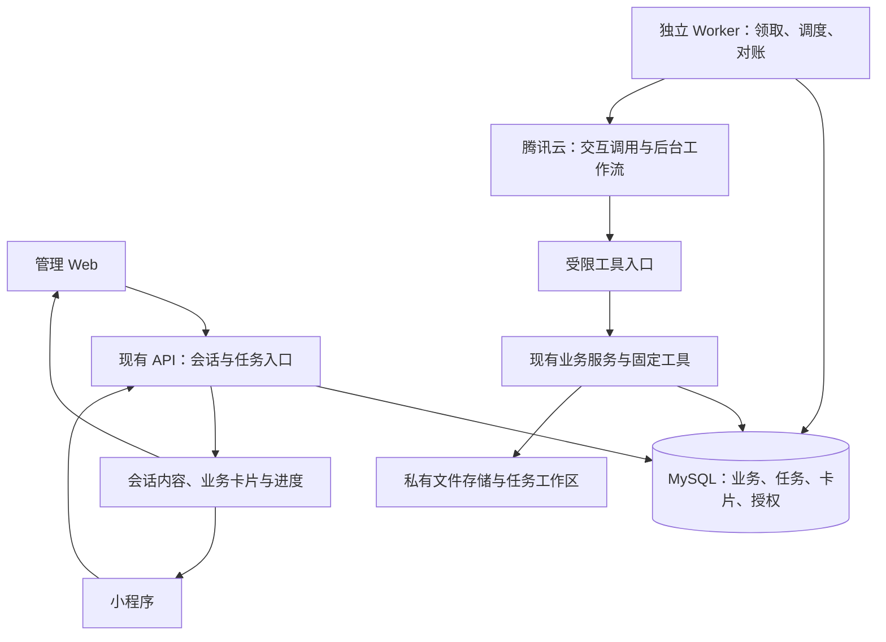

# 课程助手平台：技术落地与架构设计

版本：架构设计 v0.4（五模块与实施边界固化）｜核对日期：2026-10-24

本版按已确认的实际权限结构收敛：管理教师沿用本学院权限，学生负责人沿用责任区和已有动作权限，学生只查本人。新增运行记录用于恢复调用身份，不建设第二套授权平台。第6、11、17、18节与工具网关计划共同定义本版实施边界。

工具网关的逐项实施与验收见：[工具网关完整落地计划](../superpowers/plans/2026-10-24-tool-gateway-implementation.md)。该计划细化协议、执行授权、作业、领域接入与灰度；已开始本地候选实现，进度与未完成门禁见[实施状态](IMPLEMENTATION_STATUS.md)。

产品依据：[产品基线 v1.1](../product/AI_COLLABORATIVE_PLATFORM_FUNCTIONAL_DESIGN.md)。本文件为技术建议与实施门禁，不代表已开发、腾讯云账号已联调或生产已启用。本文记录已确认的产品与架构决定，实施和部署事实由状态页单独记录。

代码基线：`codex/integration-20261022`，HEAD `bc81fda`。既有未跟踪目录 `docs/acceptance/`、`docs/user-guides/` 不属于本次改动。

## 1. 核心结论与选择

产品固定五个独立业务模块：智能资料导入、督查排班、自动换班、申诉预审、统计报表。技术采用薄工具网关＋必要的任务运行基础，继续复用现有业务后端。模块数量不决定菜单、Agent 或微服务数量。

| 业务模块 | 触发与输出 | 最终执行边界 |
| --- | --- | --- |
| 智能资料导入 | 上传资料→整理与预览→批准保存 | 各资料组独立保存，冲突不猜测 |
| 督查排班 | 周期或管理指令→准备方案→确认发布 | 课次生成与受派分阶段，首期不自动发布 |
| 自动换班 | 本人申请→策略检查→实际改派回执 | 独立事件流程，正常路径无需逐单批准 |
| 申诉预审 | 正式申诉→材料整理与辅助意见 | 证据、考勤和疑点并列，人工终审 |
| 统计报表 | 自然语言或模板→数据快照→说明和文件 | 数值由既有统计产生，下载继续鉴权 |

1. 产品的两层智能体可落地为“管理／学生交互应用＋后台工作流应用”。腾讯云承担语义理解与流程编排，本系统承担正式事实、授权、审批和工具执行。
2. 首期建议复用现有 FastAPI 模块化后端，增加 agent 模块与受限工具入口；独立部署后台 Worker。逻辑上有工具网关，初期不要求独立网关微服务或第二套业务数据库。
3. 首期使用 MySQL 保存任务、运行身份关联和必要的审批结果；Worker 处理长任务。网关本身不建设队列和权限数据库。Scheduler 负责时间、排队、限流和派发；Redis／分布式容量控制在需要多实例扩容时再评估。
4. 管理端、小程序、后台采用不同工具白名单与执行上下文。禁止让一个持有超管权限的 Agent 通过提示词模拟不同身份。
5. 固定工具处理解压、解析、约束校验、统计和正式写入；模型处理语义映射、任务理解、材料摘要与解释。
6. 审批事实和业务版本留在本系统。跨小时审批不占用 HTTP 请求、数据库事务或后台执行槽；批准后继续下一阶段。
7. 自动换班必须在一个业务事务内完成旧受派撤销、新受派建立、申请结果、审计与执行回执；仅把申请设为通过不满足产品要求。

## 2. 现有能力与实际缺口

以下为静态核对，不是运行验收。

| 领域 | 已核对的代码 | 可复用能力 | 本轮需补 |
| --- | --- | --- | --- |
| 导入 | `importer/intake.py`、`catalog.py`、`zip_preview.py`、`service.py`、`scoped_service.py` | 文件识别、受限 ZIP、预览与确认、学院范围 | 任务工作区、语义映射建议、异常卡与审批衔接 |
| 排班 | `inspection/scheduling/`、`assignment_plan_service.py` | 快照、方案校验、版本、警告确认、原新人员锁锚点 | 周期触发、自动换班策略、系统执行来源 |
| 换班 | `inspection/service.py:create_change_request/review_change_request` | 本人当前受派申请、人工审核 | 审核当前只改申请状态；需自动选人并实际改派 |
| 排班确认 | `assignment_plan_service.py:preview/commit` | 确认计划能撤销旧受派、创建新受派并更新待处理换班申请 | 自动选择候选的受限入口、事务内执行回执、系统操作者语义 |
| 异议 | `objection/service.py:final_review/apply_final_review` | 一次正式审核、考勤更正与审计 | 独立预审结果、所有创建路径触发、指定终审人范围 |
| 统计 | `report/service.py`、`aggregation.py`、`version_service.py` | 范围过滤、聚合、导出、版本与源修订 | 自然语言口径结构化、文本与数字核验 |
| 授权 | `identity/resource_scope.py:resolve_scope` | 动作绑定学院与授权修订，限制组和资源 | 工作流调用上下文、自动化委托、不伪装人工执行 |
| 前端 | `ImportCenter.vue`、`AssignmentPlanDialog.vue`、`stores/session.ts` | 业务页与上下文、既有核对 | 助手容器、结构化卡、持久进度、开关与执行记录 |
| 运行层 | `backend/pyproject.toml`、`app/main.py` | 同步 SQLAlchemy、HTTPX、FastAPI | 持久任务及独立 Worker；本次定向搜索未发现可直接复用的通用 AI 队列 |

重要限制：现有 ZIP 解析拒绝嵌套压缩包和非表格成员。不能把“已有 ZIP 支持”当作任意混合资料包已支持。新导入工作区可把非支持文件列为忽略／待处理，但必须明确调整路径、保留安全检查并补回归。

另一个复用点：已有版本周报使用源修订、尝试令牌和发布回执保护并发。AI 报告应引用现有产物与快照，不再维护第二套周报版本。

## 3. 腾讯云平台能力核对

仅核对官方公开文档，尚未在比赛账号或实际应用中验证。公开能力与该账号的权限、配额、发布状态分开记录。

| 官方依据 | 已确认的文档事实 | 本项目选择 |
| --- | --- | --- |
| [新版对话 SSE](https://cloud.tencent.com/document/product/1759/129202) | 新入口为 `/adp/v2/chat`；提供会话、文本流及组件相关结构 | 服务端代理并归一化事件；业务卡片从本系统记录读取 |
| [旧版对话接口公告](https://cloud.tencent.com/document/product/1759/105561) | 旧接口公告于 2026-12-31 下线 | 不以旧 `/v1/qbot/chat/sse` 为新开发基线 |
| [创建工作流运行](https://cloud.tencent.com/document/product/1759/139333) | `adp.tencentcloudapi.com`，版本 `2026-05-20`；`CreateWorkflowRun` 异步返回运行 ID，要求单工作流模式 | 后台采用专用单工作流应用；不把交互应用假定为同一异步入口 |
| [查询运行](https://cloud.tencent.com/document/product/1759/139330) | `DescribeWorkflowRun` 返回运行及节点信息 | 适配层核对远端状态和本地结果 |
| [恢复等待输入](https://cloud.tencent.com/document/product/1759/139328) | `ResumeWorkflowRun` 支持继续等待输入的异步实例 | 可用于短时补充输入；长时审批采用本地持久阶段恢复 |
| [工具节点](https://cloud.tencent.com/document/product/1759/112968) | 支持自定义 API、APIKey、轮询与回调；当前文档规定轮询／回调等待有上限 | 短工具同步，长工具返回任务引用；不做无界轮询 |
| [工具输出回调](https://cloud.tencent.com/document/product/1759/139326) | `SaveWorkflowToolNodeOutput` 使用回调 Token 提交结果 | 由服务端保存 Token 并回传；不是“腾讯主动推送所有业务完成结果”的通用接口 |
| [API 概览](https://cloud.tencent.com/document/product/1759/132555) | 提供应用触发器等接口；API 请求限额与模型并发不是同一指标 | 首期保留本系统周期计划作为唯一调度源，不双重触发 |

旧版 `lke.tencentcloudapi.com` 的 AppBizId／RunEnv 和新版 AppId／Domain 不能混用。创建运行的新文档规定 Domain=1 为开发域、2 为生产域；环境由服务端部署配置选择，不能让用户或模型切换。

官方文档足以支持两层设计，但尚不能证明以下账号级条件：动态上下文如何安全绑定到插件请求、当前应用模式可用性、配额、网络可达性、图片文件访问以及工作流恢复时限。第15节用真实联调门禁解决，不猜测。

## 4. 部署与模块边界



首期建议两个进程职责：API 承接用户和工具请求；Worker 承接外部调用、执行长任务及周期扫描。同一代码仓库、共享领域服务、每次执行独立 Session。对话流可由 Worker 调用后发布本地事件，API 读取事件回传；轻量直接代理可以保留为优化，但业务任务不依赖浏览器连接存活。

工具入口位于独立路由组，部署时只允许白名单工具。默认禁止 SQL、任意文件路径、任意网络 URL、shell 与无约束代码执行能力。确需 CPU 密集的解压／解析，通过受控工作进程执行，限制时间和资源，不占 API 事件循环。

| 方案 | 收益 | 成本／选择 |
| --- | --- | --- |
| API 内网关模块＋独立 Worker | 复用事务、鉴权与部署方式；最少新增运行组件 | 建议首期采用；明确资源限额 |
| 独立薄网关＋API＋Worker | 独立公网暴露面与扩缩容 | 需要时再拆；薄网关仅转发受限业务调用，不直写业务库 |
| 独立智能业务微服务与数据库 | 大规模独立团队可单独演进 | 当前需要跨服务事务和第二套授权映射，收益尚未证明 |

后台执行与工具网关是能力边界，不由“几层智能体”推导部署数量。

首期不增加通用脱敏与逆向映射中心：各工具通过明确 DTO 只输出任务必需字段，无需发送的身份证、手机号等直接不发送。姓名模糊化不能代替权限检查；必要的身份核对仍由本地业务服务完成。

模型调用以 ADP 应用／工作流为统一入口，不默认新增直连混元原生 API 的第二套调用链。出站限流覆盖实际使用的 ADP 接口和运行配额；未经实测不把模型原生 API 的 RPM／TPM 直接当作 ADP 账号限额。

应用密钥和运行凭据沿第6节设计。首期不额外要求 HMAC；若后续采用，须验证调用端能够对真实请求动态签名，配置几个 Header 名称不等于实现签名，更不能单凭签名断言来自官方工作流节点。

## 5. 智能体应用与工作流划分

| 应用类别 | 工具范围 | 运行方式 |
| --- | --- | --- |
| 管理交互助手 | 授权查询、准备草案、创建卡片与后台任务 | 对话；明确上下文和作用范围 |
| 学生／志愿者助手 | 本人查询、说明、本人申诉与换班申请 | 对话或按钮，独立应用配置与凭据 |
| 后台执行应用 | 资料整理、排班、自动换班、预审、报告五条限定工作流 | 事件或周期触发，单工作流模式 |

推荐完整形态为两个交互应用＋五个单工作流应用，分阶段创建；这是七份云端应用配置，不是七套服务或七种模型。五条后台流程分别发布、分别配置工具凭据和版本，便于隔离自动换班写权限、申诉材料和导入能力。若比赛账号应用数量受限，可改为一个后台单工作流入口、按服务端固定 task_kind 分支到五条子流程；合并后仍需逐运行授权，不能让模型选择任意流程或获得全部工具权限。子流程模式需实测后采用。

两个交互应用各配置一个主 Agent，首期不设置相互自由转交的专家群。后台工作流中的语义步骤使用大模型节点；固定步骤使用工具和条件节点，不将每个节点都称为自主智能体。自动换班可以完全不含 LLM 节点，候选选择和正式改派由规则工具完成，但编排在平台运行并保留执行证据。

每次运行冻结应用／工作流发布标识、工具合同版本、提示词版本、模型标识及输入版本。平台发布变更仅作用于新运行；旧任务按其阶段与版本处理，不以重新执行整个链路作为升级方式。

## 6. 身份传递与现有权限复用

### 6.1 实际权限边界

| 使用者 | 数据与动作范围 | 判定来源 |
| --- | --- | --- |
| 学院管理教师 | 原有权限允许的本学院操作 | 现有账号、角色、学院授权 |
| 学生负责人 | 原有责任区及获授权功能 | 现有 ResourceScope 和业务守卫，不因进入管理助手扩大 |
| 学生 | 本人课表、考勤、申诉记录 | 服务端绑定的学生身份 |
| 志愿者 | 本人受派和已有规则允许的操作 | 当前受派关系与资格 |
| 后台自动化 | 具体策略或业务事件绑定的任务 | 现有范围＋策略／审批事实 |

“管理教师通常有本学院大部分权限”是业务默认，不能直接改成教师角色无条件允许所有操作。仍调用既有 permission/scope 检查；负责人既不能被提升为全学院，也不能只因是学生账号就失去已有责任区权限。小程序内有责任区查询入口时，同样走责任区业务服务，而非硬套本人查询或开放全院查询。

### 6.2 四层只做各自的事

| 层 | 职责 | 不维护的东西 |
| --- | --- | --- |
| 登录入口／任务服务 | 根据登录身份选择助手，明确任务时提前检查现有权限，创建运行记录 | 第二套角色权限矩阵 |
| Scheduler | 定时、排队、限流、派发和恢复；取消或失效任务不派发 | 谁能查哪个学院的规则 |
| Tool Gateway | 验证应用来源和运行凭据，恢复上下文，限制可调用工具，交给业务服务 | 学院、责任区、学生归属算法 |
| 现有业务服务 | 重查当前权限和数据归属，执行业务规则与事务 | 对话提示词中的身份声明 |

意图明确时入口尽早拒绝，节省模型调用；意图需要模型理解时，先理解再由后端检查对应动作。能使用助手不等于其中所有工具均可使用；最终数据权限不在 Scheduler 中判断。

### 6.3 最小运行记录与凭据

任务／会话模块新增 `agent_run`，或在已实现的运行表中补齐等价字段，不另建通用 grant 平台：

```text
id / app_key_id / entry_kind（MANAGEMENT、SELF_SERVICE、AUTOMATION）
actor_user_id / source_session_id（交互来源；无人发起的后台运行可空）
college_id / semester_id（当前上下文，不能代替权限）
task_id / workflow_kind（后台或长任务时）
policy_id / policy_version / approval_id（按实际业务需要）
credential_digest / credential_expires_at / revoked_at / status
```

当前换班候选具体使用`auto_change_execution_id`唯一绑定源执行记录、`workflow_kind=change`和空`source_session_id`；`actor_user_id`保留实际申请人。策略/版本/授权人在执行记录中，不复制为第二套角色权限。内部签发、HTTP/MCP调用已进行本地验证；ADP触发/等待/对账仍待实现，见[实施状态](IMPLEMENTATION_STATUS.md)。

运行记录只保存“本次代表谁、来自哪里、关联什么任务”。不保存角色副本、全量资源 ID 列表或一套独立 allowed_actions；执行时从现有权限服务获取最新范围。具体申请、文件组等绑定在 task 的业务输入中。

后端生成高熵随机运行凭据，只存摘要；通过受信变量／Header 传给腾讯云工具。网关用应用密钥确认来源，用运行凭据定位记录，检查应用、环境、有效期和状态，再恢复真实用户／业务任务。run_id 本身不是凭据，客户端或模型不能仅传 user_id、college_id、role 就改变身份。

应用密钥首期保存在部署秘密配置，工具组在代码中固定，不建设动态客户端管理表。运行凭据到期后由本系统继续任务时轮换，旧凭据立即失效；模型没有续期工具。关闭页面不取消长任务；退出登录使会话派生查询失效；已批准持久动作按批准事实和批准人当前权限执行，不要求浏览器在线。

切换账号、学院或学期重新建立交互运行，拒绝旧运行的迟到响应。账号停用／角色或责任区撤销后，既有业务服务的当前权限检查仍生效。

### 6.4 三组工具与后台边界

首期工具组为 MANAGEMENT（管理／责任区）、SELF_SERVICE（本人）、AUTOMATION（后台）。组只决定工具能否暴露，实际操作仍受原有权限约束。后台再按固定 workflow_kind 选取导入、换班等工具子集；这是代码中的流程约束，不是新角色体系。

学生本人查询工具不接收 student_id；管理或责任区工具可以接收班级筛选，但服务端必须确认班级在现有可见范围。负责人从小程序发起责任区查询时，由后端确认其既有管理能力后进入管理／责任区工具组，不能仅看客户端类型授予权限。

自动换班绑定策略和申请；最终业务事务检查开关、范围、申请状态和候选冲突。后台执行者记录 SYSTEM，保留授权负责人，不伪装成人工逐单审核。资料保存、排班发布仍引用正式批准记录；AI 预审不能获得终审工具。

若腾讯云无法安全传递逐运行凭据，采用“模型返回结构化意图→本系统按真实登录身份校验→调用业务服务或启动受限后台流程”。不得把凭据塞进模型自由填写的参数来勉强联调。

## 7. 工具合同建议

以下是待实现的工具名称与合同方向，不是已存在接口。为 Tencent 导出专门的小型 OpenAPI 工具合同，避免直接导入整个后端 OpenAPI。

| 工具 | 输入重点 | 返回内容 | 写权限 |
| --- | --- | --- | --- |
| `import.inspect` | 上传引用、已绑定范围 | 文件清单、类型建议、问题 | 仅任务工作区 |
| `import.preview` | 已确认映射、资料组 | 现有批次 ID、变更摘要、源修订 | 仅草案 |
| `schedule.prepare` | 计划 ID、目标周期 | 课次与排班草案、缺额 | 准备或授权的任务生成阶段 |
| `change.resolve` | 绑定的换班申请 ID | 改派回执或人工处理原因 | 仅自动换班专用应用＋有效策略 |
| `objection.precheck` | 绑定申诉 ID与材料版本 | 辅助意见、依据位置、缺失项 | 仅辅助结果 |
| `report.prepare` | 模板、结构化过滤条件 | 快照引用、指标、产物引用 | 导出／归档分别校验 |
| `self.records` | 本人查询条件 | 本人数据 | 只读 |
| `job.status` | 本次运行可见的任务引用 | 当前阶段、结果／卡片引用 | 只读 |

通用输出保留现有 `code/message/data/requestId` 风格；长任务返回 `job_id`、业务状态、结果引用。工具节点若不适配 HTTP 202，使用明确的 `data.status=QUEUED` 契约并在联调中固定，不能把“已受理”解释为业务成功。

业务错误区分：权限失效、资料冲突、源版本变化、需要审批、无候选、额度不足、远端暂不可用。可重试性由服务端错误码决定，不交给模型猜测。

每个正式动作绑定 `operation_key` 和参数哈希。同 key 同参数返回原回执，不同参数返回冲突。平台自动重试与本地重试共享该键，不能生成新键重复写入。

## 8. 持久任务、排队与限流

### 8.1 首期队列选择

现有技术栈已有 MySQL，暂未发现成熟队列运行基础；建议首期用小范围持久作业表与独立 Worker，先验证负载。队列只负责固定处理器的领取、状态、超时、重试和恢复，业务编排在 ADP，业务计算在已有服务，不在本地再设计通用 DAG 编辑器。

MySQL 官方将 `SKIP LOCKED` 列为可处理类似队列表竞争的机制；它会跳过锁定行，不适用于要求一致视图的普通业务读取。[MySQL 锁定读](https://dev.mysql.com/doc/refman/8.4/en/innodb-locking-reads.html)

领取步骤：短事务选可运行任务并加锁 → 更新 lease_owner、lease_until、attempt_token → 提交 → 在事务外访问 ADP／读取文件 → 用令牌条件更新结果。业务写入前再验证租约及操作键。旧 Worker 租约失效后不能发布结果。

### 8.2 状态与事件

入队返回 QUEUED，实际领取执行后才是 RUNNING。等待云端、人工补充和审批分别展示；只有本地业务回执确认目标阶段完成才显示成功。进度优先使用阶段名和真实计数；无可靠分母不提供百分比，无历史测量不提供预计秒数。

建议任务状态：`QUEUED → RUNNING → WAITING_EXTERNAL / WAITING_INPUT / WAITING_APPROVAL → READY → RUNNING → SUCCEEDED / PARTIAL / FAILED / CANCELED`。状态图允许从失败后的明确重试进入新尝试，但不能复写已生效动作。

任务与作业区分：任务是用户可见的一件事；作业是一个可执行阶段。等待外部运行／人工输入时释放本地执行槽。远端仍在运行时，保留其外部并发占用，不能因本地释放就无限提交。

申诉创建、换班申请、审批结果和下一阶段作业登记在同一数据库事务中，作业表兼作有限 outbox。先业务提交后仅内存发通知会丢事件，因此不采用该方式。Worker 至少一次领取，业务以操作键保证有效结果只生效一次，不声称分布式消息恰好一次。

### 8.3 三类容量

1. 入站额度：用户／学院的请求量、同时排队数、文件批量上限。
2. ADP 出站容量：应用调用速率、远端并发、模型预算；控制创建、轮询和模型调用，不能只限制工具入口。
3. 本地工具容量：解压解析、SQL 查询、文件生成分别限并发；工具容量与等待 ADP 的容量分离，避免父任务占满槽而子工具无法执行。

首期单 Worker 使用固定并发与有界队列，换班优先于批量资料；普通短查询直接执行。先保证批处理不占满换班执行容量，学院公平轮转和优先级老化在实际出现饥饿后增加。

首期默认单调度实例以简化速率控制，但任务与租约持久化；若支持多调度实例，则额度与并发预留必须事务化共享，不能各自在内存计算一个完整额度。实际并发上限须根据账号配额与压测配置，不凭空填写性能承诺。

### 8.4 故障恢复

- 429／短时网络故障使用有上限退避，遵循可用的重试提示。
- 创建 ADP 运行超时但可能已被接收时进入“远端结果未知”，先按本地运行关联查证；未证明未创建前不盲目创建第二次。
- 云端成功但本地未收到：查询远端并核对本地 operation_key，恢复结果。
- 本地已提交业务而云端超时：以本地回执为准，不重复写入。
- 人工接管、取消、关停策略后，迟到回调不能继续正式写入。
- 重复通知只重试投递，不重做改派或导入。

FastAPI 的进程内 BackgroundTasks 不作为这些持久业务的可靠队列；独立 Worker 承担可恢复执行。[FastAPI 后台任务说明](https://fastapi.tiangolo.com/tutorial/background-tasks/)

## 9. 审批卡、确认卡与恢复

卡片由服务端基于结构化任务／业务草案生成，模型负责说明文字。核心字段：card_id、task_id、type、payload_schema_version、payload_hash、source_revision、allowed_decisions、expires_at、version、业务引用。

用户点击后发送 card_id、decision、version。服务端验证当前登录身份、卡片状态、当前业务权限、输入哈希及源版本。审批与执行许可登记同事务，重复点击返回同一决定；过期或源变化返回需刷新。

长期等待流程采用分阶段方式：本次 ADP 运行输出草案与卡片引用后结束；本地任务进入 WAITING_APPROVAL；批准后执行确定性写入或触发下一条后台工作流。这既保留腾讯云编排，也避免依赖平台等待数天。

短时问答可用 ResumeWorkflowRun，但恢复内容只是输入，不能自行成为批准依据。只有本系统的审批结果能签发后续写许可。

对话中的“同意”只能定位唯一明确的当前卡片并引导确定动作；多张卡不能默认一并批准。UI 不执行模型返回的任意 HTML、JS 或 URL。

批准入库的人与上传人不同，需要显式处理现有批次／计划的 actor 绑定：若现有服务不允许跨人确认，首期可由审批人依据相同源重新生成草案并校验哈希后确认，或增加受控委派确认路径；不得伪造上传人的登录身份。具体实现先用回归测试固定原行为。

## 10. 各业务的落地路径

### 10.1 智能导入

工具输入采用本系统已授权上传的 file_id／workspace_id，不能接受模型提取的任意 file_url 并直接下载。后端根据文件归属读取存储对象；如平台确需读取资料，由后端生成限定对象、短时有效的访问方式，不对模型开放任意 URL 获取工具。

上传先进入私有文件存储，创建任务工作区与清单。现有约束作为起点：ZIP 50 MiB、单表格10 MiB、展开合计200 MiB、队列1000表格、目录项5000、每批最多100文件；本轮不提高这些上限。

工作区使用生成的任务与文件 ID，原文件名只作元数据；禁止路径穿越、链接和加密 ZIP，限制真实读出字节。嵌套压缩包首期继续不支持。不同目录同名文件保留独立引用；完全重复可标记，不能把不同内容覆盖。

固定解析器先处理标准资料；需要语义理解时，只向模型提供必要表头、样例行与布局信息，输出受 Pydantic 校验的映射建议。学号／工号用字符串，保留前导零；时间表达最终由现有 parsing 规则校验。

模型产物不能直接转成 SQL。来源映射须覆盖每条建议到源文件／表格／行列。固定工具生成 ImportBatch 和现有预览，异常形成问题卡，各组独立确认。文件内容提示词不能更改工作流权限。

首期持久产物按既有 StorageBackend 保存，Worker 本地只作可重建缓存。后续多 Worker 不应假设能访问另一台机器的临时路径。资料保留与清理按来源档案／中间产物区分，未完成审批引用的文件不得清理。

### 10.2 周期排班

周期计划保存在本系统：学院、组、学期、规则、授权人、时区 Asia/Shanghai、下一次时间、有效期和版本。唯一周期键采用计划 ID＋目标业务周＋执行代次，策略版本作为快照；修改配置不自动重复生成同周任务。生成实际日期时复用校历。

调度器登记作业后调用 ADP 排班流程，先就绪检查，再课次生成，再排班。课次生成与受派两阶段各有操作键，后一步失败保留前一步回执。

复用 AssignmentPlanService 的快照与校验；已有自动 preview 拒绝已受派任务，不通过直接修改其参数来模拟换班。警告需人工确认的方案不能自动发布。调度暂停与权限撤销在正式执行前重查。

首期按产品默认自动生成草案、人工发布；自动发布是另行有效策略，不从“周期运行”隐式推导。

### 10.3 自动换班事务

1. 本人申请创建时，登记符合策略的换班作业；开关默认关闭，只纳入开启后的新申请。
2. Worker 读取待处理申请，验证当前受派／任务／策略，触发 ADP 专用工作流。
3. 工作流调用受限候选与决策工具；排除原受派人，遵守资格、组范围、跨组冲突、现有上限和不可自动确认警告。
4. 正式执行使用独立 `AutoChangeService`，复用排班快照、校验和最小写入核心。不要依次调用两个内部自行 commit 的公开服务来伪造原子性。
5. 在短事务中重新检查策略与权限，按现有统一锁序获取学期／组、原新人员日期锚点、任务／受派及申请相关锁；策略变更、人工改派也必须遵守兼容顺序。最终锁序在编码前与已有入口逐项核对，避免新增“申请先锁”与现有“受派先锁”的环路。
6. 验证申请仍待处理、原受派版本一致、任务可调整、候选仍有效；新受派、旧受派撤销、申请完成、审计、operation_key 回执和通知作业同事务提交。
7. 失败回滚该事务。无候选或需人工判断则保留申请待处理，自动任务标记需人工，不将申请置为已通过。

并发关停的明确语义：关停事务与执行最终检查竞争同一策略版本／锁；关停先提交则执行拒绝，执行先提交则关停不追溯撤销。不能保证“点击关停”瞬间中断已经提交中的事实。

当前计划服务可更新所有旧受派下的待处理申请。新增自动路径须明确绑定本次申请，并处理同旧受派的其他未完成记录，不能留下可再次改派的旧请求。申请创建的并发重复也要补数据库约束或稳定锁，而不是只依赖 has_pending 的查询。

审计：现有 assigned_by、processed_by、AuditLog.actor_user_id 可为空。自动动作记录 SYSTEM、授权人、策略版本和运行引用；界面显示“系统自动／授权负责人”，不把授权负责人写成逐单人工审核者。可新增关联 automation_action 表承载这些信息，不新增全权限机器人账号。

### 10.4 申诉预审与终审

在所有正式申诉创建路径登记预审作业；补充材料或考勤变化产生新输入哈希，旧预审结果标记过期。新结果表关联 objection_id、考勤版本、材料清单哈希、规则版本、模型／工作流版本和证据定位。

正式终审继续复用 apply_final_review 及其考勤更正事务；指定教务室终审人的限制必须覆盖现有管理入口、责任教师入口和工具入口，不能只限制 AI 页面。限制范围按产品配置，保留历史审核记录。

AI 读取授权材料，图像访问采用短期、限定文件的访问方式；不把真实证明放入公共知识库。具体图像访问是否需额外平台上传，通过联调确定，不以永久公开链接解决。

预审结构固定为提取事实、证据位置、关联考勤、矛盾／缺失、辅助建议。不得以公章清晰度推断真实性，不得因日期重合直接判定缺勤应撤销。模型输出不设置“真实性通过”或“自动终审”字段。

AI 预审失败不阻塞有权限的人工终审；后台迟到结果不得改变已终审结论。图片提取值与真实性判断分离。

### 10.5 报表

模型输出受限 ReportIntent：模板、时间、授权维度和指标。服务端根据权限固定学院／本人范围，调用 StatisticsService 或 ReportService；不提供模型生成 SQL 的工具。

表格、摘要和导出引用同一快照；先生成数值结果，再让模型组织说明，并校验文本中指标引用。现有 ReportService 已分阶段提交且有尝试令牌，Worker 直接包裹其可恢复操作，不外套一个假定跨所有阶段的大事务。

四类报告需要逐类验证已有口径覆盖：不能因为已有统计模块就声称所有模板现成。直接导出与正式版本生成独立授权，下载仍走现有文件授权。

## 11. 数据结构建议

表按职责增量建设：网关新增身份关联最少只需 agent_run；agent_task/job/card 属于任务与审批基础，已有则复用。operation、workspace、ai_review 随对应业务增加，不能作为只读网关首期的全部前置条件。部署配置管理应用密钥，不新增客户端／独立 grant／共享容量管理表。

以下为逻辑模型，按业务阶段逐步落表，不要求首期一次创建全部结构；可合并的运行元数据不机械拆表。迁移前再冻结列类型和索引；不在本轮编写迁移。

| 模型 | 核心内容／约束 |
| --- | --- |
| agent_task | 用户可见任务、类型、范围、发起人、授权人、状态、输入哈希、父任务、结果引用 |
| agent_job | 可执行阶段、available_at、priority、lease、attempt_token、attempt_count、远端运行引用；任务＋阶段＋输入修订唯一 |
| agent_card | 卡片类型、内容哈希、源修订、状态、决定人与版本；重复决定幂等 |
| agent_run | 应用标识、入口类型、真实用户／会话、当前学院／学期、关联任务、运行凭据摘要和有效期；不复制角色与权限列表 |
| automation_policy | 自动换班或周期排班策略、范围、授权人、版本、开关、有效期、下次运行时间 |
| agent_operation | 正式动作 operation_key、参数哈希、授权与执行来源、业务回执；唯一键保障重试 |
| agent_task_event | 可分页的状态事件、错误码与关联 ID；不存每个 Token 的重复明细 |
| agent_workspace_item | 任务内文件引用、原路径、哈希、解析来源、处理状态；正式文件内容复用现有存储 |
| objection_ai_review | 申诉辅助结果及输入版本；不写旧人工初核字段 |

会话与消息需要持久化时可增加 agent_conversation／agent_message，按用户、客户端类型、学院、学期与授权上下文隔离。切换学院或账号不复用原会话记忆；前端清除旧卡片显示并拒绝迟到响应。

队列关键索引建议：status＋available_at＋id、任务＋阶段＋输入修订唯一；用户列表按范围＋创建时间分页。优先级排序的查询计划要用真实数据 EXPLAIN 验证，不默认一个索引覆盖全部公平调度条件。PK 遵循现有 pk_column，对外使用字符串。

## 12. 前后端边界与建议文件布局

所有标为“新建”的路径为规划，不表示文件存在。

| 路径 | 职责 |
| --- | --- |
| 新建 `backend/app/modules/agent/http_router.py`、`schemas.py` | 工具 HTTP 入口与合同；用户会话／卡片入口随对应任务增加 |
| 新建 `agent/models.py`、`task_service.py` | 运行关联与按需任务状态；查询和事务复用领域服务 |
| 新建 `agent/gateway.py`、`run_context.py`、`registry.py` | 工具适配、运行身份恢复、三组固定工具目录；业务权限复用原服务 |
| 新建 `agent/adp_client.py`、`adp_events.py` | 新版云 API／对话适配、事件归一化 |
| 新建 `agent/worker.py`、`scheduler.py` | 固定处理器、租约、周期和远端对账 |
| 新建 `agent/workspaces.py` | 上传引用、工作区与来源清单 |
| 新建 `inspection/auto_change_service.py`、`automation_policy.py` | 自动换班领域行为与策略 |
| 调整 `inspection/assignment_plan_service.py` | 提取最小无 commit 写入核心，外部接口行为保持兼容 |
| 新建 `objection/ai_review.py` | 辅助预审数据及有效性；正式审核仍在现有服务 |
| 新建 `apps/admin-web/src/components/assistant/` | AssistantPanel、TaskCard、DecisionCard，单一职责 |
| 新建 `apps/admin-web/src/composables/useAssistant.ts`、`api/assistant.ts` | 状态与接口；上下文切换取消旧请求 |
| 调整现有导入、排班、申诉和报告页面 | 嵌入卡片和入口，不新增一套业务编辑表单 |
| 新建小程序 `api/assistant.js` 与有限卡片组件 | 本人助手和任务结果；换班仍接既有业务入口 |
| 后续迁移、部署 Worker 配置及独立工具合同 | 独立审核版本、默认关闭、按阶段启用 |

管理端沿用 Vue Composition API＋TypeScript；按 vue-best-practices 规划组件边界。核心卡片只接收经过验证的 DTO，组件向外发出决定事件，由统一接口层提交；不把鉴权和业务校验写进聊天组件。

建议本系统 API：`/api/v1/assistant/conversations`、`/assistant/tasks/{id}`、`/assistant/cards/{id}/decisions`、`/colleges/{cid}/automation-policies`。工具路由独立前缀 `/api/v1/agent-tools/`。均为建议合同，正式实现时同步 API_CONTRACT、API_INDEX 和 OpenAPI。

Web 可用带认证的 fetch 流读取归一化 SSE，不把访问令牌放 URL；小程序首期采用任务轮询保证基本可用，流式体验在开发者工具与真机验证后开启。服务端完成状态不以某次 SSE 是否送达为准。

## 13. 发布、运维与回退

- 新配置默认关闭，按学院和模块逐项启用。后台应用密钥、云 API 凭据仅在服务端，开发／生产分离。
- 先部署兼容迁移和状态接口，再部署 Worker 与平台工作流，最后开启入口和自动策略；模型／提示词／工具合同随版本记录。
- Worker 退出停止领取，已有短事务完成或回滚；远端运行保留关联以便下次对账。迁移不在每个 API 进程启动时执行。
- 监控排队等待、远端未知状态、业务失败、人工接管率、审批积压、429、Token 实际消耗、文件处理时长；未知消耗不能记为零。
- 故障先关闭自动换班和周期策略、停止新调度；保留原人工入口。已批准且生效的业务不因应用回退而撤销。
- 迁移采用新增兼容字段／表，回退代码前确认未处理任务的兼容性；不靠删除新表或恢复全库备份回滚局部业务。
- 成功标准区分本地测试、腾讯云开发域联调、测试学院验证、生产启用及小程序真机验证。

## 14. 分阶段落地与验收门禁

本节为总体架构路线图。工具网关的具体文件、接口与验收顺序以配套实施计划为准；网关底座、任务基础和领域增强分别交付，不把本节阶段字母与计划任务编号混用。

| 阶段 | 交付 | 必须通过的门禁 |
| --- | --- | --- |
| A：平台接入验证 | 新版聊天、一个只读工具、一个后台工作流、受信上下文回传 | 管理／学生隔离、无真实学生资料、鉴权失败可见、工作流输入输出有记录 |
| B：任务与卡片基础 | 持久任务、独立 Worker、状态恢复、确认与审批卡 | 重启恢复、重复提交幂等、旧卡过期、跨学院拒绝、关停迟到结果不写 |
| C：资料闭环 | ZIP 工作区、确定性解析、AI 映射、问题卡、分组批准保存 | 原文件到结果可追溯、重名不猜、审批与源版本一致、已成功组保留 |
| D：自动换班 | 策略开关、事件、候选、原子改派、系统审计 | 真实 MySQL 并发；开关竞态、重复申请、候选被抢、提交后重试全部覆盖 |
| E：预审与报表 | 全量预审事件、终审范围、四模板口径与说明 | 迟到预审不改结论；文字／导出一致；无分母不编率；跨院不泄露 |
| F：周期排班与联合展示 | 周期任务、草案发布、完整两端链路 | 同周期不重复；权限撤销；时区校历；失败仅重试未完成阶段；实际平台编排证据 |

自动换班和周期排班共同复用任务基础，但事件型换班先验证，以较小业务范围检验事务和授权，不要求先开发所有复杂资料格式。

新增测试应具体覆盖：工具权限、执行凭据过期与重放、卡片哈希、租约过期、远端创建结果未知、自动换班事务回滚、跨组占用、人工与自动并发、资料异常、报告口径。

可复用的定向回归包括 `tests/unit/test_assignment_confirmation_plan.py`、`test_scoped_assignment_requests.py`、`test_zip_preview.py`、`test_scoped_objection.py`、`test_scoped_statistics.py`。在 backend 内用 `.venv/Scripts/python.exe -m pytest` 执行实际选定用例；Web 使用现有类型检查／构建。新增用例随实现先失败再修复，不把本次文档检查称作功能验证。

MySQL 集成夹具会删除重建表，必须先确认独立 `_test` 数据库并核对 `tests/integration/conftest.py`。不对未知环境自动迁移或 seed。

## 15. 首次平台联调清单与未验证项

| 验证项 | 需要的材料／操作 | 通过证据 | 不通过时的处理 |
| --- | --- | --- | --- |
| 应用与模式 | 比赛账号可用应用、开发域、模型配额 | 管理交互和后台单工作流实际运行 ID | 调整应用划分，不猜测账号能力 |
| 会话与凭据 | 新版对话、用户与执行上下文传递 | 工具收到服务端绑定的正确上下文，篡改被拒绝 | 使用结构化意图交回后端再发后台任务 |
| 工具网络与认证 | 可访问的 HTTPS 工具测试入口、Header APIKey | 正常调用成功，错误凭据与跨任务调用拒绝 | 修正入口配置，不开放无鉴权工具 |
| 异步与恢复 | Create／Describe／Resume／回调 | 真实运行、超时、恢复与晚到结果记录 | 采用更短阶段与本地持久恢复 |
| 文件访问 | 合成表格与脱敏图片 | 工作区解析及平台读取成功，链接失效符合预期 | 调整授权传递方式，不永久公开材料 |
| 发布与用量 | 应用发布版本、配额与计费字段 | 运行关联到版本，使用量真实可查 | 保守限并发，不宣称可承载全校流量 |

本轮未进入腾讯云账号，以上状态均为待实测。它们是进入编码／启用前的明确验证项，不影响产品基线已固化。

## 16. 产品需求覆盖

| 产品编号 | 本技术稿对应 |
| --- | --- |
| PR-AI-01、PR-AI-08 | 第7、9、10.1、11节：资料、工作区、卡片、批准保存 |
| PR-AI-02 | 第5、8、10.2节：周期编排与现有排班 |
| PR-AI-03 | 第6、10.4节：辅助意见与正式终审隔离 |
| PR-AI-04 | 第7、10.5节：受限取数与可追溯报告 |
| PR-AI-05 | 第8、10.3节：自动换班及原子事务 |
| PR-AI-06、PR-AI-07 | 第4—6节：两层运行与现有权限复用 |
| PR-AI-09 | 第8、9、12节：持久任务与前端卡片 |
| PR-AI-10 | 第3、5、15节：官方能力、平台工作流与联调 |
| PR-AI-11 | 第6、12节：本人能力与小程序 |

## 17. Tool Gateway：一个工具内核，两种协议入口

### 17.1 协议选择

建议设计 MCP 适配层，但先以 HTTP 工具跑通首条后台链路。HTTP 和 MCP 调用同一个 ToolRegistry、上下文校验器和领域处理器，不复制业务实现。

腾讯云官方新建工具文档支持 API 与自定义 MCP；新版 MCPPluginConfig 明确列出 SSE＋HTTP 和 Streamable HTTP 两种传输及插件 Header 参数。因此首选远程 HTTPS Streamable HTTP，兼容要求确实时再加 SSE。这里不采用供本机客户端启动进程的 stdio 方式。[新建工具](https://cloud.tencent.com/document/product/1759/117855)、[MCPPluginConfig](https://cloud.tencent.com/document/api/1759/132545)

| 接入方式 | 推荐场景 | 约束 |
| --- | --- | --- |
| HTTP＋小型 OpenAPI 合同 | 后台工作流按明确节点调用固定工具 | 容易定义入参、错误分支、异步任务引用；不导出全部后端接口 |
| MCP Streamable HTTP | 管理／本人交互助手发现与选择工具 | tools/list 只列当前应用能力；tools/call 每次重新鉴权 |
| MCP Apps | 暂不采用 | 属于嵌入 HTML 交互扩展，不是调用 MCP 工具的前提 |

管理端 Vue 和原生小程序继续渲染本系统的卡片 DTO，不为 MCP 引入一套 iframe 卡片实现。[MCP Apps 指南](https://cloud.tencent.com/document/product/1759/139882)


### 17.2 工具目录和权限配置

ToolSpec 建议包含：name、contract_version、input_schema、output_schema、handler、tool_group、workflow_kinds、effect_kind、timeout_class、idempotency_required。Schema 共用，按协议生成 OpenAPI 或 MCP 描述。名称映射集中管理，例如内部 import.preview 对外可使用 import_preview，避免不同客户端命名兼容差异。

工具目录只分 MANAGEMENT、SELF_SERVICE、AUTOMATION 三组。应用密钥在部署配置中绑定组；后台按代码中的 workflow_kind 选择工具子集。运行上下文决定本次入口，不能通过模型参数切换工具组；不新增七套权限配置。

工具分级：READ（读取）、PREPARE（草案／辅助结果）、REQUEST（本人提交申请）、APPLY（正式业务变更）。交互助手可读取、准备并提出动作卡；本人申请仍经本系统登录入口确认提交。后台自动换班仅获绑定申请的 APPLY 权限；预审永远不能调用正式终审。

MCP 的工具描述、readOnly 等提示仅帮助模型选择，不能代替服务器校验。tools/list 隐藏工具也不能代替 tools/call 拒绝未授权调用。MCP Session ID、腾讯 UserId、模型传入的 student_id 均不能直接作为本人身份凭证。

### 17.3 一次工具调用的执行合同

1. 验证应用密钥，定位部署配置中的工具组。
2. 根据运行凭据读取 agent_run，核对应用、状态、有效期及关联业务任务。
3. 用固定 Schema 校验业务参数；范围由服务端决定，越界参数明确拒绝。
4. 调用现有业务服务；由服务重查当前权限、输入版本、策略开关及审批事实。
5. 短操作直接运行领域服务；长操作持久化子作业并返回其引用。
6. 正式动作在事务内绑定 operation_key、参数哈希、业务事实和执行回执。
7. 输出结构化业务结果并记录工具时延、错误类型及 trace_id；日志不记录凭据或完整申诉材料。

统一结果建议包含 status、result_ref、job_id、card_refs、source_revision、error_code、retryable、trace_id。MCP 在 structuredContent 返回结果；HTTP 返回对应 JSON。协议成功不代表业务成功，QUEUED、NEEDS_REVIEW、NO_CANDIDATE 均不得渲染成“已完成”。

operation_key 由本地任务阶段签发，不由模型生成。执行引用最好经固定变量／Header 传递，不能进入模型可编辑文本。静态插件 Header 的存在不证明逐会话变量能够安全传入；若实测无法绑定动态上下文，交互 MCP 只开放非敏感说明工具，涉及个人数据和写操作改由后端接收结构化意图后执行。

网关是业务能力适配层，不承担提示词编排、周期扫描和任意 HTTP 转发。它可先挂载在现有 FastAPI 应用。若以后独立部署 MCP 网关，网关通过受限内部 API 调领域服务，不把学生数据和规则复制过去。

## 18. Scheduler、Dispatcher、Worker 的具体分工

以下为任务运行层职责，不属于 Tool Gateway 内部模块；只读网关不依赖这些组件全部完成。Scheduler 不维护角色和数据范围规则。

“每周触发流程”和“给志愿者安排任务”是不同算法。前者是自动化调度器，后者继续复用 inspection/scheduling。

| 组件 | 负责 | 不负责 |
| --- | --- | --- |
| Automation Scheduler | 扫描到期计划，生成周期实例；计算下一次触发 | 分配志愿者、执行模型、审批 |
| Job Dispatcher | 公平选择作业、预留限额与并发、分配租约 | 自行判断业务是否应当通过 |
| Worker | 调用 ADP、执行固定本地处理器、提交结果 | 长时间占锁等待云端或人 |
| Reconciler | 查询远端状态、处理租约到期和结果未知 | 无条件重放全部工作流 |
| ADP Workflow | 当前业务阶段的节点顺序、条件分支、语义处理 | 本地事实持久化与最终权限裁决 |
| Scheduling Engine | 资格、课次、冲突、上限和候选方案 | 周期定时、云端流量限额 |

这些首先是逻辑组件。首期 Worker 进程内运行轻量扫描、派发与对账循环，本地重工具进入受限执行池；不需要立刻部署四个微服务。阻塞的同步数据库／文件计算不放进共享异步事件循环。

### 18.1 周期实例与宕机恢复

周期计划包括 timezone、next_fire_at、valid_until、catchup_policy、target_period_rule、policy_version。持久时间统一存 UTC，展示和校历计算转换为 Asia/Shanghai。

到期时短事务锁定计划，插入唯一周期实例并推进 next_fire_at。去重身份用计划 ID＋业务周期＋执行代次；policy_version 作为快照。修改配置不能自动生成同周第二次正式排班。需要重做时明确创建新代次，并校验已生成课次与受派。

默认补跑策略：仅补当前仍有业务意义的周期，过期周记为 MISSED 并展示；不在重启后给过去数周批量生成任务。取消当前周期不会删除已生成课次；重跑只处理未完成阶段。

### 18.2 队列与限流池

入队完成后立即向前端返回任务 ID。状态与卡片保存在 MySQL；前端关页不取消任务。Redis 暂不作为硬依赖。MySQL 队列的扫描、争用或吞吐经测量成为瓶颈时，再接成熟消息中间件，领域幂等和业务回执保留。

首期只用单 Worker 的有界并发和换班优先队列，短查询不强制排队。模型请求速率、远端运行数和本地重工具槽分别限制；具体数值通过账号配额和测试确定。不预建共享容量租约表、学院轮转调度器或分布式限流系统；增加多个 Worker 前必须升级共享限额机制。

发起 ADP 运行后释放本地 Worker 槽，但保留远端运行预留；工具回调使用独立的本地执行容量。人的确认等待不占这两种计算槽。全局运行未知的任务保守保留预留并交对账处理，避免因超时误判为空闲。

重试责任固定：云端工具节点仅做受限短暂网络重试；本地任务层负责阶段恢复；业务动作靠 operation_key 幂等。一个失败不能同时触发云端多次重试、本地重跑和用户重提三套无界重试。模型无权决定无限重试。

### 18.3 两条关键时序

自动换班：本人点击申请 → 事务保存申请和作业 → Dispatcher 分配容量 → 创建 ADP change 工作流 → 校验策略 → 规则工具查找候选 → 原子改派工具再次验证并提交 → 读取真实回执 → 展示成功并投递通知。无候选进入人工待处理；候选冲突只在有限次数内重新准备，超过上限交人工。

导入审批：上传 → 本地安全整理 → ADP 识别及预览 → 服务端生成问题／审批卡 → 本次云端阶段结束 → 用户补充或管理员批准 → 本地校验源版本 → 继续相应阶段／执行已批准写入。待审批不是一直运行的聊天请求。

## 19. 腾讯云应用配置与工作流画布设计

### 19.1 推荐拓扑：2 个交互 Agent＋5 条后台流程

| 配置名称（规划） | 模式与入口 | 工具与模型边界 |
| --- | --- | --- |
| course-admin-assistant | 管理交互应用，一个主 Agent | 理解跨步骤需求，澄清歧义，创建任务并解释卡片；无直接终审或批量保存权 |
| course-self-assistant | 本人交互应用，一个主 Agent | 本人课表、考勤、申诉进度、志愿者受派；服务端按角色收窄 |
| course-import-flow | 单工作流，任务触发 | 资料工作区、映射、预览；模型只用于不确定语义 |
| course-schedule-flow | 单工作流，周期／管理任务触发 | 就绪检查、课次与排班准备、发布卡；规则工具做排班 |
| course-change-flow | 单工作流，换班申请事件触发 | 绑定申请、查候选、原子改派、回执；可以不使用模型 |
| course-objection-flow | 单工作流，申诉／材料变化触发 | 材料摘要、规则核验、辅助结论；无终审工具 |
| course-report-flow | 单工作流，对话／按钮触发 | 结构化口径、快照、说明、导出；无任意 SQL |

这是推荐的完整配置数量；第一阶段仅创建管理交互和一个只读后台测试流程。每个应用独立工具凭据与环境配置；实际 AppId、AppKey 由部署配置管理，不写文档或前端。

后台选择单工作流，是为了明确使用 CreateWorkflowRun 的异步入口。前台可以使用平台支持的 Agent 工具选择模式，即使控制台称 Multi-Agent，也先只设置一个主 Agent。无需为了展示智能体数量，增加五个互相聊天的自主专家。

平台文档说明，多 Agent 中把带选项卡、文件收集、参数提取等节点的工作流当作工具时，可能产生中间输出并打断流程。项目因此把长任务与人工卡片留在本地任务中心，而不是将完整审批流程挂成主 Agent 的长工具调用。[Multi-Agent 说明](https://cloud.tencent.com/document/product/1759/118325)

### 19.2 前台主 Agent 的约束

管理助手流程：接收服务端绑定上下文 → 理解意图 → 必要时追问缺失的业务条件 → 调用读取或 prepare/task-submit 工具 → 引用返回的任务／卡片 → 说明后续动作。跨业务请求拆成可见的子任务，例如“导入本周课表后安排查课”，导入生效后才允许准备排班，不假定全部自动批准。

本人助手流程：识别查询或申请意图 → 使用本人限定工具 → 返回记录或填写建议 → 需要提交时给确认卡／跳转既有表单。不能通过用户自报姓名查询他人记录。学生与志愿者可以共用应用，但会话授权与实际可调用动作由后端分别控制。

每个 Agent 的系统规则应明确：信息来源、可用动作、何时追问、只引用工具事实、错误处理、不能把已受理说成成功。知识库仅放规则与使用说明；学籍、课表、考勤、证明材料走实时受限工具，不用公共检索替代权限查询。

### 19.3 五条流程的节点设计

以下箭头对应平台画布节点；工具为第7、17节合同的进一步拆分方向，尚未实现。条件判断使用结构化字段，不让模型判断某段自然语言是否表示“审批通过”。

**资料整理**：开始（task_ref、input_revision）→ 工具：读取已绑定工作区清单 → 条件：标准模板是否可解析 → 标准路径调用固定解析；不确定路径调用大模型输出字段映射 → 工具：校验映射与预览 → 条件：是否有问题 → 生成问题卡／生成审批卡 → 结束（卡片与预览引用）。解压在本地工具中，不能由云端模型拼接 shell。补充信息只重跑受影响资料组。

**督查排班**：开始（周期实例引用）→ 工具：核对授权、校历、资料就绪 → 条件：不齐则生成处理卡结束 → 工具：生成／复用目标课次 → 工具：准备受派方案 → 条件：缺额或警告则说明 → 生成发布卡 → 结束。首期不自动发布；以后仅在有明确发布策略且无需人工警告确认时走正式提交分支。

**自动换班**：开始（申请引用）→ 工具：校验待处理申请与开关 → 条件：不允许则转人工／结束 → 工具：按规则准备替补方案 → 条件：无候选转人工 → 工具：原子执行改派 → 条件：版本冲突有限重试／转人工 → 工具：读取回执 → 结束。候选排序采用可配置规则与公平性，同分可用可复现随机策略；不由模型凭个人印象选人。

**申诉预审**：开始（申诉引用、材料修订）→ 工具：读取授权材料与相关考勤 → 可选提取节点：图片文字／材料字段 → 大模型：形成带证据定位的辅助意见 → 工具：校验结构、材料引用与规则版本 → 保存独立预审结果 → 结束。规则冲突和材料不清晰标为待核实，不推断证明真伪；材料识别失败仍可进入人工终审。

**统计报表**：开始（报告任务引用）→ 大模型或参数节点：输出 ReportIntent → 工具：校验授权、时间范围、模板与指标 → 缺条件时生成问题卡并结束 → 工具：取得统计快照 → 大模型：基于指标引用写说明 → 工具：核验数字引用并渲染文件 → 返回下载卡 → 结束。数字核验不通过时保留确定性表格并采用模板说明，不阻塞全部导出。

长工具在平台等待上限内可用轮询／输出回调；超过上限应拆阶段。审批等待不配置成无限循环。最终业务成功依据本地回执，而不是仅凭 ADP 运行状态为成功。

每条异步流程显式配置轮询间隔、总等待期限、最大尝试次数和到期分支，数值由真实节点能力和负载验证确定；不以参考稿中的统一30秒／60秒作为平台事实。到期转本地继续追踪或人工处理，不重新提交同一正式动作。限流拒绝、已排队和运行失败使用不同状态，不能把无限排队当成防超时方案。

展示和答辩仅报告已测量的完成率、延迟及恢复行为，不宣称“100%无损”“99.9%连续性”“必获满分”。云端模型处理必要数据时，不能声称所有数据都未离开校园。

### 19.4 接入先验证什么

1. 脱敏只读工具同时验证 HTTP 和 MCP；工具列表与调用授权必须一致。
2. 同一应用两个模拟用户并发，确认上下文不串线；尝试修改资源 ID 必须拒绝。
3. 单工作流 Create／Describe 完整运行；工具重复请求得到同一回执。
4. 实测动态执行引用传递、Header 配置、流超时和断线重连；没有证明身份绑定前不开个人查询工具。
5. 自动换班在测试学院验证开关竞态、无候选、人工同时改派及迟到结果；成功后再扩展其余工作流。

新增网关微服务、Redis、自由协作多 Agent 都是有条件的演进：分别以隔离／扩容需求、队列性能证据、真实复杂任务中可测量的单 Agent 局限为依据，不作为参赛首版的先决条件。

## 20. 本轮证据边界

已完成：产品基线固化；当前代码结构与关键事务路径的静态核对；官方新版接口及异步工具能力查询；架构、数据和验收门禁设计。

未完成且未声称完成：云账号联调、性能与并发验证、业务实现、迁移、部署、真实数据导入、小程序真机验收。后续按配套网关实施计划从入口合同与运行身份开始，先证明受限工具调用闭环，再逐项接入后台业务。实施计划已形成，不代表其中任务已完成。
