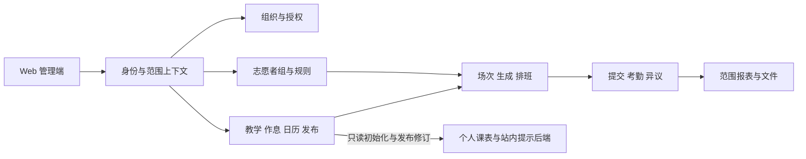

# CourseManagement 全校升级：后端与 Web 开发设计

## 2026-10-14 实施边界

本次已实现固定教师学院、学生负责人当前学籍学院及功能开关、管理员全校统筹、显式平台管理能力，以及后端/Web 的学籍异动和学生数据交接。平台管理员沿用 SUPER_ADMIN，只增加 `administrator_account.manage`，不新增角色或登录入口。普通教师不能办理跨院异动，跨院由管理员办理。

正式学籍以生效区间解析，支持转班/转专业/转院、休学、复学、毕业、退学、未来计划撤销和明确的过去日期纠错。学号、学生 ID 和微信绑定保持稳定；过去纠错保留后续区间，不自动重写历史考勤。离校本人历史访问暂定十个日历年，归档不等于物理删除。

老师通过“学生交接与学籍”导出可回导的 XLSX，上传单文件或平铺 ZIP，预览新增/字段更新/异动/错误/缺失项，确认时重新核验权限、学生版本和行政班归属版本。全量对比的缺失项只提示核查；不会自动删人、归档或恢复学籍。每批只刷新一次受影响的未来正式任务名单。已开始、有提交或已有截止事实的任务保留原快照；无法确定来源或人工人数口径的任务进入待核定队列。

学校初始化名称为“绍兴理工学院”；正式学院为“人工智能学院（低空技术与工程学院）”，软件学院保留为“软件学院（测试）”。原软件学院两个班级及其学生、账号、业务历史全部保留。测试学院目前是独立学院工作区，未实现全校汇总自动排除测试数据；历史学校报表仍保留原内容。

**仍属规划：**学院独立作息/日历及实际时间排班、动态课程类型与志愿者组规则接入抽查/排班、小程序个人课表。已有类型/组配置表不等于上述业务已接入；本轮没有小程序新功能开发。无法可靠核定的存量课程、任务、批次和报表由管理员继续核定，不根据当前学生成员猜测历史归属。

实现、验收和部署边界见 [本次交付记录](../development/ENROLLMENT_IMPLEMENTATION_ACCEPTANCE_20261014.md)。其余章节保留完整设计目标，不能将规划验收项全部视为本次已通过。


版本：2.0 · 日期：2026-10-14 · 状态：开发设计基线，固定范围与学籍交接已实施，作息/组规则及小程序个人课表仍待实施。

需求依据：[全校多学院升级产品需求文档](../product/CAMPUS_MANAGEMENT_PRD.md)。需求编号 PR、验收编号 AC、待确认决策 D 均引用该文档。本文不包含小程序文件、组件、页面编码步骤、构建或端侧测试方案；面向小程序的服务端数据与 API 仍属于后端范围。

v2.0 最新方案：固定角色＋学院归属；教师拥有唯一所属学院全量业务权限，负责人只管本人学院，管理员统筹全校。平台管理仅给现有 SUPER_ADMIN 增加 administrator_account.manage，不新增 PLATFORM_ADMIN 角色，不建设业务隔离层。取消 scoped_role_grant、role_template、跨院支援及转授系统。执行顺序见 [技术代码改造计划](CAMPUS_PERMISSION_IMPLEMENTATION_PLAN.md)。固定范围与学籍交接已按本次实施边界落地，其余内容是后续设计。

## 1. 范围、基线与实施原则

原规划基线为 dev-main / efa62b5、181729fc7239；实施前已同步主干至 5abff3d，在统一迁移 f26a1014m001 后新增 f26a1014e001。五角色保持不变，固定范围与显式平台能力已落地；具体命令证据见交付记录。

后端保持 Python 3.12、FastAPI、Pydantic 2、同步 SQLAlchemy 2、MySQL 8.4、Alembic；Web 保持 Vue 3、TypeScript、Vite、Pinia、Element Plus。新增 Vue 组件采用 Composition API 和 `<script setup lang="ts">`。不为本次改造引入微服务、异步数据库、通用规则脚本或队列。

继承约束：字符串 ID；Router → Service → Repository；关键写入与审计同事务；乐观锁 409；生成与排班两阶段；提交自动入账；异议一次审核，审核与更正能力分开校验；人填说明选填；保留历史和未提交文件。

实施由 GPT 直接完成。该开发文档不是子 agent 任务包，不授权主动委派、部署或生产迁移。产品文档中仍有效的决策项按各自范围处理；D03 已合并组配置，D01 仅确定值勤学生本人考勤登记口径，不作为实现组规则的前置技术模块。

本版精简：早晚自习复用 Course/TeachingClass/CourseSchedule 与统一课次；取消独立自习计划表、API、页面和自动免到模块。冲突配置唯一入口为志愿者组，后台仍统一检查所有相关受派，避免跨组漏检。

本版扩展：课程类型为学院可维护数据，志愿者组支持完整生命周期；组的查课范围和人员冲突规则分别建模。所有抽查入口先限定范围再采样，不能靠固定类型枚举或课程名称判断。

### 1.1 原规划时的代码与改造理由

| 当前入口 | 已核对的限制 | 改造 |
| --- | --- | --- |
| `academic/models.py` 的 AdministrativeClass.college | 字符串学院，无稳定组织关系 | College 与有效学籍 |
| `identity/models.py`、`policy.py`、`inspection/permissions.py` | 全局角色并集，管理范围尚无学院强过滤 | 固定角色/学院范围、负责人任命、平台显式补权 |
| `academic/models.py` 的 PeriodDefinition/CalendarOverride | 学期全局唯一配置 | 版本作息与学院日历 |
| `inspection/scheduling/loader.py`、`constraints.py` | 硬冲突使用节次编号 | 真实时间与分类规则 |
| `inspection/models.py` 的 InspectionType、`course_occurrences.py` | 既有固定查课类型及课次抽样路径 | 动态课程类型、组范围过滤在抽样之前、旧契约兼容 |
| InspectionTask、SubmissionDeadlineDay | 任务缺组织快照、截止按学期日共享 | 学院/场次/组/规则/任务截止 |
| `report/models.py` | 报表唯一键及源修订缺学院 | 范围化报表及修订 |
| `stores/session.ts`、`utils/period.ts` | 学期上下文与固定大节映射 | 工作区上下文及后端时间快照 |
| `academic/router.py` 的 master-timetable | 管理权限接口，不是本人接口 | 个人初始化资料的受限投影 |

## 2. 架构与边界



organization 管学校、学院；identity 管认证、学院绑定、负责人任命和平台补权；academic 管正式课表、学籍、名单、作息与日历；volunteer 管本院组、资格与规则，不建立支援关系；inspection 管课次、排班和受派；attendance/objection 管事实；report/file/audit 贯穿固定范围。

timetable 只保存私人副本与提示。正式业务模块不得依赖其 repository，不读取个人课表来计算排班、考勤、免到或源修订。正式来源可以通知个人模块，个人模块不能回写正式来源。

## 3. 数据模型与迁移目标

所有表名为拟议目标，不表示已存在。主键沿用现有 BIGINT 方案，对外转字符串；新写模型带版本和创建/更新时间。精确 Alembic revision 在实施时接当前 head，不预编不存在的 revision。

### 3.1 学校、学院及简单权限模型

| 对象 | 字段及约束 |
| --- | --- |
| school / college | 稳定代码、名称、status、lock_version，学院归学校；不以文字学院作为授权锚点 |
| teacher_college_binding | user_id 主键、非空 college_id、version；有效教师仅绑定一个学院，管理员创建/调整，缺绑定不返回全校范围 |
| manager_appointment | user_id、student_id、college_id、status、version；任命学院必须等于本人当前有效学籍学院，教师只任命本院 |
| manager_permission_config | appointment_id、permission_id、enabled、version；只配置允许的本院功能，不能赋予学籍变更、管理员/教师账号或跨院权限 |
| UserPermission（沿用） | 管理员账号管理能力作为显式逐人授予；仅 SUPER_ADMIN 可持有，不自动加入默认角色权限 |
| major / student_enrollment | 专业稳定代码、学生按日期的学院/专业/班级/状态/年级，细则见第 14 节 |

不创建通用范围授权、角色模板、权限表达式或支援表。RoleCode 保留五项，平台管理者只是 SUPER_ADMIN 的额外能力标记。新增 PermissionCode 为 administrator_account.manage；RolePermission 默认不授予它，教师/负责人个人开关也不得持有它。角色集合扩展时仍显式审核动作清单，不能由“所有枚举减几项”把新增平台能力自动授给所有管理员。

业务根增加 college_id，子资源由父链或复合外键确认归属。学院标识为空表示资料待核对而不是全校。管理员全校能力由角色明确解析，教师由绑定解析，负责人由当前有效学籍＋当前任命解析；学生/志愿者本人范围另行校验。

班级 code 在学院内唯一；学生学号学校内唯一，转专业不换号；共享课程目录只读，教学班和课表有唯一负责学院。迁移无法证明归属时进入待处理，不自动给教师全校范围。

### 3.2 统一课程、时间与发布

| 对象 | 核心字段与约束 |
| --- | --- |
| course_type | college_id、不可变 code、name、normalized_name、description、display_color、sort_order、ACTIVE/INACTIVE、lock_version；学院内 code/规范化名称分别唯一，停用仍占用名称和 code |
| schedule_profile / schedule_profile_version | 所属学校/学院、版本、状态、生效范围、时区；发布后不可覆盖 |
| time_slot | version_id、稳定 slot_code、名称、起止时刻、day_part、排序 |
| schedule_binding | 教学班/课表与方案绑定；同一对象同日必须解析出唯一方案 |
| college_calendar_override | 学院、学期、日期、STOP/MAKEUP、来源教学日期、version |
| Course / TeachingClass / CourseSchedule（扩展现有） | 共用课程模型；TeachingClass 持有 college_id、semester_id、必填 course_type_id、classification_revision；课表保留名单、周次、星期、时段、地点、可空教师及通用日历模式 |
| course_occurrence | 稳定课表来源 ID、教学实例键、实际日期、轮次、revision、真实时间；所有课程同一展开流程 |
| teaching_class_audience | 教学班与行政班共同课程关系、生效范围；与指定学生选课名单分开 |
| academic_publication / publication_change | 发布范围、revision、内容指纹、变化前后快照、生效日期、发布人 |

方案解析顺序：对象显式绑定 → 学院有效默认 → 学校有效默认；每层有重叠绑定或缺时间立即报错，不任意取第一条。校历与作息分别解析。导入必须指定原始编号的含义，不能继续全局固定大小节转换。

分类唯一事实源是学院拥有的 TeachingClass.course_type_id，Course 仍可为学校共享目录，不在共享 Course 上保存院级分类。CourseSchedule 通过教学班继承类型，课次/任务仅保存来源和快照，不允许独立编辑分类。教学班引用 `(college_id, course_type_id)` 复合外键，对应类型表唯一键 `(college_id, id)`；同一教学班不能混合类型，需要时拆教学班。

普通课/早自习/晚自习仅是幂等初始化数据，可更名停用，不是运行时枚举。code 由服务端创建且不可修改、不复用，显示名称不参与逻辑；学院内名称先去首尾空白并统一规范化，服务端和唯一索引使用一致的大小写规则。配置颜色只接受合法颜色值，不能注入任意样式。初期不增加任意标签、类型继承或跨院分类树。

现有 inspection_type 含 COURSE/MORNING_STUDY/EVENING_STUDY，保留为历史/旧客户端兼容字段，不能充当新的 course_type_id。迁移使用审核过的学院＋旧来源到类型映射，既有自习任务显式补齐课程来源；不得通过名称猜测，也不得将所有旧 COURSE 任务无条件判成普通课。兼容映射只覆盖确有相同语义的类型；自定义类型无旧枚举对应时返回明确的不支持能力错误或限制该客户端入口，不能降级伪装为 COURSE。原课程合并、课程排除/体育识别与导入唯一键同步核对，不取消现有明确的排除约束，也不让其按名称误排除自习。

场次身份不由可编辑时刻生成：同一教学实例调时递增 revision；调日期保留原实例身份及变更关联，新增补课才建立新的明确实例。任务按学院、稳定场次、检查轮次唯一，首期每场一轮，换组不产生重复考勤。

inspection_task 新增 college_id、occurrence_id、group_id、activity_start/end_at、duty_start/end_at、时间/名单/规则快照，以及 course_type_id/name_snapshot、classification_revision、group_name_snapshot、group_config_version_id。截止改为 task_deadline＋deadline_policy_version，保留旧截止与截止考核事实。未知历史时间显示未确认，不用当前作息伪造历史。

### 3.3 志愿者与规则

| 对象 | 核心字段与约束 |
| --- | --- |
| volunteer_group | college_id、name/normalized_name、owner_user_id、有效期、DRAFT/ACTIVE/INACTIVE、active_config_version_id、lock_version；学院内名称唯一，college_id 不可改 |
| group_membership | group_id、student_id、学期、有效期、status、version；允许多组，同组同学期有效区间不得重叠 |
| qualification | 原有学期资格扩展明确学院/本院组归属，不创建跨院支援表 |
| group_config_version | group_id、version、DRAFT/PUBLISHED、发布时间/人、配置摘要；一次发布原子包含查课范围与冲突规则，替代单独 group_policy_version 发布 |
| group_inspection_scope / scope_course_type / scope_class | config_version_id、college_id、class_mode=ALL_COLLEGE/SELECTED；明确类型 ID 集合和可选班级 ID 集合，目标学院内外键校验；每个目标学院一条范围 |
| group_conflict_rule（随配置版本冻结） | 默认本人课程结果、COURSE_TYPE/TEACHING_CLASS 例外、受派冲突、本班回避、日周上限及 GROUP/ALL_GROUPS 计数范围、缓冲；规则类型白名单 |
| volunteer_availability | 正式组织内的不可用声明；独立于个人显示课表 |
| assignment_decision | 受派、执行组、规则版本、判定快照、人工确认依据 |

组只接受本院有效学生，成员可先关联底册，真实提交仍需有效微信绑定及受派；不创建跨院支援关系。

组内课程冲突允许只改变候选可派性，不修改学生正式考勤、名单或分母。D01 用现有登记/更正流程落实，不新增免到表/服务。若以后确需自动值勤免到，单独提出需求及数据迁移。

负责检查类型集合与本人冲突例外集合分开保存：前者筛任务，后者判断志愿者自己的正式课程。单条课程按 TEACHING_CLASS > COURSE_TYPE > DEFAULT 唯一取值；同版本、同规则种类及目标 ID 唯一，重复拒绝发布。每条重叠课程独立判定，任意 BLOCK 阻止，存在 WARN 则需确认。匹配使用本人课程的类型及实际时间，不使用待检查任务类型。外院类型按其实际 ID 匹配，无显式例外则默认，必要忙碌信息不能泄露外院课表明细。

范围计算为：该组所属学院 ∩ 所选类型并集 ∩ 班级范围 ∩ 学期日期 ∩ 本批次缩小条件。ALL_COLLEGE 指当前有效本院班级，SELECTED 必须保存非空具体班级集合；年级仅帮助界面批量选择，不保存会隐式扩张的表达式。类型始终显式列举，空集合表示无范围，不允许发布可执行配置。所有类型/班级必须属于组学院，外院引用拒绝；管理员不能用组配置绕过这一边界。

多班合上的单一教学实例不得拆成多份任务。首期只在其完整负责班级集合落入组范围且名单权限已满足时进入候选；部分命中列为范围不完整，不能以任一班命中扩大组范围。跨院合班仍受 D05 的上线边界约束。

类型维护、组基本信息/启停、组成员、组配置发布分别使用 academic.course_type.manage、volunteer.group.manage、volunteer.member.manage、volunteer.config.publish 能力。负责人字段仅表示职责，不自动授予这些能力；教师全量本院能力，负责人还需启用对应功能，均受学院归属限制。

### 3.4 配置生命周期与未来任务

类型创建即 ACTIVE 或 INACTIVE；组先保存草稿，ACTIVE 要求有效负责人、有效期和已发布的非空范围，成员为空时允许保存但排班返回无候选。所属学院和稳定 ID 不可编辑。类型/组所有写操作携带 lock_version，审计同事务；有课程、范围、规则、成员或历史任务引用时禁止 DELETE，只可停用。禁止级联删除业务记录。

类型名称/颜色/排序、组名称等展示修改只增加实体 lock_version，不修改既有任务快照或范围语义版本。类型启停、教学班重新分类、组范围/规则发布递增相应业务修订；group_config_version 发布后不可覆盖，范围和规则不能分别生效。配置本身不允许运行用户脚本。

影响预览返回受影响教学班、组、未派/已派未来任务数量与授权内明细，并绑定 impact_revision。提交在事务内复核引用及修订；并发新增引用、生成或派发使预览失效。停用不删除正式课表/选课，排班加载本人忙碌仍包含停用类型课程。

未派任务分类或组范围不符时标记 needs_review，阻止新派发，显式刷新任务快照/换组后复核；不因分类变化另建相同课次任务。已派未来任务保持原受派并产生可去重的 config_impact_item，记录资源、旧新修订、任务及 OPEN/RESOLVED 和处置记录。管理员逐项保留原受派、按当前规则改派或取消；保留不豁免当前身份/授权，不产生新的派发许可，撤权退组仍按既有失效流程处置。历史快照不覆盖，未解决提示不自动改变提交/考勤状态，完成的任务不回溯重算。

影响标记、配置变更、审计与修订在同一事务，首期同步处理；超出实测容量再设计可恢复批处理，不能用进程内异步回调遗漏影响任务。恢复类型/组需重新验证当前授权和范围，不自动重放撤回受派。

### 3.5 私人课表与提示后端

| 对象 | 核心字段与约束 |
| --- | --- |
| personal_timetable | student_id、semester_id、初始化时间、来源修订、个人日期/作息基准快照、version；学生＋学期唯一 |
| personal_timetable_entry | 个人课程内容、实际时刻、重复规则、可选来源标识/版本、version |
| personal_timetable_exception | 原场次稳定标识、单次修改/取消；不以修改后的时刻作标识 |
| timetable_notice | 本人、学期、发布事件、变化摘要、处理状态；事件键唯一防重 |
| timetable_restore_snapshot | 本人课表操作前内容与版本，用于主动批量替换后的恢复 |

初始化复制当时真实时间和日期解释，不只保留动态正式引用。来源删除不能级联删除个人条目。空个人课表不表示未初始化。

只读学校已发布资料并过滤为本人课程，不能用同班选修并集。正式共同课程与本人选课去重；缺少可靠名单时返回完整性状态，不能以假定全班参加补齐。

## 4. 固定角色、学院范围与平台补权

`WorkspaceContext` 含 actor_user_id、role_codes、college_id、authorization_revision；本人请求由绑定解析 student_id。`ResourceScope` 使用显式 SCHOOL/COLLEGE/SELF 类型，不能通过缺 college_id 默认查全部。

角色能力与范围必须同时满足：SUPER_ADMIN 具有全校业务范围；TEACHER_ADMIN 有所属学院全部业务动作但无管理员账号管理；STUDENT_AFFAIRS_MANAGER 只在当前学籍与有效任命一致的学院执行已启用功能。负责人传外院路径/ID、误配外院任命或转院后的旧任命均拒绝。转院不自动取得新院负责人能力，原任命结束后需新院重新任命。

所有 Service 的入口和 Repository 列表/total/详情/文件/导出/导入/批量都传同一 ResourceScope。旧路由不能因没有学院参数而查全校；从实际资源反解 college_id 再检查，不能只信任请求路径。批量混入范围外对象整批拒绝；本人接口不能从管理员角色派生代提交或私人课表读取。

平台补权的唯一判定为有效 SUPER_ADMIN 身份 AND 显式 administrator_account.manage。它不扩大业务范围，平台账号继续沿用 SUPER_ADMIN 的业务行为。`list_effective_permissions` 读取该显式 UserPermission 时还校验管理员角色；普通可选权限接口不能授予该 code。角色变更触及 SUPER_ADMIN、重置管理员密码、启停管理员和修改平台能力，都需同一守卫。

普通管理员不能通过 role.assign、account.manage 或自己的功能开关取得平台能力。修改目标管理员用 lock_version，操作者权限在锁内重读；沿用稳定 SUPER_ADMIN 角色行锁保护最后有效管理员，并检查至少仍有一个有效 SUPER_ADMIN 持平台能力。首次能力由明确的运维初始化赋给指定现有管理员，普通 seed 不自动将全部管理员升级。

Teacher/负责人范围变化使 authorization_revision 变化；后续请求及提交事务复核。保留现有会话回查、内存 access token、HttpOnly refresh 和串行 401 刷新，不另建平台登录或第二种令牌。

## 5. 时间、排班与事务

正式时间使用带时区 ISO 契约，服务端统一为 UTC 比较，数据库沿用项目 UTC 存储约定。冲突比较 `[start_at, end_at)`；day_part 使用配置，移除固定节次 1—2 为上午等逻辑。默认采用完整活动占用，细分查课窗口需明确配置。

纯判定函数接收 TaskSnapshot、CandidateSnapshot、GroupPolicySnapshot，返回含 code、effect、rule_version、脱敏冲突引用的结果。BLOCK 阻止，WARN 需要绑定具体版本的人工确认，ALLOW 按该组规则允许。早晚自习与普通课使用同一判定，不增加 EXEMPT 状态或特殊年级/时间分支。未知规则拒绝发布。

自动排班、手动改派、换班、任务编辑共用判定源。无合法候选给出原因计数；外院既有安排只返回必要忙碌结论。

### 5.1 先过滤后随机的唯一入口

场次候选加载顺序：校验执行组、所属学院和当前固定角色范围 → 读取已发布组范围 → 按类型/班级/学期粗筛课表 → 展开或取得稳定课次 → 校验完整班级范围、实际日期及有效性 → 应用批次缩小条件及现有课程排除规则 → 排除该轮已生成任务 → 对合法集合抽样。SQL 可提前粗筛，但精确过滤必须在随机选择前完成；不能先从全院抽样再丢弃不匹配项。生成已有任务的重新排班走任务接口，不从抽样接口补造。

支持手选及既有抽查配额模式，首期不扩展通用权重引擎。每班 N 次在每个所选班级的过滤后候选集合内计数，多班共享课次同时满足相关班级计数且任务仍唯一；无法满足完整配额则返回 INSUFFICIENT_ELIGIBLE_OCCURRENCES 和逐班缺额，不隐式少抽、不跨类型补齐。用户可明确调整数量后重新预览。

预览返回 execution_group_id、group_config_version_id、规范化筛选、候选/排除计数、selected_occurrence_ids、每班配额结果及 selection_revision；需要随机时记录算法版本和 seed 供解释，但提交以服务端持有或可验证的具体选择集合为准。不能只信任客户端 seed 或自报候选 ID。提交不重新抽样，重试相同幂等键返回原批次结果；同键不同请求指纹拒绝。

`selection_revision` 绑定学院、组配置、角色和学院范围、课程类型状态与教学班分类、候选集合源修订、场次、课表/名单、日历和作息。源新增/改类也会改变候选集合，须使旧预览失效。排班预览另绑定成员、资格、组织不可用、既有受派修订。个人课表 revision 永远不进入这两种修订。

直接生成、导入任务、手选、自动派发、手动改派和换组均调用同一 scope 校验；前端筛选不能替代服务端检查。换组针对同一任务原子撤旧受派并建立新受派，重新预览新组配置且留审计；唯一键仍为学院＋稳定课次＋检查轮次，不含组或类型，防止多组并发重复生成。

### 5.2 提交与并发

并发锁沿用全校共享的 volunteer_day_lock，新增同人 ISO 年/周锁保护跨日期周上限；按组配置的本组/全部组计数范围核验，有组配额时增加其稳定锚点。规则在组内配置不代表只查询本组数据：时间冲突始终检查全部相关受派。固定顺序获取授权、学院教学修订、类型/组配置、人员周期与任务锁，同类按稳定 ID 排序；事务内重读类型状态、分类、组范围、成员、资格、规则、受派和配额，过期返回 409。导入/改分类、停用类型/组/成员、发布规则和生成遵循同一锚点及顺序，保护无已有引用时的并发新增。

生成事务先落课次任务；排班事务再落受派与必要的人工确认。排班失败不回滚已成功生成。排班放行不写考勤；实际提交/更正、异议、审计及正式报表源修订在对应事务内一致。

## 6. 服务端 API 契约草案

下列全为目标接口，实施时保持现有响应 envelope/错误码规范并更新 OpenAPI；不代表已挂载。所有 ID 为字符串，日期为 YYYY-MM-DD，带时区时间为 ISO 8601。写入携带 `lock_version` 或资源 `version`；旧版本返回 409。

| 路径族（前缀 /api/v1） | 方法及用途 | 范围/并发 |
| --- | --- | --- |
| /me/workspaces；/colleges/{cid}/capabilities | GET 可进入学院、当前能力 | 不以扁平 /me 权限并集判管理动作 |
| /schools/{sid}/colleges；/colleges/{cid} | POST/GET；GET/PATCH | 校级学院管理/当前学院读取 |
| /administrator-accounts；/{uid} | GET/POST；PATCH；POST password-reset | SUPER_ADMIN＋administrator_account.manage，目标只能是管理员，版本和最后存续保护 |
| /teacher-accounts；/{uid}/college | GET/POST/PATCH；PATCH 学院绑定 | 管理员管理教师，创建必填唯一学院，调院影响预览 |
| /colleges/{cid}/managers；/{uid}/permissions | 本院任命/撤销及功能配置 | 教师本院或管理员，目标学籍一致，功能白名单 |
| /colleges/{cid}/course-types；/course-types/{tid} | GET/POST；GET/PATCH/DELETE | 类型管理，名称唯一，状态变更带影响预览；仅无引用可删除 |
| /colleges/{cid}/configuration-impacts/preview；/configuration-impacts/{iid}/resolve | POST 预览变更；POST 明确保留/改派/取消 | 资源动作权限、impact_revision、任务 lock_version，保留不得绕过失效身份 |
| /colleges/{cid}/time-profiles；/time-profile-versions/{vid}/publish | CRUD 草稿；POST 发布 | 作息管理＋影响预览修订 |
| /colleges/{cid}/teaching-classes/{tcid}/classification | PATCH 分类变更 | 类型归属、教学班版本与影响修订，历史快照保留 |
| /colleges/{cid}/calendar-overrides、/course-schedules | CRUD＋发布，普通课/早晚自习共用 | 日期、名单、课程及方案范围校验 |
| /colleges/{cid}/volunteer-groups；/groups/{gid} | GET/POST；GET/PATCH/DELETE | 组新建/更名/状态变更，所属学院不变，有引用禁删 |
| /colleges/{cid}/groups/{gid}/members | GET/POST/PATCH/DELETE 成员维护 | 入退组有效期、资格与未来受派影响；删除含义为结束成员关系，保留历史 |
| /colleges/{cid}/groups/{gid}/config-versions；/config-versions/{vid}/publish | GET/POST 草稿版本；POST 原子发布范围和规则 | 本院配置能力、active_config_version、impact_revision、本院类型/班级校验 |
| /colleges/{cid}/occurrences；/inspection-selections/preview；/inspection/generate | GET 范围内列表；POST 手选/随机预览；POST 生成 | 必填 execution_group_id、selection_revision、服务端选中集合、幂等键 |
| /colleges/{cid}/assignment-plans/preview；/commit | POST 预览/提交 | 明确 task_ids、组、版本、人工确认 |
| /colleges/{cid}/academic-publications/preview；/publish | POST 正式发布 | 学院、学期、来源数据版本、内容指纹 |
| /colleges/{cid}/reports；/schools/{sid}/reports | GET/POST 授权报表 | 汇总与明细能力分开，持有源修订 |
| /me/timetable；/initialize | GET；POST 幂等初始化 | 服务端绑定 student_id，已有记录不覆盖 |
| /me/timetable/entries；/entries/{eid} | POST；PATCH/DELETE | 本人所有权＋version，无正式业务副作用 |
| /me/timetable/entries/{eid}/exceptions | POST/PATCH/DELETE 单次修改 | 原场次身份、本人版本 |
| /me/timetable/notices；/notices/{nid}/read、/ignore | GET；POST | 只变消息状态，不变课表 |
| /me/timetable/update-preview；/apply-update | POST 比较/主动采用 | 本人版本＋来源版本＋选择指纹 |
| /me/timetable/restore-preview；/restore | POST 整表恢复预览/提交 | 影响确认、操作前快照、过期拒绝 |

典型排班提交请求体：`{task_ids, execution_group_id, preview_revision, confirmations, idempotency_key}`；confirmations 记录已授权人确认的候选/具体警告，不能由任意客户端把 WARN 改为 ALLOW。结果含成功受派和未分配原因，不能隐含修改请求范围外任务。

组配置示例（所有 ID 均为示意字符串）：

```json
{
  "expected_active_version": 2,
  "inspection_scopes": [{
    "college_id": "100",
    "course_type_ids": ["301"],
    "class_mode": "SELECTED",
    "class_ids": ["501", "502"]
  }],
  "own_course_conflict": {
    "default_effect": "BLOCK",
    "type_overrides": [{"course_type_id": "301", "effect": "ALLOW"}],
    "teaching_class_overrides": []
  }
}
```

类型 301 可命名为早自习，但逻辑不比较名称。范围内多个类型为 OR，不同维度为 AND；class_mode=ALL_COLLEGE 时 class_ids 必须为空，SELECTED 时必须非空，防止含糊输入。冲突例外引用的类型/教学班必须属于当前编辑者获准配置的学院范围；不能凭传入外院 ID 创建例外。示例省略的其他必需规则在正式 Schema 中显式给值或使用已记录默认，不能把部分 PATCH 当完整发布覆盖其他配置。

类型/组列表支持分页、状态过滤与引用数量，返回服务端可执行动作；启停不是 DELETE。新增类型不会改写任何现有 scope_course_type。错误至少区分 TYPE_INACTIVE、GROUP_INACTIVE、OUTSIDE_GROUP_SCOPE、CONFIG_IN_USE、INSUFFICIENT_ELIGIBLE_OCCURRENCES 和预览过期，沿用 envelope 并配中文可操作提示；不可见资源仍按范围策略隐藏。

个人更新预览返回变更字段、个人新增条目保留情况、来源撤回状态以及 source_revision/personal_version；apply 只接受预览允许的条目集合，源已变、本人已改或范围不一致一律 409。读消息不隐式 apply。

正式发布采用同事务保存 publication 与 change 明细。个人消息在本人请求时按未处理的已发布修订幂等物化，可分页补齐长时间未登录后的变更；不依赖进程内易丢的事件或微信推送。相同内容不重复发布，关注范围不只靠当前个人条目，以免漏报官方新增课程；保留有效班级/选课来源关联，历史消息按本人归属验证。

### 6.1 个人课表后端状态

初始化：UNINITIALIZED → INITIALIZED；清空 entries 仍是 INITIALIZED。通知阅读状态与采用状态分开保存，忽略不代表采用。采用只更新 personal 模块表，不发正式业务源修订事件。

学生换绑后按当前绑定核验每次读取；重新绑定同一合法身份可以读取原内容，绑定另一学生不得搬移私人数据。管理账号默认无私人课表读取权限；诊断只记录脱敏操作信息。

## 7. 报表、文件与导入

报表唯一键包含具体范围实体、学期、周次及规范化类型/课程/组筛选范围键，并保存原筛选快照；不能只用 scope='COLLEGE' 或显示名称。历史按任务 type/group ID 及名称快照聚合，当前课表查询才使用当前分类；学院间同名类型不自动合并。正式源修订按学院分区，校级版本记录来源学院修订向量，任何相关源变化使相应汇总过期。展示更名不改写历史版本；未派任务经明确刷新分类时增加相关源修订。私人课表不参与修订。

文件上传时记录业务上下文，绑定时重查父资源归属；签名下载在签发前检查范围。撤权后旧签名有效期问题必须按现有签名机制记录短期剩余窗口，并评估敏感文件是否增加下载时会话核验；不能宣称单靠签发时检查可瞬间撤销已发链接。

导入预览绑定学院、学期、作息、映射版本及文件摘要。提交重新核验版本；默认原子导入。若产品明确需要部分成功，采用行/组级 savepoint 与清晰结果，不捕获异常后提交残留事务。跨院行与歧义名单进入错误清单。

导入映射增加 course_type_id：整批指定或文件分类列逐值映射，校验所属学院及 ACTIVE 状态；未知分类、同一教学班多类型均报行级错误，不默认普通课、不自动按字符串创建类型。预览绑定类型业务修订及教学班 classification_revision，提交前重新验证。类型与组导出保留稳定 ID 和学院来源，导入另一学院必须重新映射，不能按同名静默接线。

## 8. Web 页面与状态设计

### 8.1 页面及组件

| 页面/组件 | 职责 |
| --- | --- |
| UsersView.vue | 沿用账号页；持额外能力时显示“管理员账号”页签，普通管理员管理教师，教师管理本院负责人；不新增平台门户 |
| AdministratorAccountEditor.vue | 管理员账号创建/启停/改密、平台能力开关；props 是目标/版本，可编辑字段固定，emit save；不编辑角色数组 |
| TeacherCollegeEditor.vue | 管理员创建教师时必选学院，编辑调院展示交接；教师本人不能改所属学院 |
| ManagerPermissionEditor.vue | 显示本人学院且只读，配置本院功能；不能填写外院、管理员能力或学籍变更 |
| CollegesView.vue / MajorsView.vue / StudentsView.vue | 管理员全校组织，教师本院专业/学生，按日期档案、名单差异与异动 |
| TimeProfilesView.vue / ScheduleView.vue / CourseTypesView.vue | 作息、统一课程、动态类型和发布影响 |
| VolunteerGroupsView.vue / TaskListView.vue / TaskDrawer.vue | 本院组范围/规则、范围内抽查、生成派发和影响处理 |
| ObjectionsView.vue / ReportsView.vue | 本院一次审核、历史与统计；管理员可统筹 |

### 8.2 状态与权限反馈

`stores/session.ts` 保持登录和身份；`stores/workspace.ts` 保存可进入学院、学期及当前 capabilities。平台标记由 SUPER_ADMIN＋额外权限派生，不添加新角色枚举。教师及负责人只有一个合法学院工作区，管理员可切学院，普通账号无跨院入口。

`composables/useWorkspaceRequest.ts` 保存请求发起时 context_revision，旧学院/旧账号响应丢弃；缓存采用 user＋college＋semester 命名空间，未保存编辑切换先提示。403/404/409 分别反馈权限、不可见和版本变化，不自动重试写入。

`api/accounts.ts` 增加管理员账号方法及教师 college_id；`api/managerPermissions.ts` 本院负责人功能；`api/workspaces.ts` 学院/capabilities。页面仅组合服务端结果，组件不实现第二套授权算法。删除默认硬编码口令回退，创建/重置明确提供符合规则的新口令；不返回目标登录令牌。新增组件使用 Composition API、TypeScript、props/emits。

## 9. 文件改造清单

下列新增路径均为设计目标；现有路径按仓库根展开。

| 领域 | 新增 | 调整 |
| --- | --- | --- |
| 组织 | `backend/app/modules/organization/{models,schemas,router,service,repository}.py` | `backend/app/{models,main}.py` |
| 固定范围与平台补权 | `backend/app/modules/identity/authorization.py` | identity 的 models/schemas/service/repository/deps/policy/seed、core/permissions、所有模块 permissions，账号服务的管理员保护 |
| 统一课程与时间 | `academic/course_type_service.py`、`time_service.py`、`publication_service.py`；按需提取统一课次服务 | academic 模型/契约/仓储、importer、common/parsing/time_slots.py/dto.py/grid.py、inspection/course_occurrences.py；不另建自习活动服务 |
| 组织规则 | `backend/app/modules/volunteer/{models,schemas,router,service,repository,policy}.py` | 原资格路径、inspection/scheduling 下 models/loader/constraints/validation/planner |
| 组范围与配置影响 | `inspection/scope.py`、`inspection/config_impact_service.py` | 所有课次候选/随机/直接生成/导入/改派入口；academic/volunteer 配置变更调用统一影响处置 |
| 私人后端 | `backend/app/modules/timetable/{models,schemas,router,service,repository}.py` | 身份本人守卫、正式发布只读接口、ORM/路由注册；不改排班加载器读取私人表 |
| Web | 上节页面、组件、workspace store/composable、api/organization.ts/timeProfiles.ts/courseTypes.ts/volunteerGroups.ts/workspaces.ts/managerPermissions.ts | `apps/admin-web/src/api/{http,auth,academic,tasks}.ts`、router/index.ts、AppShell.vue、period.ts 及相关页面 |
| 迁移与资料 | `backend/migrations/versions/` 新增增量版本及定向测试 | PERMISSIONS、API_CONTRACT、API_INDEX、SCHEDULING_RULES、OpenAPI、发布与恢复说明 |

academic、identity、inspection 的现有大 Service 只按本次职责提取，不同时进行无关重构。所有现有新旧入口都有范围核验清单，不能只保护新 Router 留下旧 URL 旁路。

## 10. 实施阶段与退出条件

| 阶段 | 可交付结果 | 退出条件 |
| --- | --- | --- |
| S0 | 匿名数据盘点、待确认决策表、全接口范围清单、当前缺陷复现 | 学院/课表/名单映射和关键风险可说明；不把历史审查当已修 |
| S1 | 学院绑定/学籍、固定角色范围、账号页、负责人功能与平台补权 | 教师/负责人仅本院，平台能力非默认，角色/重置旧入口不可绕过 |
| S2 | 课表到文件/报表/导入全链路隔离 | AC01—03/10/11/18 后端与 Web 通过；此前不开放第二学院真实数据 |
| S3 | 版本作息、日历、动态课程类型及归类、统一课次、任务快照与截止、对应 Web | AC04—06，AC19/22/23/26 的类型部分；导入明确映射，历史不改写 |
| S4 | 本院组 CRUD、范围先筛再抽、类型/具体课程例外、配置影响及并发配额 | AC07—09/19—26 全链路；原 C06 场景由通用配置覆盖，不新增自动免到 |
| S5 | 个人课表后端、发布修订和站内提示 API | AC12—17 的后端契约通过；不宣称小程序产品端已交付 |
| S6 | 两学院试点、数据迁移演练、Web 验收和发布材料 | 迁移与恢复可验证，待确认/未开发/未验证项明确列出 |

S5 依赖身份范围和已发布来源，可与 S3/S4 分阶段安排；不是必须等全部排班改造结束。试点至少包含不同作息、本院同人多组、管理员办理转院和大一早自习组内例外。D01 只需在实际使用前明确本人考勤登记口径，不以自动免到子系统阻塞组规则交付。

既有代码审查中身份复用、最后超管解绑、候选越权和取消改写事实等问题须在其相关阶段复现并修复；不会因新表建成自动消失。

## 11. 测试与验收设计

### 11.1 后端

拟新增测试文件及行为：

| 文件（backend/tests 下） | 核心用例 |
| --- | --- |
| unit/test_scoped_authorization.py | 管理员全校、教师唯一学院、负责人当前学院、缺归属拒绝、平台能力显式授予 |
| integration/test_workspace_isolation.py | 列表/total/详情/混合批量/旧路由隔离及撤权 |
| integration/test_scoped_file_export.py | 导出和附件归属，签名有效期边界 |
| unit/test_time_profile_resolution.py | 同节不同时间、绑定歧义、版本生效、调休、缺时刻 |
| unit/test_unified_course_occurrences.py | 普通课/自习同模型、稳定身份、变更日期、重复生成、同名课程不误合并 |
| integration/test_course_type_lifecycle.py | 自定义类型无需枚举改动、院内规范化重名/外院引用拒绝、更名、引用禁删、停用不消除本人忙碌、改分类历史不变 |
| integration/test_volunteer_group_lifecycle.py | 草稿/启用/停用/恢复、学院不可变、多组成员、权限拆分、配置原子发布、影响项处置 |
| unit/test_group_inspection_scope.py | 类型 OR/维度 AND、空集合不放大、指定班级新增不纳入、同名跨院隔离、多班课次完整覆盖 |
| unit/test_scoped_occurrence_sampling.py | 混合课表先筛后抽、逐班缺额不补其他类型、已有任务去重、共享课次配额、手选不能绕过范围 |
| integration/test_inspection_selection_commit.py | 服务端选择集合防篡改、提交不重抽、幂等重试、类型/组/候选变化 409、多组并发生成唯一 |
| unit/test_group_conflict_policy.py | 具体教学班 > 本人课程类型 > 默认；早自习例外不放开另一课程/受派、多个重叠任一 BLOCK 拒绝、跨院同名不串用、私人课表不参与 |
| integration/test_configuration_change_races.py | 停用/改分类与生成/改派竞争、停用与并发新增引用、旧预览拒绝、已有受派影响项和历史快照 |
| integration/test_cross_group_assignment_concurrency.py | 转院前后历史受派日期冲突、跨日周限、规则发布/停用竞争 |
| integration/test_assignment_attendance_boundary.py | 组规则放行只写受派，不自动修改本人考勤或统计分母 |
| integration/test_personal_timetable.py | 幂等初始化、删空、并发保存、身份隔离、日期快照 |
| integration/test_timetable_notices.py | 发布去重、来源增删改只提示、已读不采用、主动采用版本冲突 |

私人无副作用测试应在编辑前后比较正式候选/冲突结果、任务、考勤和报表修订，而不只是断言未调用某函数。MySQL 并发与复合外键必须使用隔离测试库验证，SQLite 单测不替代。

### 11.2 Web

当前 package.json 只有类型检查与构建脚本，没有已配置的组件测试命令。实施时为工作区竞态、授权编辑和人工确认流程建立 Vitest/Vue Test Utils 测试配置并锁定依赖；端到端用例覆盖学院切换、失权、409 和发布影响预览。不要在未配置前声称 `npm test` 可用。

拟测试文件：`src/stores/workspace.test.ts`（身份/学院缓存隔离）、`src/composables/useWorkspaceRequest.test.ts`（旧响应丢弃）、`src/components/inspection/AssignmentPreview.test.ts`（版本变更撤销确认）、`tests/e2e/workspace-isolation.spec.ts`（真实授权接口与页面链路）。后端验权测试与按钮显示测试分别完成。

新增 `src/components/volunteer/InspectionScopeEditor.test.ts` 验证空范围、停用引用和跨院选项；`tests/e2e/course-types-groups.spec.ts` 覆盖新建自定义类型→录课→新建组→配置范围/冲突→随机预览→生成→派发，以及改名/停用/改分类的影响清单。定向端到端验证 A 组早自习范围内绝不抽到普通课、旧预览不会静默重抽。

### 11.3 实施时使用的现有命令

```powershell
# backend/：只在配置核对后运行；集成测试另用明确的隔离 *_test 库
.\.venv\Scripts\python.exe -m pytest tests/unit -q -p no:cacheprovider
.\.venv\Scripts\python.exe -m ruff check app tests --no-cache
.\.venv\Scripts\python.exe -m mypy app
.\.venv\Scripts\python.exe -m alembic heads

# apps/admin-web/
npm.cmd run build
```

定向失败用例先行，修复后再跑受影响链路。构建不等于交互验收；新测试脚本在配置提交后写入对应 README。本轮没有执行这些业务验收，不报告历史测试数为当前通过。

## 12. 数据迁移、上线与兼容

采用扩展 → 回填 → 验证 → 强制约束 → 收缩旧字段。先加可空归属/新表，映射原学院文本及真实名单；未知、混合和重号进入人工核对清单。正式启用隔离前清除“缺范围可查全校”的兼容路径，不能给所有教师默认全校授权。

旧作息按可靠数据建立初始版本；缺时刻的历史保持未确认，未来排班要求完整。任务、提交、名单、考勤、异议、文件、报表按关联追溯归属。存量资格分配到有依据的学院历史组，不复制虚构历史。

各学院幂等建立初始类型，按可靠教务字段、旧任务语义和审核映射归类教学班；无法证明的进入待分类清单，不统一填普通课。类型 code 只用于稳定配置，不作为 Python/TypeScript 分支枚举。回填确认后才对未来可执行教学班强制非空；历史任务无法可靠回填时保留 unknown 完整性标记与旧字段，不伪造类型快照。组范围从审核后的原负责课程/班级转成明确类型及班级集合，不能默认“全学院全部类型”；既有精确课程授权仍作为授权上限交集，不能被转换扩张。

若一个旧教学班实际混用多个类型，拆教学班及课表来源时维护原来源映射、名单和课次身份，不重复生成任务。所有类型/组引用使用外键 RESTRICT；发布前验证孤儿、停用引用、规范化名称重复和无可执行范围组。兼容代码退出需以调用端能力核验为依据，不能只因新 Web 构建成功就删除旧枚举。

关键索引按学院/学期/日期任务查询、user/college 授权、group/member 资格和正式报告范围设计，用匿名真实规模下的 EXPLAIN 验证。迁移前核对复合键重复、外键孤儿、行数及各学院事实对账；在隔离 MySQL 演练后再申请对应环境的迁移授权。

旧调用端仍有固定时间/角色假设。后端和 Web 上线不能证明小程序已适配：保留可用的旧契约字段，在服务器验证身份/范围；不向旧客户端静默返回它会错误解释的新能力。发布清单逐项标明哪些业务仍等待小程序端交付，必要时按学院/能力限制启用，而不是放松服务端保护。

写入多学院和新时间事实后，不可回滚到忽略这些范围的旧应用。故障时停新写，回到支持新范围的兼容版本或前向修复；需要备份恢复时明确数据窗口及文件/审计一致性。记录发布 SHA、额外差异、迁移、权限映射、回滚路径和未提交状态。

## 13. 需求覆盖与完成定义

| 产品需求 | 后端责任 | Web 责任 | 验收 |
| --- | --- | --- | --- |
| PR-01—03 | 学院、固定角色隔离与平台补权 | 工作区、账号与负责人功能 | AC01—03 |
| PR-04—05 | 时间、日历、动态类型、统一课次、范围抽查/生成 | 类型维护、课表分类、预览与生成 | AC04—06/19—24/26 |
| PR-06—08 | 组 CRUD、范围和规则版本、冲突优先级、并发、排班/考勤边界 | 组织四区、解释、生命周期处置，无独立自习/免到页面 | AC07—09/19—26 |
| PR-09—10 | 事实快照、分类报告、明确类型映射和导入发布 | 审核、统计、映射及发布 | AC10/18/22/23/26 |
| PR-11—13 | 私人副本、更新提示、主动采用 | 仅正式资料发布，不操作私人内容 | AC12—17 的服务端部分 |
| PR-14 | 本人/受派接口与兼容策略 | 无小程序端实现责任 | 产品文档定义端侧行为，当前不能验收端侧完成 |
| 全部 Web 范围 | 版本与范围反馈 | 切换/竞态/表单隔离 | AC11 |
| W01—06、FD01—14 | 资料准备、名单历史、生成/派发边界、提交/异议/附件、统计及配置状态 | 操作前置、明确范围、影响处置和可恢复错误反馈 | AC27—35/38/39；落实到相关 S1—S4/S6 定向验收 |
| MP01—06 | 私人初始化完整性、单次修改、恢复快照、主动采用及本人任务契约 | 不提供私人后台；正式发布仍是 Web 职责 | AC36/37 及既有 AC12—17 的服务端部分；端侧仍待独立开发 |
| PR-15 | 生效学籍/课程参与、身份号关联、导入比较、归档、影响交接、历史范围 | 学生档案、异动向导、名单对账、专业管理、用途明确的导出 | AC40—49，详见第 14 节；不把新增字段视为流程交付 |
| 固定角色及平台补权 | 五角色不变、额外管理员账号能力、唯一教师学院、负责人当前学院、旧接口保护 | 原账号页扩展，教师学院绑定及负责人本院功能；不新增平台门户 | AC50—54，具体文件和定向测试见实施计划 |

开发完成需对应后端和 Web 验收证据、迁移演练、契约与发布记录齐全。小程序产品需求完整不等于小程序开发完成。待确认项以产品文档当前决策表为准（D03 已合并组配置），后续确认同步两份文档及受影响验收。

## 14. 学籍异动、导入对账与归档的补充设计

### 14.1 身份与日期事实

| 模型 | 必需字段/约束 | 责任 |
| --- | --- | --- |
| major | college_id、code、name、status、lock_version；学院内代码唯一 | 更名不改 ID；跨院迁移、真正拆并建立目标对象，不改历史归属 |
| student（扩展） | 稳定 id、当前身份资料、identity_revision、enrollment_revision、档案可见标记 | 原 administrative_class_id 仅当前投影，不用于历史/未来日期判断；不保存会覆盖历史的唯一学籍事实 |
| student.student_no（现有字段沿用） | 学校内唯一、转专业时不变；经核验的录错更正留独立审计 | 不为正常转专业新增 student_identifier 表或旧新号转换流程，异常号不得另建同一人 |
| student_enrollment | student_id、college_id、major_id、class_id、admission_year、study_grade、enrollment_status、valid_from/valid_to、event_id | 日级半开区间，同日期最多一份主学籍；在籍/休学/毕业/退学/校外转出等学籍状态不等于账号 DISABLED |
| enrollment_change | 学生、类型、原/目标归属、effective_date、登记时间/人、源批次、DRAFT/SCHEDULED/APPLIED/CANCELED、version、可选说明 | 单次或批次办理、未来生效、显式撤销/更正和可查交接，不引入多级审批 |
| teaching_class_participation | student_id、teaching_class_id、valid_from/to、来源、status、version | 明确共同课/正式选课/补修关系；不因改当前班清空全部旧课 |
| lifecycle_impact_item | change_id、任务/资格/授权/异议对象、影响前后修订、OPEN/RESOLVED、处置人/时间 | 有负责者的影响清单，可复用配置影响记录协议，不重复造通用待办服务 |
| student_import/export_batch（扩展导入批次或独立导出记录） | 用途、范围、source_as_of、effective_date、模板、来源/文件摘要、基线修订、结果/差异摘要 | 区分增量/完整名单对比/异动，提供回导及交接依据 |

主要归属与学院/专业/班关系通过复合引用及 Service 核验同一学校和有效状态；院内混专业教学班不能反推学生专业，正式专业来自学籍。院级专业/班归属不直接修改为另一学院：首期创建目标对象并批量登记学籍变化，旧对象/任务保留。

区间使用学校当地日期 `[valid_from, valid_to)`，valid_to 可空表示未结束。入学年份不由当前班 grade_year 反推覆盖。登记未来变更时写好经核验的区间计划，所有未来课次/排班直接按发生日解析；不能等后台定时改 Student.current_class 后才使正确性生效。当前投影可在请求或可重试作业更新，但不能作为唯一事实源。未过生效日显示 SCHEDULED，已生效显示 APPLIED；状态物化失败不改变日期查询的正确结果。

### 14.2 办理授权、事务和影响

普通学生资料 PATCH 不再直接改学院/班级/学籍状态；归属和状态变化进入 enrollment_service。普通导入禁止在 `_apply_admin_roster` 无条件更新归属或设 ACTIVE。教师可处理本院资料/学籍变更/归档/日期纠错，管理员统筹全校及跨院变更；负责人不能办理学籍变更，不再配置专项动作授权。

跨院命令仅 SUPER_ADMIN 办理，同院命令 TEACHER_ADMIN 必须与原/目标学院相同；新院教师导入不获得旧院写能力，无权项交管理员且不创建第二个学生。平台能力不是办理跨院变更的额外条件，管理员原业务能力即可。

按现有全局锁顺序锁定账号/授权、受影响学院教学修订、学生及相关配置、人员周期和任务；同类按 ID 排序。单个学生锚点串行保护学籍区间及新旧标识，事务内重新检查原学籍、区间重叠、目标、授权、源版本和课程清单。事件、区间、业务修订、影响项及审计同事务；冲突返回 409，不先改班再补其他关系。

异动 preview 返回原/目标、生效日、课程退出/保留/新增、未来任务名单/应到/本人受派、资格/授权、开放异议、缺资料和阻断项，绑定 identity/enrollment/participation/authorization/任务修订及规范化请求。confirm 不扩大集合、不再次猜测课程；重复键返回既有办理结果，同键不同请求拒绝。

生效日前未提交任务按其日期保留旧名单；生效日起未来未执行任务需显式新名单版本并调整对应初始/当前人数，旧版本保留且旧提交页失效。已开始、已有提交或截止事实不自动刷新；历史补录只写核准学籍不等于重写正式考勤，事实纠正另走有权限的既有版本链。名单刷新和相关正式源修订按影响同事务处理，不能只改应到数字。

原组成员/资格和院级管理授权按生效影响复核，新院资格重新核验，旧院未来安排由管理员撤回/改派，不允许跨院支援延续，不复制全部角色和权限。旧任务、考勤、异议、附件归属由原资源及当时学籍快照判断；本人读取通过同一 student_id。新院当前学生范围不自动包含其旧院全部明细；原院历史授权不允许修改新院当前学籍。学院/审核人退出须有接管授权。

未生效取消保留事件并移除其未来区间安排，再检查后续已登记事件；已生效撤销不能直接删除区间，使用反向事件或有权更正并保留中间事实。首期禁止同一学生多个未解决未来异动计划相互覆盖；确需多次排期时先提供可核验顺序再扩展。

### 14.3 导入、导出与归档契约

扩展导入用途为 INCREMENTAL、FULL_SCOPE_COMPARE、ENROLLMENT_CHANGES，分别明确学院/班级范围、来源截至日期、有效日期和完整性声明。比较在业务写入之前得到新增/普通更新/不变/异动/状态变化/缺失/身份冲突/错误行；按源行序号显示前后值。FULL_SCOPE_COMPARE 的缺失不自动产生退学/毕业；教师须明确办理事件。课程名单替换仍是 participation 命令，不能兼办主学籍。

同号不同人、同人多个目标、旧源重导、损坏数字标识或未映射组织均阻断有影响的确认；空字段默认不改，清空必须有显式 clear_fields。一张旧导出表的当前值不是最新基线，确认重查修订。旧预览只重查“学号存在”不够，必须校验归属/状态/授权是否变化。

ZIP 先统一解析、分类经用户确认、校验文件间冲突和依赖，再产出整体差异计划；默认明确批次全成全败。当前 bulk 会逐文件提交，迁移期间 UI 必须如实显示成功/失败粒度；不能 catch 后把已成功修改称作回滚。需要部分成功另立明确子批次/savepoint 及日志，按成功键重试；重导网格课表须按稳定来源行/规则身份 reconcile，而不是每次追加 CourseSchedule。

新增学生当前清单、异动交接、历史归档导出，区别于课表、考勤和绑定码。导出含用途、范围、as_of、生成时间、schema_version、基线及可回导标记；表内稳定组织代码和身份标识以文本写入，普通清单无绑定码。可编辑回导需字段白名单、每行基线/版本及模板校验，导出记录不充当未经校验的写权限凭证。无唯一基线的外部资料先比较，不直接覆盖。

归档以学籍事件、档案可见性和有效课程/资格/授权表达，**不调用 deactivate_student 作为统一毕业/休学处理**。账号禁用/绑定撤销仍是单独身份命令。离校历史保存/本人查询默认暂定 10 年，记录 departure_effective_date、history_until、retention_policy_version；按学校当地日历计算明确到期日，留期限版本以便后续调整，休学不默认等于永久离校。服务端每次检查本人/管理范围，十年不扩大管理授权或异议窗口；附件期限及到期清理待明确，未结事项不擅自清理。毕业不能删引用学生，归档导出不能触发物理删除。

过去日期办理需保留 recorded_at 与 effective_date 两个字段。日期补录/纠错由本院教师或管理员先预览学籍区间及历史影响，跨院仍仅管理员，确认只补正学籍，已提交名单/考勤/截止考核及归档报表不自动重写。确需更正事实仍调用相应授权和版本流程，而不是统一重建旧任务。

### 14.4 API、Web、改造与验收

目标接口仍遵循字符串 ID、版本/预览及现有 envelope：

| 路径族（/api/v1） | 操作与边界 |
| --- | --- |
| /colleges/{cid}/majors | 有范围的专业维护，更名/归档；跨院重组不能直接 PATCH 归属 |
| /colleges/{cid}/students、/students/{sid}/enrollments | 以 as_of 查询当前/历史；根据查询日期判断可见，不默认全校搜索 |
| /enrollment-changes/preview、/confirm；/{id}/cancel | 单人/批次明确旧新范围、日期、课程及影响、幂等；管理员统筹跨院/教师本院判定 |
| /colleges/{cid}/student-imports/preview、/{batch_id}/confirm | 明确用途和范围的差异预览，不隐式转院/复学 |
| /colleges/{cid}/student-exports | 当前清单/交接/归档、筛选/as_of/用途/版本，导出权限独立 |
| /colleges/{cid}/student-archives/preview、/confirm | 明确学籍事件及影响；非删除学生或批量解绑 |

Web 新增/调整 StudentsView（当前/历史档案）、MajorsView、EnrollmentChangeDrawer、StudentImportPreview、StudentExportDialog；支持按日期看归属、旧新值比较、未来生效及影响处理。VolunteersView 不再把学生删除当毕业清理，ScheduleView 不再承诺只导入名单就完整修正转专业。交接记录复用普通范围页面，不新增通用审批后台。

academic 新增 `enrollment_service.py` 与 participation 解析，扩展 models/schemas/repository；importer 先比较后调用同一命令；identity 与 volunteer 复核范围失效，inspection 使用任务发生日学籍和课程，report 使用事实快照。TaskRosterMember 补 enrollment_id、college_id/major_id/class_id_snapshot 及名称快照；本班回避不再从历史名单成员 join 当前班，所有自动/人工路径一致。历史报表按稳定班 ID 分组，不只用班名字符串。

迁移只对当前归属建立有证据的起始区间；未知过去日期不编造。任务快照缺学院/专业/班级 ID 时依据可靠源/人工映射回填，记录 unknown，不能靠今天的班倒推整个学期。学生姓名/学号纠正与已归档快照关联保持，不能为迁移“清空旧名单重新生成任务”。

S1 增加专业与学籍底座及固定学院角色边界；S2 增加按日期范围/历史交接，开放第二学院前验证；S3/S4 补有效课程、名单/排班联动；S6 覆盖老师对账/回导/归档。转专业不换学号；身份异常或未支持重组进待处理，不能静默回落旧字段直接更新。

拟补定向验收：`test_enrollment_effective_dates.py`（未来日期/区间与反向事件）、`test_student_import_diff.py`（增量不转院/激活、完整名单缺行、旧源回导、ZIP 矛盾/原子结果）、`test_transfer_participation.py`（旧课保留/退出及补修、旧任务历史）、`test_student_archive_access.py`（归档非解绑、十年边界/期限修改、本人/旧院/新院范围、未结异议接管）、`test_student_identity_consistency.py`（转专业学号/学生 ID/绑定不变、新号矛盾和损坏号码拒绝）、`test_enrollment_change_concurrency.py`（并发办理/导入/生成/改派）、`student-lifecycle.spec.ts`（本院教师或管理员预览→办理→导出回导→归档真实流程）。这些是后续测试目标，本次未运行；SQLite 局部方法复核不证明 MySQL 事务/HTTP 范围。
