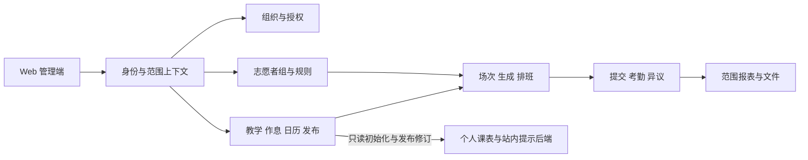

# CourseManagement 全校升级：后端与 Web 开发设计

2026-10-14 教师权限确认：真实教师管理员角色绑定有效主学院后，自动拥有全部本院工作区权限，无逐人本院权限配置。工作区能力和后端资源范围复用这一派生规则，操作时重新核对有效账号、实际角色、最新主学院绑定及学院状态。跨院权限仍按超管显式授权的动作、学院及有效期核验；学校配置、学院任命和授权管理不因教师身份派生。旧章节中教师逐项授权或转授的设计由本条替代，旧业务入口依 P2 逐项接入。

2026-10-14 范围更新：个人课表保存云端并提供本人读取/增删改；正式教务资料明确发布后才作为按学期初始化来源，已有副本（含空课表）不覆盖。通知只展示内容，不实现阅读状态、忽略、主动采用、整表覆盖或微信推送。下文旧复杂通知/采用流程由本条及更新接口表替代。正式发布与管理总课表查询是不同入口，不放宽总课表权限。

版本：1.2 · 日期：2026-10-13 · 状态：开发设计基线，配置底座已部分实施，其余按阶段接入。

实施状态见 [实施计划与进度](CAMPUS_IMPLEMENTATION_PLAN.md)。当前新增学院/配置授权、课程类型、组基本信息与原子配置发布及 Web 入口；没有把新配置接入旧课表/抽查/排班，也未完成全校业务隔离。目标接口和目标模型仍需与已实施清单区分，不能据本文直接宣称全校可上线。

需求依据：[全校多学院升级产品需求文档](../product/CAMPUS_MANAGEMENT_PRD.md)。需求编号 PR、验收编号 AC、待确认决策 D 均引用该文档。本文不包含小程序文件、组件、页面编码步骤、构建或端侧测试方案；面向小程序的服务端数据与 API 仍属于后端范围。

## 1. 范围、基线与实施原则

工作区：`dev-main`，HEAD `b24018441f6e28c287706981e3f342fa2f0d4627`，2026-10-13 核对时存在未提交改动。这里的基线是代码定位，不是线上版本证明。实施前重新核对 HEAD、差异、迁移 head 与依赖锁。

后端保持 Python 3.12、FastAPI、Pydantic 2、同步 SQLAlchemy 2、MySQL 8.4、Alembic；Web 保持 Vue 3、TypeScript、Vite、Pinia、Element Plus。新增 Vue 组件采用 Composition API 和 `<script setup lang="ts">`。不为本次改造引入微服务、异步数据库、通用规则脚本或队列。

继承约束：字符串 ID；Router → Service → Repository；关键写入与审计同事务；乐观锁 409；生成与排班两阶段；提交自动入账；异议初终审分离；人填说明选填；保留历史和未提交文件。

实施由 GPT 直接完成。该开发文档不是子 agent 任务包，不授权主动委派、部署或生产迁移。产品文档中仍有效的决策项按各自范围处理；D03 已合并组配置，D01 仅确定值勤学生本人考勤登记口径，不作为实现组规则的前置技术模块。

本版精简：早晚自习复用 Course/TeachingClass/CourseSchedule 与统一课次；取消独立自习计划表、API、页面和自动免到模块。冲突配置唯一入口为志愿者组，后台仍统一检查所有相关受派，避免跨组漏检。

本版扩展：课程类型为学院可维护数据，志愿者组支持完整生命周期；组的查课范围和人员冲突规则分别建模。所有抽查入口先限定范围再采样，不能靠固定类型枚举或课程名称判断。

### 1.1 当前代码与改造理由

| 当前入口 | 已核对的限制 | 改造 |
| --- | --- | --- |
| `academic/models.py` 的 AdministrativeClass.college | 字符串学院，无稳定组织关系 | College 与有效学籍 |
| `identity/models.py`、`policy.py`、`inspection/permissions.py` | 全局角色并集，管理范围尚无学院强过滤 | 完整授权子句与工作区上下文 |
| `academic/models.py` 的 PeriodDefinition/CalendarOverride | 学期全局唯一配置 | 版本作息与学院日历 |
| `inspection/scheduling/loader.py`、`constraints.py` | 硬冲突使用节次编号 | 真实时间与分类规则 |
| `inspection/models.py` 的 InspectionType、`course_occurrences.py` | 既有固定查课类型及课次抽样路径 | 动态课程类型、组范围过滤在抽样之前、旧契约兼容 |
| InspectionTask、SubmissionDeadlineDay | 任务缺组织快照、截止按学期日共享 | 学院/场次/组/规则/任务截止 |
| `report/models.py` | 报表唯一键及源修订缺学院 | 范围化报表及修订 |
| `stores/session.ts`、`utils/period.ts` | 学期上下文与固定大节映射 | 工作区上下文及后端时间快照 |
| `academic/router.py` 的 master-timetable | 管理权限接口，不是本人接口 | 个人初始化资料的受限投影 |

## 2. 架构与边界



organization 管学校、学院、成员；identity 管认证和范围授权；academic 管统一正式课表、名单、作息与日历，早晚自习也从课表产生；volunteer 管组、资格、支援与规则；inspection 管课次、排班和受派；attendance/objection 管事实与变更；report/file/audit 贯穿资源范围。

timetable 只保存私人副本与提示。正式业务模块不得依赖其 repository，不读取个人课表来计算排班、考勤、免到或源修订。正式来源可以通知个人模块，个人模块不能回写正式来源。

## 3. 数据模型与迁移目标

所有表名为拟议目标，不表示已存在。主键沿用现有 BIGINT 方案，对外转字符串；新写模型带版本和创建/更新时间。精确 Alembic revision 在实施时接当前 head，不预编不存在的 revision。

### 3.1 学校、学院及身份范围

| 对象 | 核心字段与约束 |
| --- | --- |
| school / college | school_id、code、name、status、lock_version；学院 code 在学校内唯一 |
| college_membership | college_id、user_id、status、有效期、version；不等于已授全部功能 |
| scoped_role_grant | user_id、template_id、scope_type、scope_key、有效期、status、version、授予人 |
| grant_constraint | grant_id、合法课程/组织范围；仅支持类型化配置，不接受表达式代码 |
| role_template / template_permission | 模板、动作集合、版本、可转授边界；发布变更展示受影响授权 |
| student_enrollment | student_id、college_id、class_id、起止日期；同一日期学籍冲突需显式处理 |

校级和院级授权使用显式 scope_type（SCHOOL/COLLEGE）与非空 scope_key；校验对应实体存在且属于同一学校，不以 college_id=NULL 表示全域，也不依赖 MySQL 可空唯一键阻止重复授权。

班级、教学班、课表、任务、导入批次、正式报表等业务根增加 college_id。子表可以经强制父链确定归属；冗余归属时使用 `(college_id, parent_id)` 复合外键和父表对应唯一键，防止错连。多态文件/审计关联由统一服务验证资源真实范围。

班级 code 在学院内唯一；学生学号按学校唯一，跨院转学仍是同一学生；课程目录可学校共享只读，教学班及课表有明确负责学院。来源不清的存量记录不能猜测学院。

### 3.2 统一课程、时间与发布

| 对象 | 核心字段与约束 |
| --- | --- |
| course_type | college_id、不可变 code、name、normalized_name、description、display_color、sort_order、ACTIVE/INACTIVE、lock_version；学院内 code/规范化名称分别唯一，停用仍占用名称和 code |
| schedule_profile / schedule_profile_version | 所属学校/学院、版本、状态、生效范围、时区；发布后不可覆盖 |
| time_slot | version_id、稳定 slot_code、名称、起止时刻、day_part、排序 |
| schedule_binding | 教学班/课表与方案绑定；同一对象同日必须解析出唯一方案 |
| college_calendar_override | 学院、学期、日期、STOP/MAKEUP、来源教学日期、version |
| Course / TeachingClass / CourseSchedule（扩展现有） | 共用课程模型；TeachingClass 持有 college_id、semester_id、必填 course_type_id、classification_revision；课表保留名单、周次、星期、时段、地点、可空教师及通用日历模式 |
| course_occurrence | 稳定课表来源 ID、教学实例键、实际日期、轮次、revision、真实时间；所有课程同一展开流程 |
| teaching_class_audience | 教学班与行政班共同课程关系、生效范围；与指定学生选课名单分开 |
| academic_publication / publication_change | 发布范围、revision、内容指纹、变化前后快照、生效日期、发布人 |

方案解析顺序：对象显式绑定 → 学院有效默认 → 学校有效默认；每层有重叠绑定或缺时间立即报错，不任意取第一条。校历与作息分别解析。导入必须指定原始编号的含义，不能继续全局固定大小节转换。

分类唯一事实源是学院拥有的 TeachingClass.course_type_id，Course 仍可为学校共享目录，不在共享 Course 上保存院级分类。CourseSchedule 通过教学班继承类型，课次/任务仅保存来源和快照，不允许独立编辑分类。教学班引用 `(college_id, course_type_id)` 复合外键，对应类型表唯一键 `(college_id, id)`；同一教学班不能混合类型，需要时拆教学班。

普通课/早自习/晚自习仅是幂等初始化数据，可更名停用，不是运行时枚举。code 由服务端创建且不可修改、不复用，显示名称不参与逻辑；学院内名称先去首尾空白并统一规范化，服务端和唯一索引使用一致的大小写规则。配置颜色只接受合法颜色值，不能注入任意样式。初期不增加任意标签、类型继承或跨院分类树。

现有 inspection_type 含 COURSE/MORNING_STUDY/EVENING_STUDY，保留为历史/旧客户端兼容字段，不能充当新的 course_type_id。迁移使用审核过的学院＋旧来源到类型映射，既有自习任务显式补齐课程来源；不得通过名称猜测，也不得将所有旧 COURSE 任务无条件判成普通课。兼容映射只覆盖确有相同语义的类型；自定义类型无旧枚举对应时返回明确的不支持能力错误或限制该客户端入口，不能降级伪装为 COURSE。原课程合并、课程排除/体育识别与导入唯一键同步核对，不取消现有明确的排除约束，也不让其按名称误排除自习。

场次身份不由可编辑时刻生成：同一教学实例调时递增 revision；调日期保留原实例身份及变更关联，新增补课才建立新的明确实例。任务按学院、稳定场次、检查轮次唯一，首期每场一轮，换组不产生重复考勤。

inspection_task 新增 college_id、occurrence_id、group_id、activity_start/end_at、duty_start/end_at、时间/名单/规则快照，以及 course_type_id/name_snapshot、classification_revision、group_name_snapshot、group_config_version_id。截止改为 task_deadline＋deadline_policy_version，保留旧截止与截止考核事实。未知历史时间显示未确认，不用当前作息伪造历史。

### 3.3 志愿者与规则

| 对象 | 核心字段与约束 |
| --- | --- |
| volunteer_group | college_id、name/normalized_name、owner_user_id、有效期、DRAFT/ACTIVE/INACTIVE、active_config_version_id、lock_version；学院内名称唯一，college_id 不可改 |
| group_membership | group_id、student_id、学期、有效期、status、version；允许多组，同组同学期有效区间不得重叠 |
| qualification / support_grant | 原有资格扩展明确归属；支援含来源组、目标学院、课程范围及有效期 |
| group_config_version | group_id、version、DRAFT/PUBLISHED、发布时间/人、配置摘要；一次发布原子包含查课范围与冲突规则，替代单独 group_policy_version 发布 |
| group_inspection_scope / scope_course_type / scope_class | config_version_id、target_college_id、class_mode=ALL_AUTHORIZED/SELECTED；明确类型 ID 集合和可选班级 ID 集合，目标学院内外键校验；每个目标学院一条范围 |
| group_conflict_rule（随配置版本冻结） | 默认本人课程结果、COURSE_TYPE/TEACHING_CLASS 例外、受派冲突、本班回避、日周上限及 GROUP/ALL_GROUPS 计数范围、缓冲；规则类型白名单 |
| volunteer_availability | 正式组织内的不可用声明；独立于个人显示课表 |
| assignment_decision | 受派、执行组、规则版本、判定快照、人工确认依据 |

支援以来源组资格＋目标授权判断，不为同一学生制造重复账号。组成员可先绑定学生底册，真实提交仍需有效微信绑定及受派。

组内课程冲突允许只改变候选可派性，不修改学生正式考勤、名单或分母。D01 用现有登记/更正流程落实，不新增免到表/服务。若以后确需自动值勤免到，单独提出需求及数据迁移。

负责检查类型集合与本人冲突例外集合分开保存：前者筛任务，后者判断志愿者自己的正式课程。单条课程按 TEACHING_CLASS > COURSE_TYPE > DEFAULT 唯一取值；同版本、同规则种类及目标 ID 唯一，重复拒绝发布。每条重叠课程独立判定，任意 BLOCK 阻止，存在 WARN 则需确认。匹配使用本人课程的类型及实际时间，不使用待检查任务类型。外院类型按其实际 ID 匹配，无显式例外则默认，必要忙碌信息不能泄露外院课表明细。

范围计算为：有效授权/支援范围 ∩ 所选类型并集 ∩ 班级范围 ∩ 学期日期 ∩ 本批次缩小条件。ALL_AUTHORIZED 指实时授权内班级，SELECTED 必须保存非空具体班级集合；年级仅帮助界面批量选择，不保存会隐式扩张的表达式。类型始终显式列举，空集合表示无范围，不允许发布可执行配置。跨院 scope 引用目标院类型/班级，不引用来源院同名类型；组编辑不能创建或扩大 support_grant。

多班合上的单一教学实例不得拆成多份任务。首期只在其完整负责班级集合落入组范围且名单权限已满足时进入候选；部分命中列为范围不完整，不能以任一班命中扩大组范围。跨院合班仍受 D05 的上线边界约束。

类型维护、组基本信息/启停、组成员、组配置发布分别使用 academic.course_type.manage、volunteer.group.manage、volunteer.member.manage、volunteer.config.publish 能力。负责人字段仅表示职责，不自动授予这些能力；范围受现有授权子句限制。

### 3.4 配置生命周期与未来任务

类型创建即 ACTIVE 或 INACTIVE；组先保存草稿，ACTIVE 要求有效负责人、有效期和已发布的非空范围，成员为空时允许保存但排班返回无候选。所属学院和稳定 ID 不可编辑。类型/组所有写操作携带 lock_version，审计同事务；有课程、范围、规则、成员或历史任务引用时禁止 DELETE，只可停用。禁止级联删除业务记录。

类型名称/颜色/排序、组名称等展示修改只增加实体 lock_version，不修改既有任务快照或范围语义版本。类型启停、教学班重新分类、组范围/规则发布递增相应业务修订；group_config_version 发布后不可覆盖，范围和规则不能分别生效。配置本身不允许运行用户脚本。

影响预览返回受影响教学班、组、未派/已派未来任务数量与授权内明细，并绑定 impact_revision。提交在事务内复核引用及修订；并发新增引用、生成或派发使预览失效。停用不删除正式课表/选课，排班加载本人忙碌仍包含停用类型课程。

未派任务分类或组范围不符时标记 needs_review，阻止新派发，显式刷新任务快照/换组后复核；不因分类变化另建相同课次任务。已派未来任务保持原受派并产生可去重的 config_impact_item，记录资源、旧新修订、任务及 OPEN/RESOLVED 和处置记录。管理员逐项保留原受派、按当前规则改派或取消；保留不豁免当前身份/授权，不产生新的派发许可，撤权退组仍按既有失效流程处置。历史快照不覆盖，未解决提示不自动改变提交/考勤状态，完成的任务不回溯重算。

影响标记、配置变更、审计与修订在同一事务，首期同步处理；超出实测容量再设计可恢复批处理，不能用进程内异步回调遗漏影响任务。恢复类型/组需重新验证当前授权和范围，不自动重放撤回受派。

### 3.5 私人课表与提示后端

| 对象 | 核心字段与约束 |
| --- | --- |
| personal_timetable | student_id、semester_id、来源修订、来源日期/作息快照、entries JSON、current_version；学生＋学期唯一；聚合版本守护增删改 |
| academic_publication / published_schedule / published_schedule_student | 不可变正式发布与真实名单投影，按学院＋学期＋版本；来源删除不级联删除历史 |
| publication_audience | 发布＋学生唯一、本人的内容指纹及是否变化；作为通知投影，无已读/未读状态 |
| personal_timetable_exception | 原场次稳定标识、单次修改/取消；不以修改后的时刻作标识 |
| 单次例外/恢复快照扩展 | 仍为后续增强，不作为本次简单通知和课程整条规则编辑的前置条件 |

初始化复制当时真实时间和日期解释，不只保留动态正式引用。来源删除不能级联删除个人条目。空个人课表不表示未初始化。

只读学校已发布资料并过滤为本人课程，不能用同班选修并集。正式共同课程与本人选课去重；缺少可靠名单时返回完整性状态，不能以假定全班参加补齐。

## 4. 授权与请求上下文

`WorkspaceContext` 至少包含 actor_user_id、school_id、college_id、authorization_revision；个人请求另取有效绑定 student_id。每个 Service 先取得当前动作完整的 ResourceScope，Repository 必须接受它；不提供“省略 scope 就查全部”的默认。

授权按完整子句判定：动作＋学院＋课程/组限制＋有效期＋资源归属整体匹配，再对匹配结果求并集。不能分别并集角色动作和学院列表。本人资源、受派身份及审核回避另行守卫。

列表、total、详情、候选、附件、导出、导入预览及批量写入共用范围。资源不存在或对当前人不可见均不暴露明细；已可见资源缺某动作返回权限错误。批量写混入外院 ID 默认整批拒绝。

授权发布/撤销增加修订，后续请求和写事务内复核。学校身份可继续有效，已撤销学院操作立即失效。并发撤权与业务写按稳定授权锚点串行确定先后：撤权完成之后的新写不得成功。

管理请求使用显式学院路径。旧个人任务/提交接口可从实际资源和本人受派解析归属；不能为旧管理接口无学院参数而默认全域。兼容模式只在已验证单学院范围内使用，多学院上线前逐入口完成策略。

## 5. 时间、排班与事务

正式时间使用带时区 ISO 契约，服务端统一为 UTC 比较，数据库沿用项目 UTC 存储约定。冲突比较 `[start_at, end_at)`；day_part 使用配置，移除固定节次 1—2 为上午等逻辑。默认采用完整活动占用，细分查课窗口需明确配置。

纯判定函数接收 TaskSnapshot、CandidateSnapshot、GroupPolicySnapshot，返回含 code、effect、rule_version、脱敏冲突引用的结果。BLOCK 阻止，WARN 需要绑定具体版本的人工确认，ALLOW 按该组规则允许。早晚自习与普通课使用同一判定，不增加 EXEMPT 状态或特殊年级/时间分支。未知规则拒绝发布。

自动排班、手动改派、换班、任务编辑共用判定源。无合法候选给出原因计数；外院既有安排只返回必要忙碌结论。

### 5.1 先过滤后随机的唯一入口

场次候选加载顺序：校验执行组及目标学院授权 → 读取已发布组范围 → 按类型/班级/学期粗筛课表 → 展开或取得稳定课次 → 校验完整班级范围、实际日期及有效性 → 应用批次缩小条件及现有课程排除规则 → 排除该轮已生成任务 → 对合法集合抽样。SQL 可提前粗筛，但精确过滤必须在随机选择前完成；不能先从全院抽样再丢弃不匹配项。生成已有任务的重新排班走任务接口，不从抽样接口补造。

支持手选及既有抽查配额模式，首期不扩展通用权重引擎。每班 N 次在每个所选班级的过滤后候选集合内计数，多班共享课次同时满足相关班级计数且任务仍唯一；无法满足完整配额则返回 INSUFFICIENT_ELIGIBLE_OCCURRENCES 和逐班缺额，不隐式少抽、不跨类型补齐。用户可明确调整数量后重新预览。

预览返回 execution_group_id、group_config_version_id、规范化筛选、候选/排除计数、selected_occurrence_ids、每班配额结果及 selection_revision；需要随机时记录算法版本和 seed 供解释，但提交以服务端持有或可验证的具体选择集合为准。不能只信任客户端 seed 或自报候选 ID。提交不重新抽样，重试相同幂等键返回原批次结果；同键不同请求指纹拒绝。

`selection_revision` 绑定学院、组配置、授权/支援、课程类型状态与教学班分类、候选集合源修订、场次、课表/名单、日历和作息。源新增/改类也会改变候选集合，须使旧预览失效。排班预览另绑定成员、资格、组织不可用、既有受派修订。个人课表 revision 永远不进入这两种修订。

直接生成、导入任务、手选、自动派发、手动改派和换组均调用同一 scope 校验；前端筛选不能替代服务端检查。换组针对同一任务原子撤旧受派并建立新受派，重新预览新组配置且留审计；唯一键仍为学院＋稳定课次＋检查轮次，不含组或类型，防止多组并发重复生成。

### 5.2 提交与并发

并发锁沿用全校共享的 volunteer_day_lock，新增同人 ISO 年/周锁保护跨日期周上限；按组配置的本组/全部组计数范围核验，有组配额时增加其稳定锚点。规则在组内配置不代表只查询本组数据：时间冲突始终检查全部相关受派。固定顺序获取授权、学院教学修订、类型/组配置、人员周期与任务锁，同类按稳定 ID 排序；事务内重读类型状态、分类、组范围、成员、资格、规则、受派和配额，过期返回 409。导入/改分类、停用类型/组/成员、发布规则和生成遵循同一锚点及顺序，保护无已有引用时的并发新增。

生成事务先落课次任务；排班事务再落受派与必要的人工确认。排班失败不回滚已成功生成。排班放行不写考勤；实际提交/更正、异议、审计及正式报表源修订在对应事务内一致。

## 6. 服务端 API 契约草案

下列全为目标接口，实施时保持现有响应 envelope/错误码规范并更新 OpenAPI；不代表已挂载。所有 ID 为字符串，日期为 YYYY-MM-DD，带时区时间为 ISO 8601。写入携带 `lock_version` 或资源 `version`；旧版本返回 409。

| 路径族（前缀 /api/v1） | 方法及用途 | 范围/并发 |
| --- | --- | --- |
| /me/workspaces；/colleges/{cid}/capabilities | GET 可进入学院、当前能力 | 不以扁平 /me 权限并集判管理动作 |
| /schools/{sid}/colleges；/colleges/{cid} | POST/GET；GET/PATCH | 校级学院管理/当前学院读取 |
| /colleges/{cid}/grants；/{grant_id} | POST/GET；PATCH/DELETE | 明确授予及转授边界、授权版本 |
| /colleges/{cid}/course-types；/course-types/{tid} | GET/POST；GET/PATCH/DELETE | 类型管理，名称唯一，状态变更带影响预览；仅无引用可删除 |
| /colleges/{cid}/configuration-impacts/preview；/configuration-impacts/{iid}/resolve | POST 预览变更；POST 明确保留/改派/取消 | 资源动作权限、impact_revision、任务 lock_version，保留不得绕过失效身份 |
| /colleges/{cid}/time-profiles；/time-profile-versions/{vid}/publish | CRUD 草稿；POST 发布 | 作息管理＋影响预览修订 |
| /colleges/{cid}/teaching-classes/{tcid}/classification | PATCH 分类变更 | 类型归属、教学班版本与影响修订，历史快照保留 |
| /colleges/{cid}/calendar-overrides、/course-schedules | CRUD＋发布，普通课/早晚自习共用 | 日期、名单、课程及方案范围校验 |
| /colleges/{cid}/volunteer-groups；/groups/{gid} | GET/POST；GET/PATCH/DELETE | 组新建/更名/状态变更，所属学院不变，有引用禁删 |
| /colleges/{cid}/groups/{gid}/members | GET/POST/PATCH/DELETE 成员维护 | 入退组有效期、资格与未来受派影响；删除含义为结束成员关系，保留历史 |
| /colleges/{cid}/groups/{gid}/config-versions；/config-versions/{vid}/publish | GET/POST 草稿版本；POST 原子发布范围和规则 | 配置发布权限、active_config_version、impact_revision、目标类型/班级和支援校验 |
| /colleges/{cid}/support-grants | POST/GET/PATCH/DELETE | 目标学院、来源组、课程范围与超管授权 |
| /colleges/{cid}/occurrences；/inspection-selections/preview；/inspection/generate | GET 范围内列表；POST 手选/随机预览；POST 生成 | 必填 execution_group_id、selection_revision、服务端选中集合、幂等键 |
| /colleges/{cid}/assignment-plans/preview；/commit | POST 预览/提交 | 明确 task_ids、组、版本、人工确认 |
| /colleges/{cid}/academic/semesters/{sid}/publication-preview；/publish | POST 正式发布 | 学院 academic.manage、来源修订、内容指纹；同内容不新增版本 |
| /colleges/{cid}/reports；/schools/{sid}/reports | GET/POST 授权报表 | 汇总与明细能力分开，持有源修订 |
| /me/timetable；/initialize | GET；POST 幂等初始化 | 服务端绑定 student_id，已有记录不覆盖 |
| /me/timetable/entries；/entries/{eid} | POST；PATCH/DELETE | semester_id、本人绑定＋current_version；UUID 条目 ID 字符串，无正式业务副作用 |
| /me/timetable/entries/{eid}/exceptions | POST/PATCH/DELETE 单次修改 | 原场次身份、本人版本 |
| /me/academic-notices | GET 分页展示 | 本人相关正式发布事件；没有已读/未读、忽略或采用接口 |

典型排班提交请求体：`{task_ids, execution_group_id, preview_revision, confirmations, idempotency_key}`；confirmations 记录已授权人确认的候选/具体警告，不能由任意客户端把 WARN 改为 ALLOW。结果含成功受派和未分配原因，不能隐含修改请求范围外任务。

组配置示例（所有 ID 均为示意字符串）：

```json
{
  "expected_active_version": 2,
  "inspection_scopes": [{
    "target_college_id": "100",
    "course_type_ids": ["301"],
    "class_mode": "SELECTED",
    "class_ids": ["501", "502"]
  }],
  "own_course_conflict": {
    "default_effect": "BLOCK",
    "type_overrides": [{"course_type_id": "301", "effect": "ALLOW"}],
    "teaching_class_overrides": []
  }
}
```

类型 301 可命名为早自习，但逻辑不比较名称。范围内多个类型为 OR，不同维度为 AND；class_mode=ALL_AUTHORIZED 时 class_ids 必须为空，SELECTED 时必须非空，防止含糊输入。冲突例外引用的类型/教学班必须属于当前编辑者获准配置的学院范围；不能凭传入外院 ID 创建例外。示例省略的其他必需规则在正式 Schema 中显式给值或使用已记录默认，不能把部分 PATCH 当完整发布覆盖其他配置。

类型/组列表支持分页、状态过滤与引用数量，返回服务端可执行动作；启停不是 DELETE。新增类型不会改写任何现有 scope_course_type。错误至少区分 TYPE_INACTIVE、GROUP_INACTIVE、OUTSIDE_GROUP_SCOPE、CONFIG_IN_USE、INSUFFICIENT_ELIGIBLE_OCCURRENCES 和预览过期，沿用 envelope 并配中文可操作提示；不可见资源仍按范围策略隐藏。

个人更新预览返回变更字段、个人新增条目保留情况、来源撤回状态以及 source_revision/personal_version；apply 只接受预览允许的条目集合，源已变、本人已改或范围不一致一律 409。读消息不隐式 apply。

正式发布采用同事务保存 publication 与 change 明细。个人消息在本人请求时按未处理的已发布修订幂等物化，可分页补齐长时间未登录后的变更；不依赖进程内易丢的事件或微信推送。相同内容不重复发布，关注范围不只靠当前个人条目，以免漏报官方新增课程；保留有效班级/选课来源关联，历史消息按本人归属验证。

### 6.1 个人课表后端状态

初始化：NOT_INITIALIZED → INITIALIZED；清空 entries 仍是 INITIALIZED。未发布时不创建副本，返回 NOT_PUBLISHED；绑定后或首次进入新学期调用 initialize，重复调用返回已保存副本。来源只在首次初始化复制，后续教务发布只提供通知，不设阅读或采用状态；私人保存不发正式业务源修订事件。

学生换绑后按当前绑定核验每次读取；重新绑定同一合法身份可以读取原内容，绑定另一学生不得搬移私人数据。管理账号默认无私人课表读取权限；诊断只记录脱敏操作信息。

## 7. 报表、文件与导入

报表唯一键包含具体范围实体、学期、周次及规范化类型/课程/组筛选范围键，并保存原筛选快照；不能只用 scope='COLLEGE' 或显示名称。历史按任务 type/group ID 及名称快照聚合，当前课表查询才使用当前分类；学院间同名类型不自动合并。正式源修订按学院分区，校级版本记录来源学院修订向量，任何相关源变化使相应汇总过期。展示更名不改写历史版本；未派任务经明确刷新分类时增加相关源修订。私人课表不参与修订。

文件上传时记录业务上下文，绑定时重查父资源归属；签名下载在签发前检查范围。撤权后旧签名有效期问题必须按现有签名机制记录短期剩余窗口，并评估敏感文件是否增加下载时会话核验；不能宣称单靠签发时检查可瞬间撤销已发链接。

导入预览绑定学院、学期、作息、映射版本及文件摘要。提交重新核验版本；默认原子导入。若产品明确需要部分成功，采用行/组级 savepoint 与清晰结果，不捕获异常后提交残留事务。跨院行与歧义名单进入错误清单。

导入映射增加 course_type_id：整批指定或文件分类列逐值映射，校验所属学院及 ACTIVE 状态；未知分类、同一教学班多类型均报行级错误，不默认普通课、不自动按字符串创建类型。预览绑定类型业务修订及教学班 classification_revision，提交前重新验证。类型与组导出保留稳定 ID 和学院来源，导入另一学院必须重新映射，不能按同名静默接线。

## 8. Web 页面与状态设计

### 8.1 页面职责

| 拟新增或调整 | 主要职责 | 需求 |
| --- | --- | --- |
| CollegesView.vue | 学院启停、影响预览 | PR-01 |
| RoleGrantsView.vue / UsersView.vue | 模板与完整范围授权、有效期、撤销 | PR-02/03 |
| TimeProfilesView.vue | 方案、时段、版本发布与影响预览 | PR-04 |
| CourseTypesView.vue | 动态类型列表、新建、编辑、更名、排序、启停与引用影响，不写死类型选项 | PR-05/10 |
| ScheduleView.vue（统一入口） | 共用课程、动态类型选择、名单、周次、时间与地点编辑，重新分类预览 | PR-05 |
| VolunteerGroupsView.vue / VolunteersView.vue | 新建/编辑组，基本信息、成员、查课范围、冲突规则四区，支援及停用处置 | PR-06/07 |
| ScheduleView.vue / SettingsView.vue | 正式课表、校历、发布版本 | PR-04/10 |
| TaskListView.vue / TaskDrawer.vue | 执行组选择、范围内课次数量、随机/手选预览、生成、派发、冲突解释及影响待处理 | PR-05/07/08 |
| ObjectionsView.vue / ReportsView.vue | 范围化审核、历史及统计口径 | PR-09 |

Web 不增加私人课表编辑器或浏览名单。正式发布页面只显示发布影响和受影响人数，不呈现学生私人编辑内容。

### 8.2 组件与状态边界

拟新增 `stores/workspace.ts` 保存 college_id、semester_id、capabilities、context_revision；`stores/session.ts` 保持身份/会话。可进入学院列表来自后端，当前学院能力单独获取。

`components/workspace/WorkspaceSwitcher.vue` 接收选项/currentId，发出 change 请求；`components/authorization/GrantEditor.vue` 接收模板与现有授权，发出保存草稿；`components/time/TimeSlotEditor.vue` 只编辑时段；`components/volunteer/ConflictRuleEditor.vue` 编辑已允许规则；`components/inspection/AssignmentPreview.vue` 展示结果并发出明确确认。页面负责组合和调用，不把授权/日期算法复制进组件。

新增 `components/volunteer/InspectionScopeEditor.vue` 编辑目标学院、类型多选、班级模式与名单；与 ConflictRuleEditor 分开展示并一次发布。类型选项来自目标学院授权 API，显示学院、名称、状态；停用引用保留可见标记，不能自动删除后扩大成“全部”。具体教学班冲突例外放在高级选项，默认只显示类型级配置，减少常规配置负担。

任务页面未选有效执行组时不开放抽查；选组后显示其范围，批次条件只能缩小，类型变化清空旧选择与预览。范围内候选数和缺额来自后端，不用已加载的一页数量代表总数。并发更名可刷新显示，影响语义的修改须重新预览；409 不自动重新抽样或提交。

拟新增 `composables/useWorkspaceRequest.ts` 捕获请求发起的 context_revision；切换时取消旧请求，无法取消的响应也按版本丢弃。抽屉再校验 task_id，避免同学院任务切换时响应覆盖。退出清理身份、学院、学期、能力和选择状态。

所有 API 方法显式接收作用域参数，禁止从可能已变的全局状态在响应阶段推断请求范围。缓存/偏好使用 user＋college＋semester 命名空间。未保存表单的切换按产品选择保留草稿或丢弃，不能把 A 草稿提交到 B。

按钮以当前 capabilities 控制；后端 403/404/409 分别提示失权、不可见或需刷新。人工确认在版本变化后失效，不自动重试写入。保留当前内存 access token、HttpOnly refresh 和串行刷新一次重试机制。

## 9. 文件改造清单

下列新增路径均为设计目标；现有路径按仓库根展开。

| 领域 | 新增 | 调整 |
| --- | --- | --- |
| 组织 | `backend/app/modules/organization/{models,schemas,router,service,repository}.py` | `backend/app/{models,main}.py` |
| 范围权限 | `backend/app/modules/identity/authorization.py` | identity 的 models/schemas/service/repository/deps/policy/seed、core/permissions、所有模块 permissions |
| 统一课程与时间 | `academic/course_type_service.py`、`time_service.py`、`publication_service.py`；按需提取统一课次服务 | academic 模型/契约/仓储、importer、common/parsing/time_slots.py/dto.py/grid.py、inspection/course_occurrences.py；不另建自习活动服务 |
| 组织规则 | `backend/app/modules/volunteer/{models,schemas,router,service,repository,policy}.py` | 原资格路径、inspection/scheduling 下 models/loader/constraints/validation/planner |
| 组范围与配置影响 | `inspection/scope.py`、`inspection/config_impact_service.py` | 所有课次候选/随机/直接生成/导入/改派入口；academic/volunteer 配置变更调用统一影响处置 |
| 私人后端 | `backend/app/modules/timetable/{models,schemas,router,service,repository}.py` | 身份本人守卫、正式发布只读接口、ORM/路由注册；不改排班加载器读取私人表 |
| Web | 上节页面、组件、workspace store/composable、api/organization.ts/timeProfiles.ts/courseTypes.ts/volunteerGroups.ts | `apps/admin-web/src/api/{http,auth,academic,tasks}.ts`、router/index.ts、AppShell.vue、period.ts 及相关页面 |
| 迁移与资料 | `backend/migrations/versions/` 新增增量版本及定向测试 | PERMISSIONS、API_CONTRACT、API_INDEX、SCHEDULING_RULES、OpenAPI、发布与恢复说明 |

academic、identity、inspection 的现有大 Service 只按本次职责提取，不同时进行无关重构。所有现有新旧入口都有范围核验清单，不能只保护新 Router 留下旧 URL 旁路。

## 10. 实施阶段与退出条件

| 阶段 | 可交付结果 | 退出条件 |
| --- | --- | --- |
| S0 | 匿名数据盘点、待确认决策表、全接口范围清单、当前缺陷复现 | 学院/课表/名单映射和关键风险可说明；不把历史审查当已修 |
| S1 | 组织、成员、范围授权、Web 工作区与授权页 | A 可写/B 只读无组合提权、撤权生效、单学院兼容正确 |
| S2 | 课表到文件/报表/导入全链路隔离 | AC01—03/10/11/18 后端与 Web 通过；此前不开放第二学院真实数据 |
| S3 | 版本作息、日历、动态课程类型及归类、统一课次、任务快照与截止、对应 Web | AC04—06，AC19/22/23/26 的类型部分；导入明确映射，历史不改写 |
| S4 | 组 CRUD、支援、范围先筛再抽、类型/具体课程例外、配置影响及并发配额 | AC07—09/19—26 全链路；原 C06 场景由通用配置覆盖，不新增自动免到 |
| S5 | 个人课表后端、发布修订和站内提示 API | AC12—17 的后端契约通过；不宣称小程序产品端已交付 |
| S6 | 两学院试点、数据迁移演练、Web 验收和发布材料 | 迁移与恢复可验证，待确认/未开发/未验证项明确列出 |

S5 依赖身份范围和已发布来源，可与 S3/S4 分阶段安排；不是必须等全部排班改造结束。试点至少包含不同作息、同人多组、跨院支援和大一早自习组内例外。D01 只需在实际使用前明确本人考勤登记口径，不以自动免到子系统阻塞组规则交付。

既有代码审查中身份复用、最后超管解绑、候选越权和取消改写事实等问题须在其相关阶段复现并修复；不会因新表建成自动消失。

## 11. 测试与验收设计

### 11.1 后端

拟新增测试文件及行为：

| 文件（backend/tests 下） | 核心用例 |
| --- | --- |
| unit/test_scoped_authorization.py | 完整授权子句、多学院不同权限、过期/转授上限、未知范围拒绝 |
| integration/test_workspace_isolation.py | 列表/total/详情/混合批量/旧路由隔离及撤权 |
| integration/test_scoped_file_export.py | 导出和附件归属，签名有效期边界 |
| unit/test_time_profile_resolution.py | 同节不同时间、绑定歧义、版本生效、调休、缺时刻 |
| unit/test_unified_course_occurrences.py | 普通课/自习同模型、稳定身份、变更日期、重复生成、同名课程不误合并 |
| integration/test_course_type_lifecycle.py | 自定义类型无需枚举改动、院内规范化重名/外院引用拒绝、更名、引用禁删、停用不消除本人忙碌、改分类历史不变 |
| integration/test_volunteer_group_lifecycle.py | 草稿/启用/停用/恢复、学院不可变、多组成员、权限拆分、配置原子发布、影响项处置 |
| unit/test_group_inspection_scope.py | 类型 OR/维度 AND、空集合不放大、指定班级新增不纳入、同名跨院隔离、多班课次完整覆盖 |
| unit/test_scoped_occurrence_sampling.py | 混合课表先筛后抽、逐班缺额不补其他类型、已有任务去重、共享课次配额、手选不能绕过范围 |
| integration/test_inspection_selection_commit.py | 服务端选择集合防篡改、提交不重抽、幂等重试、类型/组/候选变化 409、多组并发生成唯一 |
| unit/test_group_conflict_policy.py | 具体教学班 > 本人课程类型 > 默认；早自习例外不放开另一课程/受派、多个重叠任一 BLOCK 拒绝、跨院同名不串用、私人课表不参与 |
| integration/test_configuration_change_races.py | 停用/改分类与生成/改派竞争、停用与并发新增引用、旧预览拒绝、已有受派影响项和历史快照 |
| integration/test_cross_group_assignment_concurrency.py | 跨院同人日期冲突、跨日周限、规则发布/停用竞争 |
| integration/test_assignment_attendance_boundary.py | 组规则放行只写受派，不自动修改本人考勤或统计分母 |
| integration/test_personal_timetable.py | 幂等初始化、删空、并发保存、身份隔离、日期快照 |
| integration/test_timetable_notices.py | 发布去重、来源增删改只提示、已读不采用、主动采用版本冲突 |

私人无副作用测试应在编辑前后比较正式候选/冲突结果、任务、考勤和报表修订，而不只是断言未调用某函数。MySQL 并发与复合外键必须使用隔离测试库验证，SQLite 单测不替代。

### 11.2 Web

当前 package.json 只有类型检查与构建脚本，没有已配置的组件测试命令。实施时为工作区竞态、授权编辑和人工确认流程建立 Vitest/Vue Test Utils 测试配置并锁定依赖；端到端用例覆盖学院切换、失权、409 和发布影响预览。不要在未配置前声称 `npm test` 可用。

拟测试文件：`src/stores/workspace.test.ts`（身份/学院缓存隔离）、`src/composables/useWorkspaceRequest.test.ts`（旧响应丢弃）、`src/components/inspection/AssignmentPreview.test.ts`（版本变更撤销确认）、`tests/e2e/workspace-isolation.spec.ts`（真实授权接口与页面链路）。后端验权测试与按钮显示测试分别完成。

新增 `src/components/volunteer/InspectionScopeEditor.test.ts` 验证空范围、停用引用和跨院选项；`tests/e2e/course-types-groups.spec.ts` 覆盖新建自定义类型→录课→新建组→配置范围/冲突→随机预览→生成→派发，以及改名/停用/改分类的影响清单。定向端到端验证 A 组早自习范围内绝不抽到普通课、旧预览不会静默重抽。

### 11.3 实施时使用的现有命令

```powershell
# backend/：只在配置核对后运行；集成测试另用明确的隔离 *_test 库
.\.venv\Scripts\python.exe -m pytest tests/unit -q -p no:cacheprovider
.\.venv\Scripts\python.exe -m ruff check app tests --no-cache
.\.venv\Scripts\python.exe -m mypy app
.\.venv\Scripts\python.exe -m alembic heads

# apps/admin-web/
npm.cmd run build
```

定向失败用例先行，修复后再跑受影响链路。构建不等于交互验收；新测试脚本在配置提交后写入对应 README。本轮没有执行这些业务验收，不报告历史测试数为当前通过。

## 12. 数据迁移、上线与兼容

采用扩展 → 回填 → 验证 → 强制约束 → 收缩旧字段。先加可空归属/新表，映射原学院文本及真实名单；未知、混合和重号进入人工核对清单。正式启用隔离前清除“缺范围可查全校”的兼容路径，不能给所有教师默认全校授权。

旧作息按可靠数据建立初始版本；缺时刻的历史保持未确认，未来排班要求完整。任务、提交、名单、考勤、异议、文件、报表按关联追溯归属。存量资格分配到有依据的学院历史组，不复制虚构历史。

各学院幂等建立初始类型，按可靠教务字段、旧任务语义和审核映射归类教学班；无法证明的进入待分类清单，不统一填普通课。类型 code 只用于稳定配置，不作为 Python/TypeScript 分支枚举。回填确认后才对未来可执行教学班强制非空；历史任务无法可靠回填时保留 unknown 完整性标记与旧字段，不伪造类型快照。组范围从审核后的原负责课程/班级转成明确类型及班级集合，不能默认“全学院全部类型”；既有精确课程授权仍作为授权上限交集，不能被转换扩张。

若一个旧教学班实际混用多个类型，拆教学班及课表来源时维护原来源映射、名单和课次身份，不重复生成任务。所有类型/组引用使用外键 RESTRICT；发布前验证孤儿、停用引用、规范化名称重复和无可执行范围组。兼容代码退出需以调用端能力核验为依据，不能只因新 Web 构建成功就删除旧枚举。

关键索引按学院/学期/日期任务查询、user/college 授权、group/member 资格和正式报告范围设计，用匿名真实规模下的 EXPLAIN 验证。迁移前核对复合键重复、外键孤儿、行数及各学院事实对账；在隔离 MySQL 演练后再申请对应环境的迁移授权。

旧调用端仍有固定时间/角色假设。后端和 Web 上线不能证明小程序已适配：保留可用的旧契约字段，在服务器验证身份/范围；不向旧客户端静默返回它会错误解释的新能力。发布清单逐项标明哪些业务仍等待小程序端交付，必要时按学院/能力限制启用，而不是放松服务端保护。

写入多学院和新时间事实后，不可回滚到忽略这些范围的旧应用。故障时停新写，回到支持新范围的兼容版本或前向修复；需要备份恢复时明确数据窗口及文件/审计一致性。记录发布 SHA、额外差异、迁移、权限映射、回滚路径和未提交状态。

## 13. 需求覆盖与完成定义

| 产品需求 | 后端责任 | Web 责任 | 验收 |
| --- | --- | --- | --- |
| PR-01—03 | 学院、授权、隔离、支援范围 | 工作区、管理授权 | AC01—03 |
| PR-04—05 | 时间、日历、动态类型、统一课次、范围抽查/生成 | 类型维护、课表分类、预览与生成 | AC04—06/19—24/26 |
| PR-06—08 | 组 CRUD、范围和规则版本、冲突优先级、并发、排班/考勤边界 | 组织四区、解释、生命周期处置，无独立自习/免到页面 | AC07—09/19—26 |
| PR-09—10 | 事实快照、分类报告、明确类型映射和导入发布 | 审核、统计、映射及发布 | AC10/18/22/23/26 |
| PR-11—13 | 私人副本、更新提示、主动采用 | 仅正式资料发布，不操作私人内容 | AC12—17 的服务端部分 |
| PR-14 | 本人/受派接口与兼容策略 | 无小程序端实现责任 | 产品文档定义端侧行为，当前不能验收端侧完成 |
| 全部 Web 范围 | 版本与范围反馈 | 切换/竞态/表单隔离 | AC11 |

开发完成需对应后端和 Web 验收证据、迁移演练、契约与发布记录齐全。小程序产品需求完整不等于小程序开发完成。待确认项以产品文档当前决策表为准（D03 已合并组配置），后续确认同步两份文档及受影响验收。


### 2026-10-15 增量：志愿者不可用

`volunteer_unavailability`以学生身份关联学院/受理组/学期、UTC起止时刻、PENDING/APPROVED/REJECTED/CANCELED、版本及申请/审批人。组是受理来源，获批不可用的排班查询不按组或学院过滤；不会读取私人课表。

审批复用组成员管理权限；先锁受影响学院（升序），再按现有学期/组/本人日期锚点及任务锁序完成状态变更。审批前影响摘要绑定申请、任务及受派修订，变化409。并发新增了其他学院受派时拒绝并要求重新预览。既有未来任务在同一事务写入持久影响项，各学院按原任务权限读取；不披露其他学院任务ID或请假原因。

统一排班加载器读取获批记录并纳入输入修订，人工、自动与确认计划提交均复核；半开区间按任务冻结的真实时间相交判断。撤销不重写既有任务、考勤或截止事实。Web成员页提供申请、影响确认、审批/拒绝/撤销；本人接口预留给调用端，本轮不实现小程序页面。
