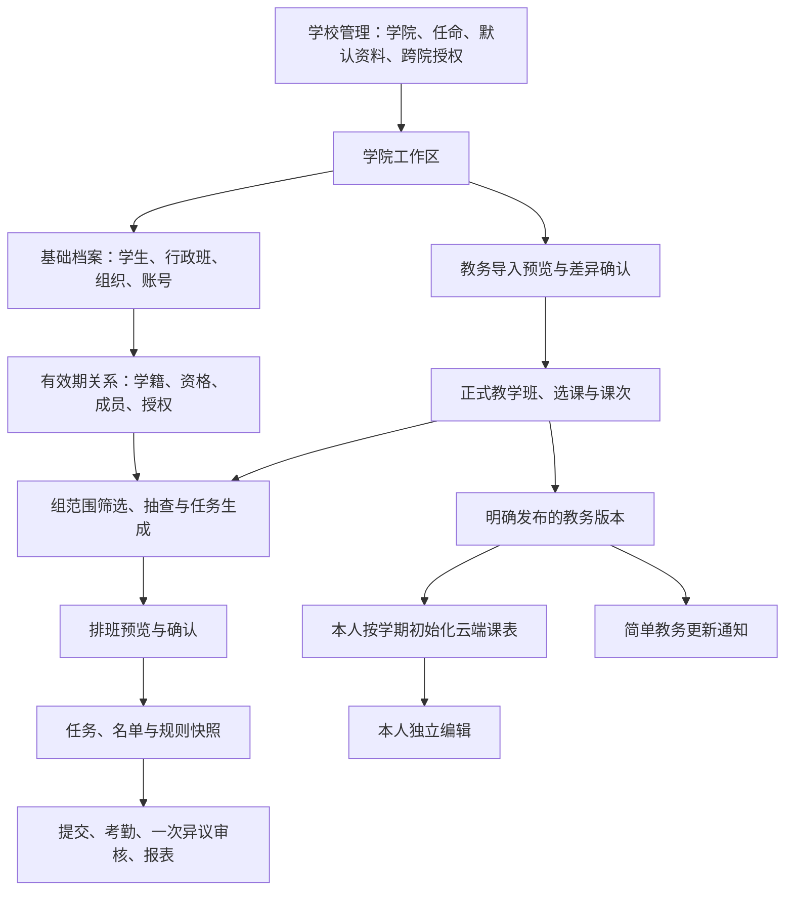

# CourseManagement 产品、架构与 Web 重构总体设计

> **适用范围更新（2026-10-24）：** 本文保留2026-10-15校园业务重构批次的设计与执行边界；D03及下文“智能体暂缓”仅描述该历史批次。当前 AI 产品与架构分别见[五模块产品基线](../product/AI_COLLABORATIVE_PLATFORM_FUNCTIONAL_DESIGN.md)和[技术架构](AI_COLLABORATIVE_PLATFORM_ARCHITECTURE.md)，不改变本文其他有效业务约束，也不代表 AI 已开发或上线。

版本：确认基线 1.2 · 更新日期：2026-10-16。初始设计核对基线为 `29c29f382deb76757d639c5d2fee0d6b1785ede2`；当前候选实现及整合基线见 [实施状态](IMPLEMENTATION_STATUS.md)。

**目标：** 面向各学院老师独立导入、维护和组织查课的真实工作流程，统一数据生命周期、学院权限、任务结果归属、页面结构和实施顺序，降低上手与日常维护成本。

**架构：** 延续 FastAPI 模块化单体、同步 SQLAlchemy/MySQL 事务、Vue 3 管理端；复用现有学籍、课次、排班、审计与个人课表模块。业务规则由服务端统一执行，Web 负责上下文、预览、明确操作与结果解释。

**技术栈：** Python 3.12、FastAPI、Pydantic 2、SQLAlchemy 2、MySQL 8.4、Alembic、uv；Vue 3、TypeScript、Vite、Pinia、Element Plus。

**执行说明：** 本文为完整产品与架构设计及分批实施计划。O01—O05 已由用户确认；R1-A/R1-B、R2、R3、R4/R5 已完成候选实现和定向验证，R4/R5 另通过服务器隔离 MySQL 验收（视频仍待素材，未知替换对象的课表变更会阻断），具体边界见当前实施状态。后续批次实施前核对接口细节，GPT 直接承担设计、关键实现及集成，不据本文启动子 agent。本轮不建设智能体，不实施小程序页面；本地完成不代表生产已部署或启用。

当前入口：[文档导航](../README.md)、[全校 PRD](../product/CAMPUS_MANAGEMENT_PRD.md)、[当前实施状态](IMPLEMENTATION_STATUS.md)。历史对照：[原后端与 Web 设计](../archive/2026-10-15/design/CAMPUS_BACKEND_WEB_DESIGN.md)、[原实施计划](../archive/2026-10-15/plans/CAMPUS_IMPLEMENTATION_PLAN.md)、[产品补全计划](../archive/2026-10-15/plans/CAMPUS_FULL_PRODUCT_COMPLETION_PLAN_20261015.md)、[已实施批次记录](../archive/2026-10-15/execution/CAMPUS_COMPLETION_EXECUTION_20261015.md)、[工作区核对及遗留项](../archive/2026-10-15/execution/WORKSPACE_RECONCILIATION_20261015.md)。

## 1. 决策来源和适用边界

### 1.1 已确认的方向

| 编号 | 决定 | 对设计的约束 |
| --- | --- | --- |
| D01 | 各学院老师自行导入和维护本院资料 | 学院可以独立完成学期准备，校级统一导入分发不作为前置条件 |
| D02 | 来源是同一个教务系统，导出格式基本一致 | 首先维护确定性格式解析器；避免让老师逐次配置全部列映射 |
| D03 | 本轮智能体暂缓，当前版本稳定后再考虑 | 本轮无模型调用、AI 分类、自然语言代操作或智能体平台建设 |
| D04 | 保留工作台、教务资料、学生与班级、志愿者组织、查课安排、考勤与异议、统计报表七个一级入口 | 调整页面职责及上下文，不为每个数据库实体增加一级菜单 |
| D05 | 学生被跨学院重复检查时，结果按任务发起归属回到相应学院 | 任务负责学院固定；各次检查独立留存，不相互覆盖，不默认合并成一个全校最终认定 |
| D06 | 学院默认隔离，跨院管理或支援由超管明确授权 | 导入、共享课程、跨院检查均不能隐含扩大名单或管理权限 |
| D07 | 教师管理员绑定主学院后默认拥有全部本院工作区权限 | 普通本院教师无需逐项配置；职责模板用于受限人员及额外授权 |
| D08 | 动态课程类型、动态组织、同人多组、组内范围与冲突规则 | 普通课、早晚自习共用正式课程链，不按名称硬编码资格或免到 |
| D09 | 获批不可用期间禁止本人所有组新增排班，已有任务保留并提示处置 | 组织页和排班页使用同一规则，不能按组绕过 |
| D10 | 云端个人课表独立，明确教务发布、按学期初始化、本人编辑、简单更新通知 | 不参与正式选课、忙碌、排班、考勤或报表；不自动覆盖个人修改 |
| D11 | 控制测试和校验幅度 | 按具体风险做定向检查，不因页面重构重跑无关全量验收 |

### 1.2 引用讨论如何纳入

用户提供的 Gemini 对话是参考材料，包含用户在另一讨论中的想法与 Gemini 的推断。本文不将其中所有结论视作本项目已批准实施。

| 参考方向 | 本文处理 |
| --- | --- |
| 学校配置统一默认作息与校历 | 作为推荐默认体验；保留已确认的学院特殊方案能力，不宣称全校永远相同。学校更新的生效及采用策略见第 6 节及已确认 O01 |
| 首次视频教程、可关闭、帮助中心可重看 | 纳入推荐交互；视频与实时准备状态配合，内容制作及资源位置实施时确认 |
| 教务线与学工线分开 | 采纳实体关系解耦原则；共享标识、维护权限和检查权限分别设计 |
| 调休、停补课、现场取消任务 | 优先复用现有能力，完善入口与影响解释；不重新建设通用异常审批流 |
| 档案码按行政班导出 Excel | 作为可沿用的分发方式，完善范围、记录和绑定进度；不替换为全班公开认领身份 |
| 跨学期数据持续存在 | 作为本次核心目标；身份持续存在不等于学籍、成员资格或授权永久不变 |
| 新增学工助理角色、48 小时锁定、异议初审、强制原因、微信推送 | 不纳入本轮；与既定角色、一次审核、说明选填、简单通知等规则分别核对，不能借改版带入 |
| 取消任务自动消除漏查、后来导入直接覆盖共享资料 | 不采用；需保护截止时事实、正式考勤和已确认的数据来源 |

本轮不会因“换学期”清空绑定或档案，也不会自动归档旧学期。既有一次异议审核、乐观锁、历史留存、生成与排班两阶段等约束继续有效。

## 2. 产品定位与成功标准

产品以“学院独立运营的查课工作台”为核心。学校负责学院开通、教师任命、学校级默认资料和跨院协调；学院负责资料维护、组织管理与日常查课；受限负责人只操作获授权范围；学生和志愿者通过小程序完成本人相关操作。

成功标准是可操作的行为：

1. 新老师能从工作台知道当前学期缺什么，进入相应页面完成，不必理解数据库或权限代码。
2. 标准教务文件可直接解析；有问题时能定位到具体文件与行，并说明怎么处理。
3. 任何关键写操作都能看清学院、学期或生效日期、目标范围和影响。
4. 换学期不用重新建学生、行政班、组织或微信绑定；新学期资格和任务又能独立管理。
5. 学院日常工作不依赖另一个学院先导入；不能借此读取外院完整档案或修改外院资料。
6. 重复检查的数据去向、学生展示和报表口径明确；历史不会因现档案变化重新归属。
7. 已有功能逐步迁入新页面，旧书签和接口有兼容安排。

## 3. 系统架构与责任边界

个人课表和通知没有指向正式排班或考勤的反向依赖。教务发布是向学生提供资料的动作，不作为所有内部查课操作的必经步骤。

### 3.1 继续复用的模块

| 领域 | 既有位置 | 责任 |
| --- | --- | --- |
| 身份与授权 | `backend/app/modules/identity/`、`organization/` | 真实账号、角色、学院/资源授权、权限来源解释 |
| 档案与教务 | `academic/` | 行政班、学籍、教学班、选课、作息、校历、正式发布 |
| 导入 | `importer/`、`app/common/parsing/` | 标准解析、来源、预览、确认与错误定位 |
| 组织与排班 | `volunteer/`、`inspection/course_occurrences.py`、`inspection/scheduling/` | 资格、成员、支援、具体课次、组规则和统一冲突检查 |
| 业务结果 | `attendance/`、`objection/`、`report/` | 任务归属的考勤、一次审核、当前与历史统计 |
| 附件与审计 | `file/`、`audit/` | 按资源授权访问，操作前后及责任账号留痕 |
| 个人课表 | `timetable/` | 本人云端副本，独立于正式业务 |

继续使用 Router → Service → Repository，写入和审计同事务。Web 不能拼接第二套名单裁剪、课次展开、权限合成或排班规则。暂不增加微服务、消息平台、搜索引擎或 AI 依赖。

### 3.2 当前已有基础与新设计的区别

本次读取代码确认：行政班和学生身份没有学期外键；组织身份也不以学期重建；成员记录具有 `semester_id` 与有效日期；已有学籍版本、任务名单版本及学院/行政班/人数快照。无需为页面改版先做一次全库拆表。

同时，现有教学班及课程类型受学院关系约束，任务以既有课次键防重复；共享教学班身份、跨院独立检查、跨表统计的新口径仍需实质改造。页面存在不能代替其迁移、权限或行为验收。

## 4. 数据生命周期：长期存在、有效期变化、学期事实

### 4.1 “不随学期重建”不等于“数据不变化”

行政班身份、学生身份可以跨学期延续。学生转专业、休学、毕业、调整行政班仍会发生，学籍不能当成永久固定字段。应区分当前档案、在某日期有效的关系和过去任务保存的事实。

| 对象 | 长期部分 | 时间或学期部分 | 换学期行为 |
| --- | --- | --- | --- |
| 学生 | 稳定学生 ID、学号、账号绑定 | 学籍状态、所属学院/行政班及其生效日期 | 身份与绑定保留，不复制学生 |
| 行政班 | 稳定班级 ID、班号、建制 | 班名等变更记录、学生有效归属、停用/毕业状态 | 保留班级，默认显示当前有效名单 |
| 教师/管理账号 | 账号和身份 | 主学院绑定、授权与任期 | 不因新学期自动清空或无期限续权 |
| 志愿者组织 | 稳定组 ID、学院归属、名称 | 学期参与、成员有效期、资格、负责人任期、配置版本 | 保留组织，预览后准备新学期人员与规则 |
| 作息模板 | 学校/学院方案身份 | 发布版本、学期、有效日期、教学班绑定 | 选择或复用版本，不引用一个可被随时覆写的时间表 |
| 课程目录 | 稳定教务课程标识及名称来源 | 课程名称/状态等版本；学院管理分类 | 复用目录，不把不同学院分类写进同一共享字段 |
| 教学班与选课 | 与教务稳定标识的关联 | 学期、教师、课次、有效选课名单 | 新学期独立，不把上学期选课静默当作本学期名单 |
| 任务、受派、考勤 | 稳定记录 ID 和来源关系 | 学期、具体课次、任务负责学院、规则/名单快照 | 保留历史，产生新学期业务记录 |
| 个人课表 | 学生本人所有权 | 各学期独立副本及本人修改版本 | 初始化新学期，不覆盖旧学期副本 |

### 4.2 查询和历史显示

- 学生与班级默认显示“当前有效档案”，提供“截至日期/变更历史”，不因顶部记住的学期改变当前名单。
- 从历史任务进入学生信息，默认展示“该任务当时快照”，并有明确的“查看当前档案”入口，不能混合两种视图。
- 某学生 3 月转院，2 月记录仍归原任务负责学院；学生当时学籍依照有效记录或快照解释，不能用当前学院反推。
- 未采集过历史名称或负责人等字段，不从今天的数据伪造历史；应说明该历史字段未留存。
- 原学院对历史任务的权限不会因学生转院全部消失，也不会因此继续拥有其当前完整档案；新学院不自动取得原学院所有检查与附件。
- 更正历史考勤按已有版本和审计机制执行；“冻结快照”不等于禁止合法纠错。
- 旧学期是否只读取决于明确归档状态；切换学期、创建新学期都不自动归档旧学期。

### 4.3 学期准备与复用

“复用上学期”应创建本学期准备草稿：可带入作息选择、组规则、人员候选；重新检查学籍、资格、有效期、教学班映射及支援授权。显示“可直接复用/需要确认/不能复用”的差异。

不复制学生身份、绑定、行政班身份和组身份；不复制历史任务、考勤、请假事实或跨院支援授权。教学班和成员记录按目标学期建立；组名相同不代表旧的目标班级范围在新学期仍有效。

## 5. 教务、学工与任务归属模型

### 5.1 分开四种归属

1. **开课学院**：教务资料说明谁开设该课程，不直接赋予全班学生管理权。
2. **学生所属学院/行政班**：按检查日期有效学籍确定，学籍维护走专门入口。
3. **导入维护学院**：负责本院提交的资料来源、选课关联及管理配置。
4. **任务负责学院**：在获授权的工作区内发起检查的学院，决定结果、异议和任务报表的管理归属。

任务负责学院由服务端核对工作区授权后固定，不能根据操作者当前主学院、学生后来转院或课程开课学院推导。生成后的任务不通过普通编辑跨院转移，纠错须单独处理事实和引用。

### 5.2 推荐实体结构：共享教务身份 + 学院管理视图

以下为职责模型。2026-10-16 的 R4 已以 AcademicOffering、既有 TeachingClass 学院视图、ImportSourceAssertion 和任务冻结课次键落地；不额外创建同义的 CollegeOfferingView 或 OfferingOccurrence 表。

| 概念 | 责任与约束 |
| --- | --- |
| 教务教学班身份 `AcademicOffering` | 学校、来源系统、学期及系统稳定身份；无教务编号时由老师确认候选后关联，来源证据可追溯。全校身份共享不代表公开名单 |
| 学院教学班视图 `CollegeOfferingView` | 学院与共享身份的关系、本院维护权限、课程分类、作息绑定、来源修订；复用/演进现有 TeachingClass，而不复制学生身份 |
| 导入来源记录 `ImportSourceAssertion` | 保留某学院提交的原始字段、文件位置、来源版本、有效关系及冲突状态，后导入不覆盖其他来源 |
| 实际课次身份 `OfferingOccurrence` | 稳定课次标识与实际日期/时间修订；教室名称和名单内容不能作为唯一身份的全部依据 |
| 选课关系 | 学生、教学班身份、有效期及来源范围；部分名单不视为完整全班名单 |
| 任务及名单 | 实际课次、负责学院、执行组织、冻结目标学生集合和规则；结果、附件及异议沿任务归属 |

软件学院可以导入其学生参与的外语课程并形成可处理的学院视图；不要求外国语学院先开通。若教务身份可以可靠确认，就关联同一身份；否则保留待核对来源，不凭名称/时间/教室强行合并，也不向普通学院展示无权查看的外院名单。

**2026-10-16 最终确认：** 教务没有教学班编号。系统按学期、课程名、完整周次、节次/实际作息、教室及教师推荐一致候选，老师确认后才关联系统身份；没有候选或不确认仍可独立使用。不按这些可变字段自动合并，也不因此共享名单。关联从确认日起用于新课次，历史任务保留原身份快照；确认前须处置本视图今日及未来有效任务。

课程分类是学院管理视图的数据。同一共享课程在学院 A 的类型配置不得改变学院 B 的组筛选或冲突规则。学院级停补课、关注范围也独立记录来源；共享的正式上课时间/地点有冲突时列入核对，不采用最后上传者获胜。业务会用到的冲突字段未解决前，阻止受影响课次生成，不阻塞无关已确认资料。

目标实现不能简单去掉现有学院过滤。要逐步引入共享身份与本院投影，区分“基础教务元数据可引用”“学生名单可读取”“正式资料可修改”的权限。

### 5.3 跨学院重复检查的正式口径

用户已确认：同一个学生被不同学院检查，记录分别归各任务负责学院。某次“正常”、另一次“迟到”各自留存，不相互覆盖，不生成隐式全校统一结论。

推荐的防重复规则：

- 不同负责学院可对同一课次、同一学生独立检查，前提是分别有名单及检查权限。
- 同一负责学院、同一实际课次、同一学生不能被不同组重复生成有效检查责任；目标学生不重叠的任务可分别执行。
- 相同请求重试返回原结果；更换组、名单排序或课次显示名称不能绕开防重复。
- 同院的重叠目标返回现有任务与冲突人数，只展示请求者有权查看的内容；不静默删掉重叠学生后执行另一份名单。
- 同院业务确需复查时，后续增加明确“复查”类型及统计关系；本轮不将误重复包装为复查。

技术上，任务键需纳入负责学院与稳定课次/范围身份，但**只在键中增加学院或名单哈希仍不充分**：两个不相同名单可能重叠。建议增加有效责任占用记录，以 `(responsible_college_id, occurrence_id, student_id)` 唯一约束阻止并发重叠，按稳定顺序锁定并与生成事务一起提交。占用记录只管理重复责任，不代替历史名单。

取消未形成正式结果的任务时，按既有取消规则事务性释放后续生成所需的有效占用；有考勤或截止时事实的任务不通过删除占用绕过历史保护。名单更正、任务恢复、导入生成、手选、随机抽查和人工入口均复用同一检查。

这部分涉及现有 `task_key`、来源课次防重、任务合并及旧 ID 的兼容，须独立迁移和定向并发验收。新功能启用前保持原有防重复机制，不先放宽约束再补保护。

### 5.4 名单、照片、考勤与异议

- 预览和确认均在服务端将明确目标集合与授权、选课及有效学籍相交，并解释不符合条件的项；不得悄悄扩大名单。
- 任务保存确定的名单版本、当时行政班和学籍学院、负责学院、课程/时间/组规则快照；人数与实际目标集合一致。
- 志愿者只获得本人当前受派任务所需名单和附件，不因参加跨院任务获得外院档案管理权。
- 学生本人可看到各次涉及自己的考勤，显示任务负责学院、课程、时间、结果和对应异议入口。
- 异议针对明确的考勤记录，由该记录负责学院授权人员处理，继续一次审核；不一次修改其他学院记录。
- 文件访问沿对应记录核验。某学院拥有自己的任务，不能据共享教学班获得另一学院现场照片或异议附件。

### 5.5 统计口径

学院管理报表默认按任务负责学院统计，并在需要时另外按“学生当时所属学院/行政班”分组。两个维度不能复用同一含义不明的“学院”筛选。

校级报表明确区分：检查任务数、检查人次、去重学生数和按课次去重的学生参与数。两院检查张三同一课次产生两检查人次、一名学生、一个学生课次；不能将两个缺勤记录直接宣传为两次独立旷课事件。

一期跨院汇总展示来源学院分别认定的结果及分布；不提供未经决策的唯一全校出勤率或最终旷课结论。仅有部分学院名单时，显示名单覆盖范围，不把已导入人数称为全班应到人数。

报表源修订按记录负责学院更新；合法改判影响当前统计，但不重写已归档报表版本。学生转院不会将旧任务报表搬到新学院。

## 6. 学校默认资料与学院日常例外

推荐默认：学校建立学期、统一校历及标准作息，学院工作区首次进入时展示本学期可采用的学校版本；无需各院重复录入标准节次。保留特殊学院或教学班使用独立方案的能力。

建议的采用策略是“显式版本”：新学期准备时选定默认版本；学校发布修订后列出差异与未来影响，学院确认采用，或由已明确授权的学校操作统一确认。已生效任务仍保留原快照。最终采用方式见已确认 O01，不能用“继承”一词掩盖自动改动历史的行为。

既有停课、补课及调休日历能力作为正式入口复用。页面解释原日期、调整后实际日期及来源，避免重建算法。默认优先级建议：已确认的单次课次调整 → 学院有效例外 → 学校默认规则；冲突的同级调整必须明确解决，不能随机挑一条。

学院例外的影响范围必须可见：是仅改变本院查课安排，还是有依据的正式课程变更。仅取消本院查课任务不能把共享教学班标为全校停课。新增来源标签建议为“学校校历”“学院调整”“本次课次调整”。

取消或改派前显示具体影响。截止前合法取消与截止后历史纠错保持既有区分；人填原因继续选填，审计仍记录操作者、时间、对象及前后状态。现场口头反馈可由授权负责人直接在后台处理，不强制引入移动端异常审批流。

## 7. 管理与权限设置

### 7.1 用户能理解的职责

| 使用者 | 默认工作范围 | 明确边界 |
| --- | --- | --- |
| 超管 | 学校管理、学院开通、管理员任命、跨院授权、归属核对 | 跨院批量操作仍要选择明确目标；学校汇总不是任意批量写入口 |
| 本院教师管理员 | 全部本院工作区管理 | 不因可管理本院而获得外院名册；账号平台管理仍按实际授权 |
| 受限管理人员 | 已授予的组、课程类型或教学班及动作 | 可用职责预设，不自动新增角色，不获得转授能力 |
| 志愿者 | 本人有效受派、获授权的本人请求 | 入组不等于负责人；资格与账号绑定分别判断 |
| 学生 | 本人考勤、异议、个人课表与相关通知 | 不因共享课程获得同学或其他学院的检查数据 |

“学院协管”可作为现有权限的配置预设候选，而非新增全能角色。受限导入、报表等尚不支持的组合必须拒绝或标为未开放，不能由前端包装成已有能力。

### 7.2 授权页面

以“人员 → 职责 → 管理范围 → 有效期 → 预览确认”呈现。默认展示教师本院能力和常用预设，高级配置再展示具体动作。每次保存说明新增哪些能力、影响哪些对象、何时失效及是否包含未来新增资源。

增加“实际权限及来源”视图，解释来自主学院身份、角色或哪条额外授权。撤销一条授权后仍有其他来源时，应直接说明，不提示已彻底撤权。预览须使用服务端有效权限合成，前端不能自行推算。

组负责人任命和必要的组范围授权在同一业务流程中完成；`owner_user_id` 本身不授予全院权限。负责人交接建议由授权管理者预览待办及新旧授权差异后确认，历史审计保留原人，旧负责人的其他独立权限不受影响；不新增强制接任确认，见已确认 O03。

### 7.3 共享账号、批量操作与审计

平台记录真实登录账号，不能把共用账号日志声称为可确定某个人的行为。独立账号可获得明确范围授权；不为线下代管新增强制审批制度。

删除班级、整批覆盖或重置前，服务端给出实际影响与版本，确认时重新检查。前端确认弹窗只负责表达意图；版本冲突、权限变化、引用保护、事务和幂等由后端处理。并发操作过期返回 409，不能让后确认者静默覆盖先提交者。

审计页面按权限查询操作账号、时间、目标、范围和前后变化；展示当前认定的来源和修改历史，不增加 48 小时自动锁定规则。

## 8. 七个一级入口与上下文设计

### 8.1 保留七入口，通过上下文区分生命周期

| 一级入口 | 二级内容 | 页面上下文 |
| --- | --- | --- |
| 工作台 | 待办、本周进度、学期准备、资料问题 | 学院 + 学期；同时标明跨学期基础资料待办 |
| 教务资料 | 导入记录、正式课表、教学班、类型与作息、发布 | 课表/导入/发布按学院 + 学期；类型目录与方案模板显示长期配置标签 |
| 学生与班级 | 行政班、学生档案、学籍变更与交接、绑定分发 | 学院 + 当前/截至日期；不被全局学期切换隐式筛成空白 |
| 志愿者组织 | 组织列表、成员、负责人、资格、请假、支援 | 混合：组织身份长期，成员资格和业务视图按明确学期/有效期 |
| 查课安排 | 手选课次、范围抽查、任务、排班、改派、未来影响 | 学院 + 学期 + 日期；选择执行组后范围进一步收窄 |
| 考勤与异议 | 考勤列表、照片、认定历史、异议处理 | 学院 + 学期；以任务负责学院为默认管理范围 |
| 统计报表 | 学院、班级、课程、组织汇总及历史版本 | 学院 + 学期 + 清晰口径；校级汇总另需权限 |

学校管理、账号与授权、帮助教程作为具有相应权限的辅助入口，不再把全部日常配置放在一个“学院与组织配置”页面。七入口不意味着每个角色都显示七项；导航依据有效能力，服务端仍逐请求鉴权。

### 8.2 顶部上下文的具体规则

统一头部固定学院位置；只有一个授权学院时直接展示名称，无需用户重复选择。学院选择、学期选择不在每个子组件重新建立独立状态。

三种页面上下文：

- `semester`：显示“软件学院｜2026—2027 第一学期”。
- `current`：同一位置显示“软件学院｜当前档案”，页面提供截至日期或变更历史；后台记住上次学期，但不将它传入当前档案请求。
- `mixed`：例如组织概览显示“组织长期资料”；进入成员/资格页签后显示“本学期参与情况”及学期选择。

不要隐藏选择器后丢掉用户的学期，也不要只是视觉隐藏而仍用旧学期过滤档案。切回查课页面恢复原学期。档案中的“查看本学期考勤”是明确跳转，携带学生和学期，不改变档案本身。

切换学院、学期或账号时，未保存内容给出保留草稿或放弃选择；草稿按账号、学院、页面、必要的学期分隔。过期请求不更新新页面；服务端提交绑定原目标，不能在请求发送后用新的全局学院替换。

历史学期显示明确状态：未归档仍按权限操作，已归档显示只读及允许的更正入口。未启用的新能力显示具体准备事项，不能给普通老师一个无意义的运行开关。

### 8.3 主要页面结构

| 页面 | 默认内容 | 主操作 | 详情与辅助入口 |
| --- | --- | --- | --- |
| 工作台 | 待排班、待审核、变更影响、当前准备项 | 处理待办/继续学期准备 | 每项直达已筛选页面，不展示无权学院的计数 |
| 导入中心 | 上传入口、未完成草稿、导入批次 | 导入/更新资料 | 来源定位、失败记录、差异与重试 |
| 正式课表 | 周视图/列表、行政班/教学班/类型筛选 | 调整单次、查看未来影响、发布 | 来源、选课、作息和历史版本 |
| 行政班列表 | 班级、年级、当前人数、绑定人数 | 查看学生、导入名单、导出档案码 | 学籍变更记录、历史任务入口 |
| 学生详情 | 当前身份、有效学籍、绑定状态 | 按权限登记学籍变更 | 历史关系与相关任务；不将历史任务归属改为当前学院 |
| 组织详情 | 概览/成员/查课范围/规则/请假待办 | 批量成员、准备新学期、查看任务 | 资格缺失解释、支援上限、负责人交接 |
| 查课安排 | 可选课次和已生成任务两种视图 | 生成任务/预览排班/确认排班 | 具体失败原因、任务详情、改派/取消及未来影响 |
| 考勤详情 | 负责学院、课程、名单版本、现场照片、当前认定 | 有权更正/处理该条异议 | 原认定、操作账号、时间和版本 |
| 权限详情 | 某人有效能力及来源 | 任命/授予额外权限/撤销 | 到期、范围、授权预览和审计 |

空状态区分“尚未导入”“筛选无结果”“无权限”“能力未启用”“资料缺失”。避免全部显示同一句“暂无数据”。界面文案使用“保存成功”“整批未保存”等用户能理解的表达，不使用“原子入库”“授权 revision”等内部术语。

## 9. 关键操作流程

### 9.1 学期准备

工作台提供可折叠准备卡，由真实数据状态生成：确认学期和作息、核对学生与班级、导入课表及选课、处理课程分类、准备组织与成员。准备项之间有依赖，但不强迫用户逐项上传；整包文件可一次解析并按依赖组织确认。

每项状态为未开始、可继续、需处理或已就绪；“已看教程”不等于“资料已就绪”。只阻止依赖缺失的操作，例如某教学班名单不足不能生成该班完整检查，不冻结整个学院其他已准备好的课程。

### 9.2 标准教务资料导入

流程：目标确认 → 上传解析 → 资料关系及差异预览 → 问题处理 → 确认导入 → 后续动作。

1. 自动带入学院、学期；行政班/学籍文件额外明确生效日期，不能用学期第一天静默覆盖历史。
2. 原格式解析器处理 Excel、多文件、ZIP；以内容和稳定标识识别类型，文件名只作为辅助。
3. 上传解析可保存临时文件和草稿，不写正式学生、选课或课表事实。每条草稿保留来源位置、标准化内容和校验结果。
4. 学号和编号按字符串处理，保留前导零；不能按姓名合并学生。跨院已存在学生转到专门的核对/交接路径。
5. 预览新增、修改、重复不变、冲突和缺少依赖。按文件或错误类别批量处理；不要求老师逐条确认完全正常的行。
6. 课程类型给出确定性规则建议，由老师整批确认；类型不可硬编码为固定枚举，缺省也不能暗含全部可查。
7. 本院导入只能修改本院合法维护范围；外院关联以明确授权或来源核对处理，不显示完整外院档案供任意选择。
8. 相同文件/内容再次提交幂等返回已有结果；文件缺少一行不表示要删除原记录。需要替换名单时明确限定“此教学班名单”等范围并预览被移除关系。
9. 确认校验源修订、权限、关联和版本。预览后被其他人修改则返回冲突，保留草稿供刷新比对。
10. 返回本次实际新增/修改/不变数量、可继续事项及未来任务影响；提供错误清单下载，但只包含获授权必要资料。

**事务建议：** 新向导以用户选择的、服务端明确限额的资料集合为一个确认事务，整批失败不留下部分正式事实。超限时在预览阶段拆成明确批次并说明依赖，用户知道哪些批次已经生效；不在确认过程中隐式拆批。文件数量、行数和大小限额根据现有导入能力测定后写入服务端与页面。

现有 bulk 仍包含逐文件预览/确认逻辑，不能仅修改文案就宣称全包原子。新旧事务语义必须在 R3 独立实现，并保留旧接口兼容边界。

### 9.3 发布正式教务资料

导入和发布分开。发布页展示学期、内容修订、涉及学生范围和相对上次变化，确认后生成不可变发布版本。

沿用已有个人课表接口：按本人身份与学期初始化、读取、增删改；教务更新只产生简单通知，不覆盖个人内容。更新通知不增加已读/未读/忽略/采用状态。不借学校共享课程重复关联为同一学生重复初始化；未来共享身份引入后，发布也需按稳定课次去重并核验完整性。

### 9.4 成员及新学期组织准备

组织是长期对象，成员列表展示选定学期的有效参与情况和资格，不显示“该组永久成员即可永远排班”。新增、退组、支援和获批不可用解释各自有效日期；既有任务通过影响清单处理。

新学期准备可复制人员候选与规则草稿，教学班范围重新映射；不能复制过期资格、跨院支援或历史请假。负责人交接列出未处理请求、未来任务和授权变化，历史操作人保留。

### 9.5 查课与排班

选择执行组 → 明确日期和目标范围 → 手选具体课次或范围内抽查 → 预览任务及人数 → 生成 → 排班预览 → 明确警告确认 → 提交。

保留既有两个阶段：任务生成成功后，排班失败或用户取消时保留任务，显示可补成员、改派或重新预览。抽查不足说明每班候选量与缺额，不跨课程类型补齐。

预览固定具体课次和名单范围；实际提交复核组配置、授权、时间、成员和配额。跨院重复检查采用第 5 节新规则；所有组受派冲突与本人正式课程忙碌仍统一检查，私人课表不参与。

现场需要取消、改教室或改派时，在任务详情显示本次与未来影响；不能把“仅取消本次检查”误实现成“修改全校教学班”。批量操作提供影响预览，不强制增加原因必填。

### 9.6 考勤、异议与学期归档

提交后沿既有机制形成正式考勤，异常学生可访问获授权的现场照片。学生的两条跨院检查分别显示来源与处理入口；一次审核仅修改目标记录。

归档建议由明确操作完成：列出未完成任务、未结异议、待处理影响及报表版本，按确定规则处理后将学期业务转为只读。补录或历史纠错需要专门能力和审计，不直接解冻所有基础档案。归档不删除学生、绑定、组织或附件。

## 10. 视频教程、帮助与用户反馈

推荐首次访问显示简短总览，可关闭并选择不再自动显示；帮助中心和具体页面始终能再次打开。不强制播放结束才允许工作，不使用自动播放声音。

按导入、组织排班、临时调整、考勤处理拆分教程，配文字摘要和字幕。完成偏好按账号及教程版本保存，换电脑不反复打扰；没有视频资源时提供文字步骤，不上线空播放器。视频由项目维护者提供或制作，本文不假定素材已存在。

导入或排班失败时给出可行动反馈：哪个对象、哪个条件不满足、已保存哪些内容、下一步去哪处理。帮助内容不显示真实学生数据、验证码、Token 或生产凭证。

## 11. Web 前端重构设计

### 11.1 文件与组件职责（建议路径）

现有文件继续按 Vue 3 Composition API、`<script setup lang="ts">`、Pinia 和 Element Plus 演进。以下新增路径是实施建议，不代表本次已创建。

| 文件/目录 | 动作与责任 |
| --- | --- |
| `apps/admin-web/src/router/index.ts` | 增加七入口及学校/权限/帮助路由，旧路径定向兼容、登录默认工作台、能力守卫 |
| `src/views/AppShell.vue` | 统一学院上下文、导航分组、上下文标识及帮助入口；移除重复页面级学院选择 |
| `src/stores/session.ts` | 保留身份、权限与学院/学期选择，区分“记住的学期”与“当前页面是否消费学期” |
| `src/navigation/workspaceNavigation.ts`（新增） | 菜单、路由、能力要求和生命周期模式的单一描述，避免侧栏与路由各写一套 |
| `src/composables/useWorkspaceContext.ts`（新增） | 页面获取明确学院、学期/截至日期和请求上下文；复用 `utils/contextEpoch.ts` 抑制过期响应 |
| `src/components/workspace/WorkspaceContextBar.vue`、`ReadinessChecklist.vue`（新增） | 三类上下文和真实准备项；展示与跳转，不计算业务资格 |
| `src/views/WorkbenchView.vue`、`AcademicView.vue`、`StudentsView.vue`、`OrganizationsView.vue`（新增） | 新页面容器；只组织子页面、路由和状态，不承载全部导入/排班算法 |
| `src/components/importer/ImportWizard.vue`、`ImportDiffTable.vue`、`ImportIssuePanel.vue`（新增） | 多步导入、差异、来源错误；复用并扩展 `src/api/importer.ts` |
| `src/views/ScheduleView.vue` | 保留课次选择业务，导入与正式教务浏览逐步迁出，接统一学院/学期/组上下文 |
| `src/views/VolunteersView.vue` | 将行政班学生迁至 Students，将资格和组织参与迁至 Organizations，原入口保留映射 |
| `src/components/campus/*` | 复用发布、作息、组、成员、规则、影响组件；逐步迁入适合页面，避免复制相同组件再维护两套 |
| `src/views/TaskListView.vue`、`ObjectionsView.vue`、`ReportsView.vue` | 统一上下文与负责学院显示；支持新任务口径及已授权筛选 |
| `src/views/UsersView.vue`、`SettingsView.vue` | 提取账号/权限与学校设置；不再同时承载所有日常教务配置 |
| `src/views/HelpView.vue`、`src/components/help/TutorialDialog.vue`（新增） | 教程目录、就地帮助及显示偏好 |

### 11.2 路由建议与旧入口迁移

建议新路径：`/dashboard/home`、`/dashboard/academic`、`/dashboard/students`、`/dashboard/organizations`、`/dashboard/inspections`、`/dashboard/attendance`、`/dashboard/reports`。学校、账号权限和帮助使用辅助路径，不新增学院日常一级模块。

旧 `/dashboard/schedule` 按已知导入/课表/查课操作参数映射到正确子页，默认进入查课安排；旧 `/dashboard/tasks` 进入任务列表；`/dashboard/objections` 进入异议页签。旧 `/dashboard/campus` 在过渡期展示到各新页面的对应入口，保留必要学院参数，不一律跳回首页丢失上下文。

`/dashboard/volunteers` 的人员资格入口迁到组织，学生班级操作迁到学生页面；只有语义明确的旧参数才能自动映射。过渡期保留旧路由兼容，不同时提供两个可编辑的重复主入口。

### 11.3 状态与请求规则

- 路由元数据使用 `contextMode: 'semester' | 'current' | 'mixed'`；混合页面每个页签明确消费哪类上下文。
- 当前档案查询不追加 `semester_id`；按历史日期查询显式传 `as_of`。服务端仍独立校验请求者范围，URL 参数不是授权证明。
- 组织身份列表与本学期成员查询分开；人数标签明确是当前成员、本学期有效成员还是符合排班资格人数。
- 筛选条件写入路由查询或上下文限定状态，刷新/分享链接可恢复；不把整个敏感名单写入 URL 或持久化浏览器草稿。
- 缓存按用户、授权修订、学院、资源和必要日期/学期隔离；切换账号或权限变化时失效。
- 401 串行刷新及至多一次重试沿用现有实现；409 展示差异并保留编辑内容，不能自动用新版本覆盖提交。
- 预览、确认页及弹窗显示目标上下文；变更学院后旧弹窗失效，不将其确认提交到新学院。
- 页面权限隐藏、加载错误、空结果和未启用状态分别处理，统一中文提示；大整数 ID 保持字符串。

### 11.4 视觉与交互原则

先完成信息结构和关键流程，再统一视觉细节。使用一致的列表、筛选、详情抽屉和主操作位置；复杂流程有明确步骤，轻量修改就地完成。

表格优先显示老师做决定需要的字段；原始编号、内部版本等放进详情。支持键盘操作、可见焦点和清晰对比度，状态不只用颜色表达。正式页面不加入无意义的技术状态数字或模型入口。

## 12. 后端接口与数据调整范围

以下是拟新增或增强的能力清单；具体 URL、schema 和迁移编号在对应实施批次定稿，不能据此向小程序声称接口已开放。

| 能力 | 输入/输出语义 | 服务端要求 |
| --- | --- | --- |
| 工作台准备状态 | 学院、学期 → 有权限的准备项、缺失数量和处理目标 | 以事实计算，不用用户勾选伪造完成；不泄漏外院计数 |
| 当前/历史档案 | 学院、`as_of`、分页筛选 → 日期有效资料及可展示历史 | 不隐式依赖当前学期；权限及历史保留边界一致 |
| 新导入草稿与预览 | 学院、目标学期/生效日、文件集合 → 来源、差异、问题、源修订 | 正式事实不提前写入；稳定格式解析和明确批次边界 |
| 导入确认 | 草稿 ID、预览修订、明确处理项、幂等键 → 本次结果及影响 | 复核权限/来源/版本，同事务提交确认集合 |
| 有效权限解释 | 授权目标人员及范围 → 有效能力、来源及到期 | 管理者只能解释其可管理范围；撤销结果不误导 |
| 学校模板与学院采用 | 模板版本、学院、学期、生效日 → 差异与影响 | 版本化，不改历史任务；采用策略见已确认 O01 |
| 学期组织准备 | 源/目标学期、组、可选人员规则 → 可复用/需映射/不可复用 | 资格及支援重验，不复制身份或历史事实 |
| 负责人交接 | 组、新负责人、版本 → 待办与授权差异，确认结果 | 任命、必要授权及审计同事务，旧独立权限保留 |
| 共享教务身份及学院视图 | 来源稳定键、学院资料关系 → 关联、待核对或冲突 | 公共标识不直接开放学生名单；局部分类与例外隔离 |
| 跨院任务结果 | 稳定课次、负责学院、目标范围 → 固定任务/名单版本 | 同院重叠防重、跨院独立结果及全链路权限 |
| 教程偏好 | 本人、教程版本、是否自动显示 | 只管理显示偏好，不等于学期准备完成 |

### 12.1 迁移策略

1. 页面重排先复用旧 API，不为了前端目录变化搬迁数据库。
2. 先增加新身份/关系及来源映射，再迁移现有 TeachingClass 等引用；旧 ID 和公开契约保持可解析。
3. 核验现有 `(semester_id, course_id, class_code)` 唯一约束与 CollegeOwned、课程类型复合外键。学院视图若需要同一教务班号出现多院，必须同时调整相关查找与唯一性，不能只改单个索引。
4. 旧任务以已有负责学院与名单快照回填新引用；无法确定的进入核对清单。不得用操作者当前学院猜测旧任务归属，也不将历史重复记录直接删除。
5. 过渡期新旧课次键建立映射；预览、幂等重试、恢复、发布和报表使用统一身份解析，不并行维护两套算法。
6. 新占用/关系约束建立前先检查既有冲突，记录待处理范围，完成后再开启新生成逻辑。
7. 新模式使用可独立控制的运行能力；关掉新入口不能回到绕过已生效约束的旧写路径。
8. 回退优先恢复应用与入口；已产生新业务事实后不得盲目降级删除新表。迁移涉及唯一性或数据回填时，在独立 MySQL 克隆定向演练并留恢复记录。

## 13. 分批实施计划

下面是项目级实施顺序。各批次交付可独立评审，详细代码步骤在其接口与待确认项明确后补充；不为尚未批准的语义提前编造完整实现。

### R0：规则与数据样本对账

**范围：** 本文、原 PRD、开发设计、实施计划、权限资料及脱敏导出样本说明。

- [x] 用户已确认 O01—O05 的表列规则；真实教务数据样本仍需核验。
- [ ] 核验教务编号与全班/本院部分名单性质，记录字段来源和同一教学班跨院样例。
- [ ] 为三类生命周期建立字段清单：当前查询、日期有效关系、历史快照各使用什么来源。
- [ ] 梳理现有读写/发布/文件/报表入口及旧文档冲突，建立功能对账表。

**验收：** 可用具体样例说明跨学期不重建、跨院不同结果各归谁、同院重复为何拒绝；未确认项不误写成已实现。只做文档和样本检查。

### R1：七入口与统一上下文

**文件：** `router/index.ts`、`views/AppShell.vue`、`stores/session.ts`；新增 navigation、workspace 上下文组件和四个页面容器，复用现有 campus 组件。

- [x] 建立页面上下文描述与导航能力映射；混合页面按当前子页确定 semester/current。
- [x] 迁移入口和旧路由映射，复用现有 API 与业务组件。
- [x] 接入上下文失效保护、未保存切换确认、当前/学期标签及缺权/未启用/空数据提示。
- [ ] 自动保存的隔离草稿、完整准备状态与当前/历史档案读取在后续批次补齐；本轮不保存浏览器草稿。
- [x] 完成 TypeScript/生产构建、定向行为检查及本地合成数据浏览器交互检查。

**验收：** 切换学期后行政班和绑定仍可见；组织列表持续存在；进入本学期成员明确改变查询；慢响应不串院；旧任务和异议链接到达正确页面。

### R2：生命周期查询、准备状态与帮助

**文件：** `academic/enrollment_*`、`history_policy.py`、scoped 查询；`volunteer/member_*`；新增准备状态服务与 schema/router；Students、Organizations、Workbench 和帮助组件。

- [x] 明确并实现当前档案与日期有效查询，不把“当前成员”与“本学期资格”混成同一数量。
- [x] 通过现有事实聚合准备项和跳转，缺失只阻断相关操作。
- [x] 增加历史任务/当前档案入口与已归档状态展示，保护原历史边界。
- [x] 先提供文字帮助；视频与偏好在素材到位后接入。

**验收：** 转院前后两个日期的查询正确，旧考勤分母与归属不变；当前档案不受上次学期影响；教师看到真实缺失项；不重新绑定、不复制学生或行政班。

### R3：导入中心与完整差异确认

**文件：** `importer/{models,schemas,service,router}.py`、`scoped_service.py`、既有解析器、`academic/schedule_integrity.py`；新增导入草稿/问题组件及必要增量迁移；前端 `api/importer.ts` 和 importer 组件。

- [x] 定义草稿、来源位置、差异、问题、确认集合和幂等契约，先补“预览不写正式资料”的失败用例。
- [x] 复用格式解析器；补全重复导入、前导零、跨院归属和部分名单语义。
- [x] 实现明确批次限额与确认事务，移除新向导中的直接自动确认路径。
- [x] 将 Schedule 中导入迁入独立页面；保留旧 API 的真实行为说明及兼容调用。
- [x] 记录导入后未来影响，不自动清学期或用重导替代学籍交接。

**验收：** 同文件重试不重复生成；一个阻断问题使确认批次整批不生效；过期预览返回 409；能够定位源文件/行并修正；未出现的行不自动删除。

### R4：共享教务身份与跨院独立检查

**已确认补充（2026-10-16）：** 教务没有教学班编号；按完整上课资料推荐候选，老师核对确认后关联系统稳定身份。未确认保持学院独立记录，不要求取得不存在的编号。部分名单仍不视为完整全班名单。依赖导入和生命周期稳定行为，不能只改前端开关。

**文件：** `academic/models.py`、`enrollment_models.py`、repository/service/scoped 查询及 publication 模块；importer；`inspection/{models,service,repository,course_occurrences,group_sampling,restore_service}.py`；attendance、objection、file、report 范围链；增量迁移及前端相关 API/详情。

- [x] 增加教务共享身份、学院视图和旧 ID 映射，保持局部课程类型与日历例外。
- [x] 实现来源冲突与维护授权；不因先导入者拥有全校编辑权。
- [x] 调整任务身份、有效责任占用、名单快照、恢复与幂等；同院重叠拒绝、跨院合法并存。
- [x] 将考勤、异议、文件、统计统一按任务负责学院管理，同时保留学生当时学籍维度。
- [x] 补充小程序接口说明中的负责学院、重复记录和异议对象；保持已有字段和 ID 可用，不实现页面。
- [x] 对唯一约束、并发生成和迁移做一次独立 MySQL 定向验收；失败才重跑相关检查。

**验收：** 两院可独立导入同一教学班的各自资料；未授权名单不可读；相同学生同一课次跨院两结果各自可追溯；同院并发生成不重复；同学期发布不重复初始化个人课表；校级统计不混淆人次与人数。

### R5：管理收口与已有产品缺口

**文件：** academic time/profile 模块；organization 授权/影响模块；volunteer 成员/组服务；report 模块；Web 学校配置、权限、组织和报表页面。

- [x] 按 O01 完成学校模板与学院采用及来源标签，复用实际时间计算。
- [x] 完成组织学期准备预览、教学班映射和人员资格重验。
- [x] 完成负责人交接及有效权限来源解释；不撤销其无关授权。
- [x] 完善报表维度、来源学院标识及归档后的合法纠错入口。
- [x] 跟进原个人课表删除恢复/单次修改计划，作为独立后端交付；不以它阻塞管理端导航改版。

**验收：** 模板更新不改历史；学期复制不复制身份/绑定或续期支援；交接后权限和待办可解释；报表口径与第 5.5 节一致。R4/R5 已完成代码及定向验收，证据与部署边界见 [实施状态](IMPLEMENTATION_STATUS.md)；R6 完整两院流程及发布已通过，生产业务启用仍待数据确认。个人课表扩展复用已整合的既有实现。

### R6：最小端到端验收与分步发布

- [x] 两个虚构学院各完成一次资料导入→课程核对→组织成员→具体课次生成→确认排班→提交→异议/报表路径。
- [x] 覆盖一次跨学期切换、一次跨院重复检查、一次同院并发防重、一次权限撤销及一个文件访问边界。
- [x] 对照本文验收表更新 API 契约/索引/OpenAPI、小程序交接、权限及实施进度，清除旧文档初终审等冲突描述。
- [x] 核对新旧资料、备份、迁移与运行能力，后端及 Web 已可回退部署。
- [ ] 生产存量任务归属、课程分类与组织成员经确认后补齐，再按全局开关实际粒度启用。
- [x] 确认灰度范围能由服务端限定后再称“一院试点”；现有全局布尔开关不能宣称天然支持逐院启用。

**验收：** 页面可操作、数据来源和权限可解释、回退边界可执行；分别记录已实现、已验证、已部署、已启用，不用健康接口代替业务链验收。

## 14. 定向验收矩阵

| 编号 | 场景 | 应有结果 |
| --- | --- | --- |
| A01 | 在学生页面切换已记住的学期 | 当前档案不清空、不变化；本学期业务入口携带明确学期 |
| A02 | 学生转院后查看旧任务 | 旧学籍快照和负责学院保留，原/新学院读取权限各自正确 |
| A03 | 新学期组织准备 | 组织和绑定保留；成员资格重验；支援不静默续期 |
| A04 | 一个标准整包多文件导入 | 识别依赖，预览不写正式事实，确认边界清晰 |
| A05 | 重复上传/预览后别人改资料 | 重复不新增；过期确认 409，保留可刷新草稿 |
| A06 | 部分名单里缺少一名原学生 | 不当作正式退选或学籍删除 |
| A07 | 两院导入同教务教学班 | 可靠身份关联，各院类型/来源独立；冲突可处理且不扩大授权 |
| A08 | 同学生同课次跨院检查 | 两结果按各任务负责学院保存，学生能分别申诉 |
| A09 | 同院两组并发检查同学生课次 | 唯一责任约束拒绝重复，整批语义明确 |
| A10 | 另一学院尝试访问本次照片 | 无对应任务/本人授权不能获得访问链接 |
| A11 | 学校作息发布修订 | 采用后未来按策略处理，旧任务时间不变 |
| A12 | 截止后试图取消抹除漏查 | 依原业务边界拒绝或转明确纠错，不抹历史 |
| A13 | 成员请假已批准 | 全部组停止该时段新排班，已有任务保留并产生处置项 |
| A14 | 撤销一条权限后仍有教师默认能力 | 页面说明剩余来源，后台保持同一实际权限 |
| A15 | 慢请求期间切换学院/账号 | 不显示旧范围数据，旧确认不能提交到新范围 |
| A16 | 发布更新且学生已编辑个人课表 | 仅产生相关简单通知，个人副本及正式业务互不污染 |
| A17 | 老 URL、刷新、返回与未保存表单 | 正确到达目标并保留合法筛选；未保存内容得到明确处理 |
| A18 | 一学生被两院各检查一次 | 检查人次为 2、学生数为 1；学校结果不伪称唯一认定 |

文档修改只做链接、结构和决策一致性检查。开发时每批只运行相关行为测试及必要的 Web 构建/交互；涉及锁、唯一性和迁移才增加真实 MySQL 定向验收。不扩大到无关压测或小程序真机测试。

## 15. 已确认事项 O01—O05

用户于 2026-10-15 确认以下表列规则。确认设计不等于功能已经实现；R1—R5 与 R6 的交付和启用边界见当前实施状态，视频仍待素材。

| 编号 | 业务选择 | 已确认规则 | 实施范围 |
| --- | --- | --- | --- |
| O01 | 学校默认作息/校历如何采用，后续修订由谁确认 | 新学期采用明确学校版本；后续修订有影响预览再采用，学院例外保留 | 学校模板及采用流程，不阻塞七入口重排 |
| O02 | 一期是否同时提供校级/开课学院整班检查入口 | 先以学院学生范围为默认；授权跨院检查可独立留结果，完整教务线入口按实际需要开放 | 跨院整班页面与名单授权预设，不影响已确认的结果归属 |
| O03 | 负责人交接是否要求新负责人主动接受 | 授权教师/超管确认后直接生效，展示待办与授权变更；不新增强制接任审批 | 负责人完整交接 |
| O04 | 历史学期何时归档、谁能更正、是否有业务结算条件 | 明确操作归档，先列出未完成事项；授权教师按专门流程更正 | 正式归档/更正流程，不能仅按日期硬锁 |
| O05 | 视频素材、首次显示和偏好保存方式 | 可关闭总览+就地短教程+帮助中心；本人按教程版本记住偏好 | 视频上线，不阻塞文字帮助与准备状态 |

数据样本核验（教学班稳定编号、部分名单、课程时间字段）属于技术与业务资料核对，不能用默认猜测替代。它是共享教学班迁移的前置条件；不需要等它完成才开始导航和基础页面梳理。

## 16. 本轮文档交付边界

本次已把用户确认的七入口、学院自导、统一来源格式、按任务负责学院归属重复检查、智能体暂缓及此前有效业务约束整合为一个设计基线；O01—O05 的确认规则已在第 15 节记录。

初始文档批次未创建新 API、页面或迁移。随后 R1-A/R1-B、R2、R3 已完成本地实现及验证；R2/R3 已新增后端读取与导入确认集合接口，没有新增迁移或改变生产运行开关。其余按 R0—R6 实施并记录实际证据，详见当前实施状态。旧计划中的未完成项没有因为新文档被写出而自动完成。智能体保持后续独立议题，仅保留正常的来源、差异、预览和服务层边界，不建设空的智能体框架。
