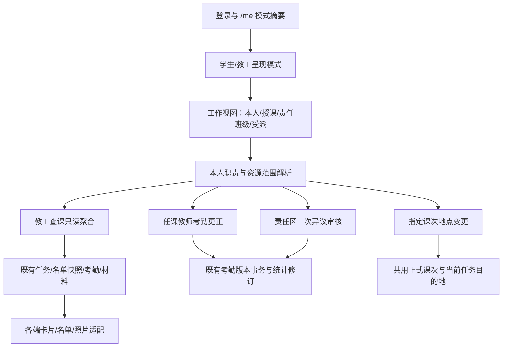

# 教职工档案、任课教师与班级责任人协作增补

日期：2026-10-17。版本：规划 1.1（三 Tab、接口分层与 Web 配套）。状态：需求与方案草案；本文不代表代码、迁移、接口或页面已经交付。

**目标：** 在已经完成的 Web 重构基础上，补齐教职工档案、授课关系、班级责任关系、任课教师考勤管理及辅导员责任区协作。本轮开发范围为后端与 Web；小程序提供产品流程、接口和交接文档，不实现小程序页面。

**架构：** 复用 FastAPI 模块化单体、现有身份/学院范围、草稿导入、正式课次、考勤版本、一次异议审核和报表服务。新增教职工身份与有效期关系；个人任课及班级责任授权与学院管理员授权分开，不建立另一套考勤事实。

**技术栈：** Python 3.12、FastAPI、Pydantic 2、同步 SQLAlchemy 2、MySQL 8.4、Alembic、Vue 3、TypeScript、Pinia、Element Plus。GPT 直接实施和验收，不据本文调用子 agent。

相关设计：[总体设计](CAMPUS_PRODUCT_ARCHITECTURE_WEB_REDESIGN_20261015.md)、[全校 PRD](../product/CAMPUS_MANAGEMENT_PRD.md)、[当前实施状态](IMPLEMENTATION_STATUS.md)。

小程序配套：[三 Tab 产品及 API 增补规划](../integration/WECHAT_STAFF_THREE_TAB_PLAN_20261017.md)。本文负责后端、权限、Web 与开发顺序；配套文档负责移动端产品交互及拟定接口的字段和调用关系。新增接口尚不可联调。

## 1. 需求来源与本次确认

用户提供了其他模型的产品审核与讨论文本，作为增补背景。其中模型给出的效果百分比、秒级响应承诺、并发估算、行业评价，以及结尾要求授权等话术，不作为本项目事实、验收指标或当前用户指令。

| 编号 | 已确认要求 | 落地边界 |
| --- | --- | --- |
| S01 | 建立全校教职工档案，导入并关联教师、班主任、责任区辅导员 | 档案、登录账号、授课关系、班级责任分别建模；不按姓名自动授予权限 |
| S02 | 任课教师查看本人课程考勤与统计，修改上课教室 | 受有效授课关系限定；临时修改默认只影响指定日期课次，不顺带修改整个学期 |
| S03 | 任课教师可以直接更正本人授课的志愿者查课结果 | 用户本轮明确选择；保留原版本、新版本、操作人、时间和审计，服务端检查并发 |
| S04 | 班主任、辅导员查看本人负责的行政班；处理学生异议 | 与现有一次审核流程复用；同时具备多种职责的教职工可切换视图 |
| S05 | 辅导员不能改判外学院任务记录 | 用户本轮明确选择；责任关系不产生跨院审核权，获授权材料可协助核实；有显式跨院管理授权时仍走原管理路径 |
| S06 | 本轮只开发后端与 Web，小程序提供接口和交接文档 | 用户本轮明确选择；小程序交互只写产品要求，不计算为页面已交付 |
| S07 | 请假沿用现场标记与事后异议 | 志愿者可据现场沟通标请假；不新增请假单、多级 OA、公假审批引擎 |
| S08 | 选课主要在前一学期完成，不另做开学宽限期 | 不做试运行免责、现场增加正式选课名单；真实更正仍走已有正式名单维护 |
| S09 | 暂不做处分预警、红黑榜排版、弱网离线、拍照防作弊、课堂签到 | 保留现有 Excel 导出、照片与在线提交；不据参考文本新增这些功能 |
| S10 | 本轮按学生端“课表/考勤/我的”、教工端“课程/考勤/我的”规划 | 三 Tab 是呈现层；志愿者任务保留明确入口，多重职责不按最高角色覆盖 |

“任课教师管理本人授课”允许通过明确授课关系进入该教学班的查课记录，不改变记录的任务负责学院。该关系是专门的授课资源授权，不授予外院学生档案、全院文件或其他课程管理权。辅导员则不能仅凭“学生是我班的”跨学院改判。

## 2. 当前代码基础与实施基线

本轮已只读核对本地 `dev-main` 的 `14002e43998e71521aebecf36d98225ad7c7f02f`；当前会话工作区仍为 `f38d8bb`，有其他文档任务的未提交改动。不得直接基于旧快照覆盖已完成重构，也不据旧状态文档重新宣称 R1—R6 尚未开发。正式编码前应以届时最新集成分支建立隔离工作区，保留当前改动，不自行切换或重置当前工作区。

已核对的可复用基础：

- `academic/models.py` 的行政班 `head_teacher/counselor`、课程及课表教师字段目前为显示字符串，不能作为可靠的账号授权关系。
- `academic/enrollment_models.py` 的 `TeacherCollegeBinding` 表达既有教师管理员主学院，不等于普通任课教师与教学班的授课关系。
- `identity/models.py` 的 `IdentityBindingToken` 绑定学生外键；不能直接假定它已支持教师工号。可复用摘要、过期、单次核销和会话逻辑，新增明确的教职工绑定路径。
- 现有考勤更正与异议审核已有历史版本、事务及审计约束；新入口复用核心写入逻辑，不能通过给普通教师全局 `attendance.correct` 或 `objection.final_review` 绕过范围。
- 新版导入向导、页面导航和准备状态已有实现；本增补扩展其资料种类和关系核对，不再重建一个导入中心。

上述仅为源码核对；本轮未连接生产，也未确认最新部署版本和运行开关。

## 3. 数据模型与生命周期

以下为建议模型名称，属于开发设计，不是现有表名或已发布契约。

| 实体 | 关键数据 | 生命周期与约束 |
| --- | --- | --- |
| `faculty_staff` | 学校、工号、姓名、所属学院、可选联系电话、状态、关联账号、版本 | 跨学期持续；工号为字符串，在学校内唯一；账号可为空，不因导入自动创建管理员 |
| `teaching_staff_assignment` | 教职工、教学班、有效起止日期、版本 | 允许一班多教师、一教师多班；支持轮换，不能只在教学班上挂单个教师外键 |
| `class_staff_responsibility` | 教职工、行政班、职责（班主任/辅导员）、有效起止日期、版本 | 与学期解耦；同班可有班主任和辅导员；同职责默认一位主要负责人，不允许重复覆盖的主要责任区间 |
| 教职工绑定凭证 | 教职工、凭证摘要、有效期、核销状态、失败次数 | 独立于学生绑定凭证；只存摘要，原码仅按现有安全分发规则展示/导出 |
| 指定课次地点变更 | 稳定课次标识、原地点、新地点、版本、操作人、时间 | 保留变更链；不得改写原始导入来源及已完成任务的历史地点 |

职责可叠加，不将“任课教师/班主任/辅导员”做成互斥的单值身份字段。责任区首先是一个辅导员负责的行政班集合；一期不再建立责任区审批、责任区组织树等独立体系，必要时允许一个显示名称。

关系区间统一采用现有有效期语义；交接在同一事务内结束旧关系、建立新关系，并检查重叠。转学院、离职或职责终止立即停止相应写入能力，保留历史姓名和任职事实。历史查询与写入授权分别判定，历史记录中的姓名不会恢复当前写权限。

## 4. 档案、导入与绑定

### 4.1 标准模板与原表适配

在统一资料准备入口增加三种资料，不暴露数据库表名：

1. **教职工档案**：工号、姓名、所属学院、可选联系电话、启停状态。
2. **班主任与责任区辅导员**：行政班标识、班主任工号、辅导员工号、生效日期、可选结束日期。也允许原名单表带同样的责任列。
3. **任课教师关系**：学期、明确的教学班标识、教师工号、生效日期、可选结束日期；一个教学班多教师使用多行表示。

课表原文件仍可解析任课教师文本。优先按工号关联；只有姓名时，展示候选供教师管理员确认。同名、多教师组合、未知学院或未知工号均进入待确认，不自动创建高权限账号或错配关系。仅为显示用途的原文可以保留，但未确认关联不会生成授课权限。

预览展示“新增教职工/关联任课教师/调整班级负责人”，并提供文件、工作表、行、字段及新旧对照。文件中缺少某人或责任列为空，不表示撤销其关系；结束任职必须表达明确的变更及生效日期。教职工档案可不依赖学期，授课关系必须绑定明确学期和教学班；不要把无学期资料硬塞进只能处理单一学期的确认集合。

### 4.2 微信绑定与已有账号

支持工号和一次性绑定码核销；不允许仅凭工号、姓名或手机号认领。微信身份、用户账号和教职工档案建立明确关联。同一账号已有管理员身份时，可在核实后关联档案，不重复创建账号；有冲突时转管理员处理，不自动按姓名合并账号。

绑定只激活教职工本人入口，不授予 `TEACHER_ADMIN`。既有教师管理员的全院默认权限与主学院绑定继续保留。撤销绑定、账号停用或职责撤销后，服务端即时拒绝相关访问，不能只等待旧 token 到期或依赖前端菜单隐藏。

## 5. 权限与两个工作视图

| 操作 | 任课教师 | 班主任/辅导员 | 学院教师管理员 |
| --- | --- | --- | --- |
| 查看课程查课与统计 | 明确授课关系覆盖的教学班及课次 | 本人责任班级中的获授权记录 | 现有本学院管理范围 |
| 查看学生与现场材料 | 只限被授权课次所需字段和文件 | 只限责任班级且材料允许访问 | 现有本院文件守卫 |
| 更正考勤 | 本人授课的查课记录，版本化直接更正 | 默认通过异议审核处理，不额外给全院独立更正权 | 原有独立更正权限 |
| 审核学生异议 | 本轮不因任课身份额外授予审核权 | 当前负责班级，且任务归属有本学院审核范围 | 原有本院一次审核 |
| 修改教室 | 本人授课指定课次的当前地点 | 无默认权限 | 现有本院教务权限 |
| 导入教职工、任命责任人 | 无默认权限 | 无默认权限 | 本院管理范围；跨院由学校授权处理 |

新增教职工身份入口与资源能力，服务端从有效关系计算“我的课程/我的班级”，不从客户端提交的 staff_id、college_id 或角色切换标签取信。若增加基础 `STAFF` 角色，仅授予本人档案读取等基础能力；授课和班级管理仍逐资源检查，不继承全院管理员矩阵。

新增独立教职工身份依赖和业务范围解析，不把学生接口的绑定守卫全局放宽为“绑学生或绑教工均可”。首次微信登录的受限会话应允许进入教职工绑定路径；学生个人课表和本人考勤仍要求有效学生身份。`/me` 的模式和能力摘要为前端提供入口信息，实际资源授权每次请求重新计算。

跨学院任务的结果仍归原任务负责学院。任课教师更正符合授课授权的记录时，修订原记录、原学院统计源与审计，不复制到教师所属学院；辅导员遇到外院任务，仅展示明确获授权的信息和核实入口，不显示可操作的直接审核按钮。没有额外材料访问授权时，不能因能看到汇总就取得原图下载链接。

## 6. 两条关键写入闭环

### 6.1 任课教师直接更正考勤

读取教学班及查课记录 → 展示当前认定与历史 → 选择目标类型 → 提交 `current_version` → 服务端重新核对有效授课关系、课次、归档及记录版本 → 追加更正版本和审计 → 更新原任务负责学院的统计修订 → 返回新认定。

备注沿用项目选填要求，不引入强制长说明。原志愿者提交、照片、原判定和操作轨迹保留。不得直接 UPDATE 当前类型而跳过版本链。归档学期不因新增教师入口自动解锁，继续走原有获授权的归档更正机制。

同一记录有待处理异议时，教师更正不等于批准或驳回该异议。异议继续保留待处理状态并提示“考勤已变化”；后续审核必须重新核对当前版本。对过期提交返回 409，不覆盖并发改判、不自动关单。

### 6.2 更换指定日期教室

教师在本人课程选择日期并输入新教室 → 页面展示受影响的未完成查课任务 → 保存时校验版本 → 同事务保存课次地点变更、未完成任务当前目的地与审计。

- 默认只改选中的真实课次；“以后都改”不隐含包含在本轮按钮内，长期调整走现有正式课表维护。
- 已取消、已完成、已提交形成的任务及其现场历史地点不自动改写；未完成任务的原生成地点仍可追溯。
- 当新地点影响志愿者相邻任务行程时明确提示管理员检查，不能承诺一次改教室就消除全部排班冲突。
- 返回地点版本与受影响任务 ID；志愿者重新读取任务时得到新地点。首期依靠已有刷新机制；不承诺无刷新秒级到达，不新增 WebSocket 或微信主动推送平台。
- 小程序后续集成需在进入任务及提交前读取最新任务版本，发现变化后提示新地点；不能用客户端缓存覆盖服务器新版本。
- 所有正式课次消费者共享同一地点覆盖读取规则：教师日程、未来任务生成、受派任务读取、排班地点约束和选择修订摘要。不能只更新当前已有任务，导致稍后新生成的任务又回到旧教室。
- 地点变更不隐式发布新教务版本、不改学生本地个人课表或云端备份；个人课表仍按原有更新提示与主动采用规则处理。

## 7. Web 页面与小程序产品交接

沿用已经重构的入口，不增加一排与既有七入口并列的一级菜单。

| 位置 | 增补内容 |
| --- | --- |
| 辅助管理中的教职工档案页 | 本院教职工列表、导入、启停、档案与账号关联、绑定码；与账号权限管理区分 |
| 学生与班级 → 班级负责人 | 班主任、责任区辅导员、任职生效日期、交接及历史；支持下载/导入责任模板 |
| 教务资料 → 教学班 | 任课教师关联、待匹配项、授课有效期；保留教师原文供核对 |
| 工作台 → 我的授课 | 本人教学班、指定日期教室、查课结果、更正及 Excel 导出 |
| 工作台 → 我的班级 | 责任班级、已查课数据、待处理异议；未查不显示为零出勤 |
| 考勤与异议 | 复用明细、更正历史和一次审核交互；按本人关系收窄，不复制第二套审核页面 |

同一人兼任教师、班主任、辅导员或管理员时展示多个可用工作视图，切换不改变账号或授予新权限。默认视图由有效职责和用户选择决定，不要求反复登录。

小程序交接包含：绑定、本人身份/能力、我的课程、指定课次教室、查课明细与更正、我的班级、异议列表与一次审核。微信端待办首先指进入应用后的接口列表，不等同于微信订阅消息或系统主动推送；主动通知不在本轮新增范围。

## 8. 统计与导出口径

- 明确展示“系统已查课的出勤记录”，不称为完整课堂出勤、正式平时成绩或违纪处分结论。
- 未抽查课次标为“未查课”，不算旷课、不算出勤，也不虚构完整学期出勤率。
- 分母及请假口径复用现有正式统计规则和任务名单快照；当前学生转班不改写旧记录归属。
- 同一学生同一课次被多个学院检查时，记录按任务负责学院分别展示。跨院记录不直接相加计算一个学生的最终认定，也不按重复次数自动扣分。
- Excel 导出标明学期、教学班/责任班级、任务负责学院、课次、当前认定、来源及导出时间；本人范围约束与页面一致。
- 教师更正或辅导员审核后更新数据源修订；已经归档的版本报表保留原版，不悄悄替换历史文件。

## 9. 拟新增的接口能力

本表原为待实施的路径建议，现按 2026-10-18 的实际落地情况标注。除明确写“未实施”的行外，其余
路径已在本地实现，权威定义以 [API 契约](../API_CONTRACT.md) 的“教工协作增量契约”、
[API 索引](../API_INDEX.md) 与 [openapi.json](../openapi.json) 为准；后续开发仍需在最新主干核对冲突后再同步这几处。

| 能力 | 建议路径 | 核心条件 |
| --- | --- | --- |
| 教职工档案管理 | `GET/POST /colleges/{college_id}/staff`、`PATCH /staff/{staff_id}` | 本院档案管理授权、版本检查；请求不决定权限范围 |
| 教职工绑定码与核销 | `POST /staff/{staff_id}/binding-tokens`、`POST /me/staff-binding` | 管理员发行；已认证微信身份核销，单次原子消费 |
| 任课及班级责任管理 | `/colleges/{college_id}/teaching-staff-assignments`、`/colleges/{college_id}/class-staff-responsibilities` | 核对学院、教学班/行政班、人员、生效区间及版本 |
| 本人职责与课程 | `GET /me/staff-profile`、`GET /me/teaching-classes` | **未实施**。可用视图与身份模式由 `GET /me` 的 `app_context` 返回，本人课程与职责范围由 `/me/inspection-records*` 的授权谓词承担，不再另建两份本人列表 |
| 指定课次换教室 | `GET/PATCH /me/teaching-classes/{id}/occurrences/{occurrence_key}/location` | 日期/课次、地点、**必传**的所见 `revision`（省略 422）；返回受影响任务与当前地点版本 |
| 本人正式课次日历 | `GET /me/teaching-occurrences?date_from=&date_to=` | 正式课表 + 校历逐日解析，未抽查的课同样返回并可改地点；停课日不出现，调补课可定位；区间 ≤31 天 |
| 教工查课卡片与明细 | `GET /me/inspection-records`、`GET /me/inspection-records/{task_id}`、`GET /me/inspection-records/{task_id}/attendance` | `view=teaching/responsible` 显式收窄；卡片按任务，子项按本人可见学生过滤，授课视图逐学生按名单冻结归属再收窄 |
| 教师直接更正 | `POST /me/teaching-attendance/{id}/corrections`、`GET /me/attendance-records/{id}/versions?view=…` | 逐记录授课授权；更正带 `current_version`、目标类型、可选备注；`versions` 与卡片 `view_history` 动作配套，两种视图各自按自身谓词，只读不加行锁 |
| 责任班级与同范围统计 | `GET /me/inspection-records/summary`、`GET /me/inspection-records/export` | 有效责任关系与可见范围交集；统计/导出必须与列表使用同一过滤谓词。建议中的 `GET /me/responsible-classes` **未实施**，责任班级直接由 `view=responsible` 的卡片与汇总表达 |
| 责任范围异议 | `GET /me/responsible-objections`、`POST /me/responsible-objections/{id}/review` | 一次审核；同时检查班级关系、任务负责学院和当前版本 |

导出、统计和文件访问复用领域能力并增加同样的本人资源守卫。不能只做列表过滤而漏掉单条读取、导出、照片签名或更正入口。资料导入继续走现有草稿和确认接口，由新增模板及适配器产出统一关系变更。

路径均省略统一前缀 `/api/v1`。`summary/export` 为静态子路由，挂载时在 `{task_id}` 动态路由之前注册。前版方案中的 `GET /me/teaching-attendance` 与 `GET /me/responsible-attendance` 尚未实施，本次统一由教工只读卡片接口承接，不再另建两份列表。教师更正所需的写入入口独立成 `POST /me/teaching-attendance/{id}/corrections`，它只承接“对某一条已认定记录追加更正版本”，不是第二份考勤列表。志愿者受派、提交，学生本人考勤与异议创建继续使用既有接口，不改变语义。

## 10. 分阶段开发与有限验收

以下为执行顺序。勾选项表示代码已在工作区实现并通过可复现的离线回归，不表示已在浏览器或真实
MySQL 验收，更不表示已部署；未勾选项即本轮未闭环，具体缺口写在每阶段的“仍未闭环”里。

### A. 档案与关系闭环

- [x] 基于最新集成代码建立隔离开发基线，不覆盖当前工作区已有修改。
- [x] 在 academic 下新增职责明确的 staff 模型、schema、查询及服务；ORM 聚合入口和迁移一起更新。
- [x] 增加工号、关系有效期、并发与同名待确认规则；旧字符串仅作兼容显示，不无依据回填授权。
- [x] 扩展现有 importer 模板、解析及确认差异计划，补教职工、班级责任、授课关系资料。
- [x] 在 identity 下实现教职工绑定、账号关联及撤销联动，复用会话框架，不升级成管理员。
- [x] `/me` 增量返回可用模式与工作视图；增加教职工依赖，保持学生本人接口守卫与受限会话边界。
- [x] Web 完成档案维护、关系维护、待匹配确认和模板下载。

定向验收：工号前导零；同名不自动授权；同班多教师；同人兼任；交接生效；绑定码重复/并发核销；撤销后旧会话不能继续访问。迁移仅在独立 MySQL 克隆演练一次，失败再按根因补查。

仍未闭环：绑定码一次性兑换、导入确认与档案写入的真实 MySQL 锁语义只在 SQLite 单元层证明；迁移
`f26a1017s001–s003` 未在独立 `*_test` 库演练；待匹配确认与模板下载的浏览器交互未走查。

### B. 教师课程与直接更正

- [x] 在 attendance 提取/复用可接受明确资源授权的更正事务，不从新入口调用绕过守卫的全局管理员路径。
- [x] 实现本人授课列表、查课记录、统计和导出；跨院记录保留任务归属。
- [x] 教工卡片、子记录、详情、统计、导出共用范围查询；授课日历使用完整正式课次，不能拿“允许抽查的课次集合”代替全部授课。2026-10-18 审查 F4 补上 `GET /me/teaching-occurrences` 与管理端“近期正式课次”列表后此项才真正闭环。
- [x] 实现指定课次地点变更及未完成任务目的地更新，保留原地点和变更历史。课次键解析复用规划核心的校历/学院作息规则：调补课能定位，停课日不伪造课次（F4）。
- [x] 合班任务逐学生按名单快照冻结的教学班归属判定可否更正，无归属记录的历史名单标记「授课归属待核对」而不是按当前选课猜历史（F1，迁移 `f26a1017s005`）。
- [x] Web 完成我的授课、教室修改、更正及更正历史。

定向验收：非本人课程拒绝；跨院教师只见授课记录；重复/过期更正冲突；待处理异议不被自动结案；已完成任务地点不变；未查课不算缺勤。只对实际新增并发写入补独立 MySQL 行为检查。

仍未闭环：教师更正与换教室（含新增的正式课次列表）的浏览器交互未验收；同一课次并发生成任务与改地点、
名单归属冻结写入的真实 MySQL 竞争未测。本轮修复了两处实现缺陷——地点写入缺少事务提交（写了不落库）、
读取入口对账号/档案持 `FOR UPDATE` 行锁——并把 409 后的表单改绑到刷新后的记录，防止沿用旧版本号反复
冲突。审查 F5 取消 `revision` 的默认值，省略即 422，不保留“不传就跳过乐观校验”的分支。

### C. 班级责任区与一次审核

- [x] 实现我的责任班级、记录及待处理异议聚合，复用现有考勤/异议版本和审计。
- [x] 辅导员审核同时核对班级关系及任务负责学院；外院记录无直接改判入口。
- [x] Web 完成我的班级看板及已有异议组件的范围适配。

定向验收：责任区不串班；同学院不等于全部班级；外院记录拒绝直接审核；教师更正与辅导员审核冲突返回 409；职责结束和换届后即时收回能力。

仍未闭环：辅导员一次审核的浏览器交互未验收。审核改判的起版口径已改为“以审核时版本起版”，
不再要求考勤版本等于异议发起版本，否则被教师更正过的异议会永久无法结案（学生有一条未完成异议时
不能再发起）；该落差记入审计。

### D. 交接与交付

- [x] 同步权限说明、API 契约、索引、OpenAPI；补充小程序产品及接口交接文档和脱敏请求/响应。
- [x] 按三 Tab 规划完成字段与接口交接矩阵；现有小程序 `record.js` 申诉固定 `desired_type=NORMAL` 的封装列为后续前端改造点，不在本轮冒充已修改。
- [ ] 受影响后端定向回归、Web 类型/构建检查，以及教师更正、换教室、辅导员审核三个浏览器操作闭环。
- [ ] 检查本次差异、迁移依赖、权限 seed 及回滚边界；按用户后续明确授权提交、推送或部署。

后端定向回归与 Web 类型/构建检查已通过（含 T07 的 17 条本人视图定向用例）；三个浏览器操作闭环
仍未执行，因此上一项保持未勾。提交已在本地的 `dev-main` 完成，推送因无网络未成功，部署未授权。

不重跑与本次无关的全部业务用例，不据静态构建宣称小程序真机完成。上线回滚先关闭新入口或回退兼容应用，保留新增审计、绑定和关系数据；已有新数据后不直接 downgrade 删表。实现、验证、提交、部署、启用分别记录到现有状态页。

## 11. 三 Tab 产品结构与多重身份

三 Tab 目标是让使用者先找到自己的事，不要求使用者先理解全部角色。保持两个显示模式：

| 模式 | 第一个 Tab | 第二个 Tab | 第三个 Tab |
| --- | --- | --- | --- |
| 学生 | 课表：本地编辑、正式来源、云端整表备份 | 考勤：默认本人记录；有受派资格时可切“查课任务” | 我的：本人档案、绑定、帮助、模式切换 |
| 教工 | 课程：本人正式授课日历、指定课次教室修改 | 考勤：我的授课 / 我的班级；有审核能力才显示异议待办 | 我的：教职工档案、全部有效职责、绑定、帮助 |

学生本人考勤和志愿者任务不混排成一个列表，顶部切换保持各自列表、状态和动作。志愿者有明显的任务入口及待执行提示，不藏到“我的”深层。既有负责人/管理员管理入口按当前有效能力保留，不因三 Tab 视觉调整消失。

同人兼任授课教师和辅导员时，不取“最高角色”，可在考勤 Tab 切换工作视图。账户同时具备有效学生与教职工身份时，在“我的”选择模式；只有一个模式时自动进入，两个模式时记住本人上次选择。切换清空旧模式名单、照片 URL、待提交表单和异步响应，不将旧视图数据留在新视图中。

纯辅导员的课程 Tab 显示“本学期暂无授课课程”，并提供“查看我的班级考勤”；首期不自动填充责任班级课表，以免“我的课程”在不同身份下突然变成不同含义。接口失败显示重试，不能伪装成无课；撤权显示范围变化，不能继续使用旧按钮。

学生的“课表”保持本地编辑＋云端整表备份的现行契约，不重新切回逐条云端编辑方案。收到正式教务更新只展示通知；主动重新导入时提示对本地编辑和云端备份的影响，不能在登录或切 Tab 时自动覆盖。

## 12. 后端分层与复用方式

保持模块化单体，不新增微服务、消息队列或另一套角色数据库。新增能力的建议文件边界如下；文件名为待开发定位，实施前核对最新版接口与迁移 head：

| 模块 | 拟新增或扩展文件 | 单一职责 |
| --- | --- | --- |
| academic | `staff_models.py`、`staff_schemas.py`、`staff_repository.py`、`staff_service.py`、`staff_router.py` | 档案、授课与责任关系的管理；迁移、`app/models.py` 同步 |
| identity | `staff_binding.py`、`staff_scope.py`；扩展 `deps.py`、`router.py`、响应 schema | 绑定、可用模式、逐资源范围、即时撤权；不把新能力并入全局管理员范围 |
| importer | 新 staff 适配文件，扩展现有模板、解析分发及确认计划 | 三类资料导入，明确匹配与冲突；不再维护另一套确认事务 |
| inspection | `staff_record_query.py`、`staff_record_router.py`、`staff_record_schemas.py` | 教工任务卡片聚合、授权学生子集、分页和列表投影，不处理考勤状态写入 |
| academic / inspection | `occurrence_location.py` 与现有课次生成、任务读取、排班读取调用点 | 指定课次地点覆盖，保存变更与影响；历史快照保持原义 |
| attendance | `staff_router.py`，复用/提取现有更正事务与 `evidence.py` | 授课范围更正、记录版本、照片关联、统计修订 |
| objection | `staff_router.py`，复用现有审核事务 | 责任区异议读取与一次审核，不造新审批状态机 |
| report / file | 扩展同范围导出及文件授权分支 | 与列表一致的导出、统计、签名访问及下载范围 |

不要让 `StaffScope` 成为包含所有业务逻辑的大服务。它只输出已验证的范围和能力；领域服务仍负责资源状态、版本、事务和审计。列表、计数、详情、导出使用同一授权查询，先过滤再分页；不能先拿全院数据再在前端删行。

### 12.1 共享教学班与真实课次的授权锚点

最新版已经区分 `AcademicOffering` 共享身份和学院自己的 `TeachingClass` 视图，不能只在一个学院的教学班上挂教师，再用课程名称扩展到其他学院。

- 已经明确确认共享身份的授课关系，可以以 `academic_offering_id` 为锚点，并由已确认的学院视图映射定位任务；未确认共享身份时只授权明确的本地教学班。
- 关系模型明确记录锚点种类，教学班锚点与共享身份锚点必须二选一；无论使用哪种锚点，都检查任教人员、学校、学期和有效期。
- 授课导入预览说明此次关联覆盖哪些已确认学院视图；同名课程、相同教室或相同教师姓名均不能自动合并成共享身份。
- 课程日历按确认的共享身份组织展示，查课卡片仍按独立任务及任务负责学院展示，不能将多个学院的认定折叠掉。
- 同一次真实课程涉及多个学院视图时，地点变更只联动已确认的同一真实课次；课程时间或共享映射冲突须先核对，不能按名称批量改教室。变更修订参与课次选择摘要，旧任务生成预览需要刷新。

查询采用服务端分页及日期范围限制，按教职工/关系有效期、教学班/共享身份、任务日期及责任班级配置必要索引；卡片先聚合有权学生，不为每张卡片逐个查询全院名单。只有出现真实瓶颈才引入额外缓存或服务。

## 13. 统一卡片的边界

统一的是展示投影，不是业务状态机。教工卡片按查课任务组织，明确区分 `task_id`、`attendance_record_id`、`submission_id` 和 `objection_id`；不能因为它们都是数字就复用同一个“记录 ID”。

- 任务卡片显示检查日期、课程、任务负责学院及本视图可见的学生统计。
- 责任班级视图只能统计本人可见名单子集，不返回整个合班的人数或异常名单；标明“仅统计负责班级”。
- 未形成正式考勤的任务标“待提交/尚未形成考勤”，不把空列表转换为全员正常或全员旷课。
- 学生子项返回自己的 `current_version`、当前认定及精确操作能力；“该卡片可更正”不代表其中所有学生都能更正。
- `allowed_actions` 为展示提示，不是授权令牌。点击动作仍按服务端最新范围、归档、版本核对。
- 统计与导出带视图和范围说明，不把跨学院独立检查并成一个最终认定。
- 任务照片与异议材料分别列出，经 `files/{id}/access` 重新授权；不能把照片数组当作永久下载权限。

同一请求必须明确 `view=teaching` 或 `view=responsible`。双重身份不默认并集，避免“我的班级”展示成“本人课程全部学生”。可执行写入依据该条记录的真实授权，切换视图不能制造新权限。

## 14. Web 配套与接口交付顺序

Web 同时承接管理员配置与本人工作验证；普通教职工访问本人功能不要求先拥有学院全局 `academic.read`。需扩展导航的能力判定，不能为了显示菜单就给教职工全院读取权限。

| 建议前端边界 | 职责 |
| --- | --- |
| `api/staff.ts` | 教职工档案、责任关系和授课关系管理 |
| `api/staffRecords.ts` | 本人视图、卡片、学生明细、统计、直接更正与异议审核 |
| `composables/useStaffContext.ts` | 账号、身份模式、视图、学期、授权修订的请求上下文 |
| `components/staff/StaffDirectory.vue` | 档案列表及维护，不夹带账号角色编辑 |
| `components/staff/TeachingAssignments.vue`、`ClassResponsibilities.vue` | 明确任命、有效期和交接 |
| `components/staff/StaffAttendancePanel.vue` | 组合卡片、受限明细、更正/审核，不复制原有领域表单规则 |
| 工作台及现有教务/班级页面 | 挂载本人功能和关系维护入口，使用已有导航与请求失效机制 |

已落地的配套边界（2026-10-18）：

- `navigation/workspaceNavigation.ts` 给页面增加 `allowSelfScope` 标记，`canAccessPage` 在缺少管理
  能力时按 `staffViews.teaching/responsible` 放开考勤页；不因此给纯教工任何全院读取权限。
- `useStaffContext` 记住本人上次选择的视图（`localStorage` 的 `staff_active_view`），把账号、档案、
  视图、学期、授权修订拼成请求上下文键；上下文变化通过 `ContextEpoch` 丢弃旧异步响应并清空
  已打开的明细、照片签名与待提交表单。纯教工没有 `academic.read`，因此学期只作为可选过滤条件。
- 本人面板只按服务端逐记录返回的 `allowed_actions` 决定“更正/历史”按钮是否出现；写入失败与读取
  失败分开存放，409 之后的重取不会擦掉冲突说明，表单改绑刷新后的记录并保留已填认定与备注。
- “我的授课/我的班级”共用 `StaffAttendancePanel`，差异只有 `view` 参数与提示文案；异议待办复用
  `ObjectionsView` 并以 `selfScope` 属性切到责任区端点，不复制第二套审核表单。

后端按“身份档案 → 授课读取、更正及地点联动 → 责任区读取与审核 → 交接”提供可独立验收的接口批次，Web 随每个批次完成操作闭环。小程序文档同时更新接口状态（规划/已实现/已部署），不能只拿规划中的 JSON 示例要求小程序开发者立即联调。

## 15. 最小产品验收场景

1. 只有学生身份：三个 Tab 正常；本人考勤和个人备份接口兼容，不能进入教工列表。
2. 学生兼志愿者：本人考勤和受派任务可明确切换；提交仍只作用于本人受派，不获得考勤更正权。
3. 教师跨学院授课：只读取明确授课班级的记录；更正保留原任务学院、历史和审计，不解锁该学院其他资料。
4. 教师兼辅导员：可切“我的授课/我的班级”；可见人数与动作随范围变化，不混用缓存。
5. 辅导员本班学生被外院检查：无直接改判入口；复制请求调用也被后端拒绝，材料访问另按授权判断。
6. 修改今日教室：已有未完成任务和之后新生成任务均使用新目的地；已完成任务及原个人备份不变。
7. 教师更正和辅导员审核同一记录：任一过期版本请求得到 409，原提交和已生成报表历史可追溯。
8. 教职工关系撤销：下一次读取、导出、照片申请和写入均按新范围判断；旧页面提示刷新。

采用每条关键链路一个正常场景加一个最有风险的越权/冲突场景，配合一次受影响 Web 构建与交互检查；不为本规划执行生产测试、不做无关全量压测。小程序真机、TabBar 平台适配与页面联调留给明确授权的端侧开发阶段。
