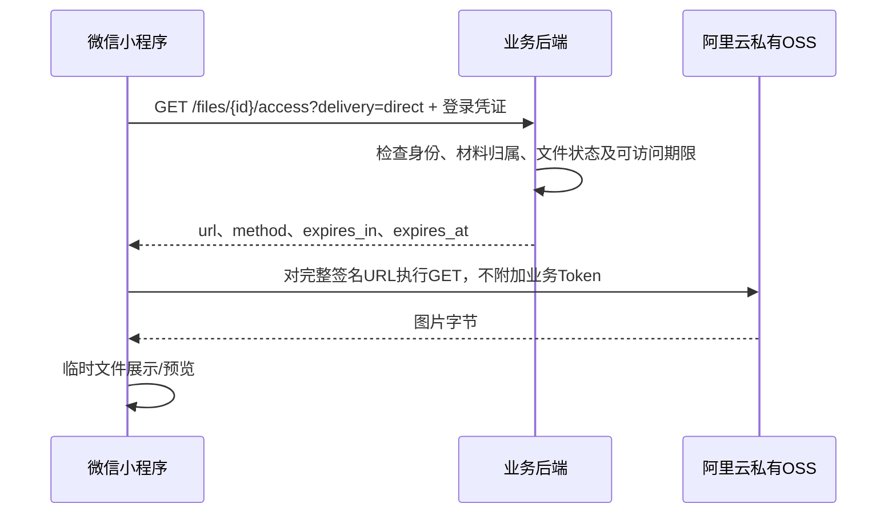

# 小程序交接：阿里云 OSS 图片直连下载

日期：2026-10-22。接收方：微信小程序开发者。交付内容：域名配置、文件访问接口适配、图片预览与下载、联调和发布验收。

**结论：后端直连能力已经部署，小程序显式请求 `delivery=direct` 即可接入。图片先经过后端验权，再由小程序直接从阿里云 OSS 下载；上传继续走现有后端接口。不要先关闭旧下载接口。**

## 1. 已交付与本次待完成事项

| 项目 | 状态与责任 |
| --- | --- |
| 私有阿里云 OSS、服务端凭据、历史文件迁移 | 后端/运维已完成；不向小程序交付 AccessKey、AppSecret 或 STS 凭据 |
| 授权后签发短期 OSS GET 链接 | 后端已部署，可直接联调 |
| Web 图片直连、精确 CORS/CSP | 已上线并通过浏览器合成图片验证 |
| 小程序服务器域名配置 | 小程序管理员配置并提供确认材料 |
| 小程序链接获取、缩略图、预览、下载与重试适配 | 小程序开发者完成 |
| 开发者工具、体验版、Android/iOS 真机验收 | 小程序开发者完成并回传结果；后端配合定位 |
| 停止旧版本中转、关闭旧下载路由 | **未执行**；需完成适配和版本兼容核对后另行安排 |

后端发布基线：`2db7a2ed59d118542163b78b224c7a0904682441`，2026-10-22 14:19（北京时间）部署；功能提交为 `f9d52c1`。部署细节和后端验证见 [发布记录](../development/OSS_WEB_DIRECT_DOWNLOAD_20261022.md)。本交接不代表小程序已经完成改造或真机验证。

本仓库 `apps/wechat-miniapp/` 是适配副本，不一定等于小程序开发者当前交付分支。本次检查未在该副本找到完整的签名文件访问封装，实施前请以开发者实际仓库、分支和提交号确定修改位置。

## 2. 域名与访问链路

### 2.1 正式环境地址

| 用途 | 地址 | 配置位置 |
| --- | --- | --- |
| 业务 API、获取签名链接 | `https://course.zsitai.xyz` | 继续保留原 request 合法域名 |
| 上传照片与证明材料 | `https://course.zsitai.xyz/api/v1/files` | 继续保留原 uploadFile 合法域名 |
| OSS 图片下载 | `https://oss-pai-um7e66idcat8ihfw7v-cn-shanghai.oss-cn-shanghai.aliyuncs.com` | 新增到 **downloadFile 合法域名** |
| 兼容代理下载 | `https://course.zsitai.xyz` | downloadFile 合法域名也保留该来源 |

微信公众平台配置路径：小程序 → 开发管理 → 开发设置 → 服务器域名 → downloadFile 合法域名。填写协议和域名，不填写对象路径、签名参数或通配符。参考 [腾讯官方域名配置说明](https://docs.cloudbase.net/lowcode/practices/miniapp-guide/downloadfile-guide)。

这是**阿里云 OSS**，不是腾讯云 COS。使用腾讯文档只是因为合法域名由微信平台管理。Bucket 保持私有，不能通过开放公共读取解决接入问题。

本次推荐使用 `wx.downloadFile` 下载，再用临时文件路径预览，不需要将 OSS 加入 uploadFile 域名，也不需要把它当作业务 API 使用 `wx.request`。若实际实现另用 `wx.request` 读取 OSS，则还需核对对应 request 合法域名；不要为此复用会附带业务 Token 的通用请求器。

开发和验收必须开启域名校验；“不校验合法域名、TLS版本及HTTPS证书”仅能用于排查，不能作为验收通过条件。Web 的 CORS/CSP 配置不能替代微信后台的域名配置。

### 2.2 链路



对已满足直连条件的图片，字节流不经过业务服务器。后端仍参与获取链接时的鉴权，这一步不能取消。

## 3. 接口契约

### 3.1 获取访问链接

```http
GET https://course.zsitai.xyz/api/v1/files/123/access?delivery=direct
Authorization: Bearer <当前登录access_token>
```

- `file_id` 来自现有详情中的 `photo_file_ids`、`file_ids` 等字段，以字符串处理；不要转成 JavaScript Number 或 `parseInt`。
- 沿用当前登录和一次 401 刷新逻辑，不增加角色、不申请全院照片权限。
- `delivery` 支持 `proxy`（默认）和 `direct`；其他值返回422。
- 服务端开关名目前为 `OSS_WEB_DIRECT_ENABLED`，但处理逻辑按显式 `delivery` 和既有资源权限判断，不检查 Web User-Agent；有相应文件访问权限的小程序会话同样可用。

响应外壳如下。URL为结构示意，不可直接使用；实际签名必须完整保留：

```json
{
  "data": {
    "url": "https://oss-pai-um7e66idcat8ihfw7v-cn-shanghai.oss-cn-shanghai.aliyuncs.com/example.png?SIGNED_QUERY_FROM_SERVER",
    "method": "GET",
    "expires_in": 298,
    "expires_at": "2026-10-22T06:25:00+00:00"
  },
  "requestId": "example-request-id"
}
```

`expires_in` 单位为秒，是本次链接返回的有效期；直连上限300秒，实际可能更短。不要假定固定5分钟，也不要仅因图片链接过期就认定材料已经被清理。

`direct` 当前是优先选择直连，**不是“所有情况都必须返回OSS地址”**。以下情况合法返回原代理路径 `/api/v1/files/{id}/download?...`：

- 服务端关闭直连或使用本地存储；
- 文件不是图片；
- 可用有效期不足2秒。SDK对1秒签名可能取整为0，后端使用代理避免产生无效链接。

因此前端应同时接受：**完整 HTTPS URL**，或**以 `/api/v1/files/` 开头的相对下载路径**。只对相对路径补上业务站点来源；绝对 URL 原样使用，不重写查询参数。

### 3.2 图片字节请求

- 对返回 URL 使用 GET，不追加 Authorization、Cookie 或业务自定义请求头。
- 不对完整 URL 再执行 `encodeURIComponent`，不拆解后重新拼接 `x-oss-*` 参数，不添加业务参数或“防缓存时间戳”。
- `wx.downloadFile` 进入 `success` 回调不等于HTTP200，必须检查 `statusCode`。
- OSS 错误可能是 XML 或非图片内容，不按业务 `{data, requestId}` 信封解析，也不把失败响应当图片展示。
- 链接在有效期内可能重复使用，属于短期访问凭证；不要写入持久化缓存、分析埋点、console、错误上报或聊天记录。

### 3.3 上传保持原方式

继续用 `wx.uploadFile` 请求 `POST /api/v1/files`，multipart字段保持 `file` 和 `category`；业务提交只传后端返回的文件ID。`SUBMISSION_PHOTO`、`OBJECTION_PROOF` 等类别沿用已有接口约束。

本次没有提供 OSS 直传上传接口。不要在小程序放入 AccessKey，不要把上传地址改成签名 GET 链接，不要把下载链接作为业务提交的文件ID。

## 4. 小程序实施建议与参考代码

建议在实际项目中增加一个统一文件访问模块，所有学生、志愿者、教工页面复用：获取链接 → 原样下载 → 展示临时文件。不要在各页面分别拼域名或实现不同的签名过期逻辑。

下面是接口适配示例，按本仓库 `api/*.js` 的 import 风格编写。示例中现有 `request` 已负责认证、一次401刷新及解包 `data`；若开发者当前分支返回完整信封，只在文件接口适配层统一解包一次。此代码是交接参考，不代表已加入或验证小程序实现。

```javascript
// 建议位置：miniprogram/api/files.js
import { request } from '../utils/request';
import { getBaseURL } from '../utils/env';

export function getFileAccess(fileId) {
  if (typeof fileId !== 'string' || !/^\d+$/.test(fileId)) {
    return Promise.reject(new Error('文件ID必须使用字符串'));
  }
  return request({
    url: `/api/v1/files/${encodeURIComponent(fileId)}/access?delivery=direct`,
    method: 'GET'
  });
}

function downloadUrl(raw) {
  if (typeof raw !== 'string') throw new Error('文件地址无效');
  if (/^https:\/\//i.test(raw)) return raw;
  if (/^\/api\/v1\/files\/\d+\/download\?/.test(raw)) {
    return `${getBaseURL().replace(/\/$/, '')}${raw}`;
  }
  throw new Error('文件地址格式不支持');
}

function downloadOnce(url) {
  return new Promise((resolve, reject) => {
    wx.downloadFile({
      url,
      // 不传业务Authorization，不调用通用request包装OSS请求。
      success(res) {
        if (res.statusCode === 200 && res.tempFilePath) {
          resolve(res.tempFilePath);
          return;
        }
        const error = new Error('图片下载失败，请重试');
        error.downloadStatus = res.statusCode;
        reject(error);
      },
      fail() {
        // 原始errMsg可能带签名URL，提示与日志都不要直接透传。
        reject(new Error('图片下载失败，请检查网络和下载域名配置'));
      }
    });
  });
}

export async function downloadImage(fileId) {
  for (let attempt = 0; attempt < 2; attempt++) {
    // 每次重新打开预览申请新链接，失败重试也必须重新申请。
    const access = await getFileAccess(fileId);
    if (access.method !== 'GET') throw new Error('不支持的文件访问方式');
    try {
      return await downloadOnce(downloadUrl(access.url));
    } catch (error) {
      // OSS/签名下载403不等于业务登录失效。换签一次，仍失败就提示人工重试。
      if (attempt === 0 && error.downloadStatus === 403) continue;
      throw error;
    }
  }
}
```

页面拿到临时路径后，使用 `wx.previewImage({ current: path, urls: [path] })`。多张照片可下载为临时路径列表，保留原顺序，并限制并行数，避免一次打开大量图片产生请求洪峰。

上述示例每次打开预览重新取链接，先保证正确性；如缩略图需要缓存：

1. 仅在当前账号、当前材料上下文的内存缓存，合并同一文件的并发取链接请求。
2. 从请求开始按 `expires_in` 倒计时并预留至少5秒余量，不依赖手机与服务器时钟完全一致。
3. 到期重新取链接；图片403只允许一次自动换签，不无限重试，也不要静默改走代理来掩盖域名配置错误。
4. 退出登录、换绑、切换身份/材料及页面销毁时清空链接、临时路径引用和在途请求状态；旧请求返回后不得写入新账号页面。
5. 文件已下载到本地后，URL过期不会自动删除本地字节。临时路径不能成为永久查看凭证；重新进入材料时仍重新验权，不调用 `wx.saveFile` 持久保存敏感照片。

## 5. 错误处理

区分**业务后端获取链接失败**与**已经拿到链接后的图片请求失败**：

| 阶段/状态 | 含义与前端处理 |
| --- | --- |
| `/access` 401 `UNAUTHENTICATED` | 沿用统一会话刷新，至多一次；仍失败引导重新登录 |
| `/access` 403 `FORBIDDEN` | 无相应访问资格，停止自动重试，不扩大资源范围 |
| `/access` 404 `NOT_FOUND` | 文件不存在或当前账号不可见，统一显示无权查看/材料不可用，不向用户区分两者 |
| `/access` 409 `STATE_CONFLICT` | 尚未就绪，提示稍后刷新 |
| `/access` 410 `FILE_EXPIRED` | 材料已过可访问期限或清理，不能通过反复换签恢复 |
| `/access` 422 | 参数错误，核对字符串ID和delivery值，不循环重试 |
| `/access` 503 `UPSTREAM_UNAVAILABLE` | 存储暂不可用，显示稍后重试，不输出原始SDK异常 |
| 图片GET 403 | 可能为签名过期等原因；清掉旧链接，重新调用access并重试一次；仍失败回传脱敏诊断，不触发业务登出 |
| 图片GET 400 | 核对签名是否被编码、拼接、改写或添加参数；记录状态与平台错误码，不无限换签 |
| 图片GET 404 | 不继续使用旧链接；重新获取时若后端404/410则按对应规则处理；仍异常由后端核对对象 |
| `url not in domain list` 等平台失败 | 检查downloadFile合法域名及配置是否已在真实设备生效；换签通常不能解决 |
| 网络超时或图片解码失败 | 保留失败占位和手动重试入口，勿把该材料误记为不存在 |

业务接口错误带 `requestId` 时可回传该字段。日志只记录必要的请求阶段、状态码、业务错误码、域名和脱敏版本信息，**不记录完整签名URL、URL查询参数值、登录Token或照片内容**。

## 6. 开发者需要提供的资料

通过现有协作渠道提供以下内容即可，不需要提供任何云存储密钥：

| 材料 | 具体内容 |
| --- | --- |
| 实际代码基线 | 仓库地址、分支、完整提交SHA；本次修改文件清单 |
| 文件访问相关代码 | 获取access链接、业务请求器、地址补全、图片缩略图、预览、下载及缓存模块；若提供仓库无需重复贴源码 |
| 微信后台域名配置 | request/uploadFile/downloadFile相关域名配置截图，证明OSS精确域名已加入；无需账号密码或AppSecret |
| 运行环境 | 微信开发者工具版本、基础库版本、是否开启域名校验；测试手机系统和微信版本 |
| 联调版本 | 体验版版本号、对应提交SHA、明确授权的测试身份与测试步骤；不要传真实Token或完整学生名单 |
| 问题证据 | 请求阶段、HTTP状态/业务错误码、后端requestId（若有）、发生时间及脱敏截图；隐藏签名参数和敏感信息 |

后端可提供：本交接、已有API契约、合成测试材料及脱敏诊断支持。联调材料由后端确认授权后提供；不能拿无权限的真实照片猜测文件ID来测试。

## 7. 验收清单

| 场景 | 预期结果 | 验收方 |
| --- | --- | --- |
| 配置与域名 | 开启域名校验；体验版真机访问OSS正常 | 小程序 |
| 学生查看本人获授权现场照片 | 后端access成功，直连图片显示和预览成功 | 双方 |
| 志愿者查看本人可访问提交照片 | 名单与照片来源正确，GET200 | 双方 |
| 教工查看获授权照片 | 按授课/责任范围显示，不因直连扩大范围 | 双方 |
| 无权限材料 | access404/403，不生成可用链接；不误显示缓存照片 | 双方 |
| 旧版兼容 | 不传delivery仍获取代理地址，不受新版本发布影响 | 后端/小程序 |
| 合法代理回退 | 模拟代理相对URL，前端只补业务来源，仍可下载 | 小程序 |
| 已有链接真实过期 | 图片失败后重新取链接一次，可用材料恢复；不反复退出登录 | 双方 |
| 后端明确410 | 显示已过期/清理，不循环重试 | 双方 |
| 连续下载403或网络失败 | 自动重试有上限，保留人工重试；页面不持续发请求 | 小程序 |
| Android及iOS | 缩略图、多图预览、返回页面和重新进入均正常 | 小程序 |
| 退出登录/换绑 | 清空旧链接与路径引用，在途响应不写入新身份页面 | 小程序 |
| 上传与提交 | 保持原后端上传流程，提交仍用文件ID | 双方 |
| 日志检查 | 无签名URL、Token、照片内容泄漏 | 双方 |

回传验收时逐项标记“通过 / 失败 / 未测”，附体验版版本、SHA和设备信息。开发者工具忽略域名校验后的成功、Web浏览器通过及后端单元测试，均不能替代小程序真机验收。

## 8. 发布、回退与后端是否需要再改

1. 先确认域名配置和实际代码基线，再完成统一文件访问适配。
2. 发布体验版，完成上述验收，尤其是Android/iOS、过期换签与身份切换。
3. 发布正式版。新版本显式direct后，满足条件的图片下载即绕过后端字节中转。
4. 保留旧版代理入口，观察实际使用和错误情况，再讨论是否停止签发代理链接及关闭旧入口。

**正常接入不需要后端新增接口或修改权限。** 当前没有“小程序直连专用开关”，也不需要把小程序冒充成Web。后端继续对每个文件ID授权，OSS只验证短期签名。

若要求“不改小程序也让全部请求默认直连”“direct绝不允许代理回退”或“立即关闭 `/files/{id}/download`”，则需要另行修改后端策略，并先验证旧版、非图片下载及短有效期兼容。这些变更**未实现、未启用，也不作为本次开发者交接的前置条件**。

紧急回退优先将小程序文件访问适配切回 `delivery=proxy` 或回退到已验证的旧版本；不要擅自关闭共享的 `OSS_WEB_DIRECT_ENABLED`，否则会同时影响Web。Bucket无需改为公开，云存储凭据无需下发。

## 9. 参考与可核对源码

- [文件访问契约](../API_CONTRACT.md)：文件模块。
- [已部署版本、证据及服务器回退](../development/OSS_WEB_DIRECT_DOWNLOAD_20261022.md)。
- [接口索引](../API_INDEX.md)、[OpenAPI](../openapi.json)。
- 后端：`backend/app/modules/file/router.py` 的 `get_file_access`；`service.py` 的 `get_access`；`storage.py` 的 `ObjectStorage.presign_direct_get`。
- 已完成的Web参考：`apps/admin-web/src/api/files.ts`、`src/composables/useFileAccess.ts` 和 `src/utils/fileAccessCache.ts`。参考其参数、缓存和上下文隔离，不直接复制浏览器API到小程序。

本次仅编写交接文档，没有修改小程序源码、微信后台配置或线上下载策略。
